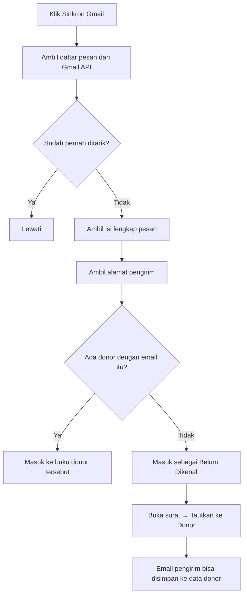

# Panduan Menghubungkan Gmail ke Aplikasi Kartidaya

Aplikasi ini bisa **kirim dan terima email sungguhan** lewat akun `@gmail.com`.
Supaya bisa, ada 3 hal yang harus disiapkan:

1. **Alamat aplikasi yang aman** — `https://` (GitHub Pages) atau `http://localhost:8080`.
2. **Google Cloud project + OAuth Client ID** — dibuat sekali oleh pemilik akun Gmail.
3. **Hubungkan** di halaman Setelan aplikasi.

> **Penting:** Google **menolak** aplikasi yang dibuka dengan `file:///C:/...`.
> Pakai salah satu:
>
> | Cara | Alamat | Perlu apa |
> |---|---|---|
> | **GitHub Pages** (paling mudah) | `https://suwandhih.github.io/kartidaya/` | tidak ada |
> | **Server lokal** | `http://localhost:8080/index.html` | jalankan `serve.bat` |

---

## Langkah 1 — Buka aplikasi

### Cara A — GitHub Pages (disarankan)

Buka **<https://suwandhih.github.io/kartidaya/>** di browser. Selesai.
Bisa juga dibuka dari HP Android tanpa perlu PC menyala.

### Cara B — Server lokal

1. Buka folder `C:\data\Kartidaya`
2. Dobel-klik **`serve.bat`**
3. Browser otomatis terbuka di `http://localhost:8080/index.html`
4. Biarkan jendela hitam itu **tetap terbuka** selama memakai aplikasi

Kalau muncul pesan *"Python tidak ditemukan"*, install Python 3 dari
<https://www.python.org/downloads/> (centang **Add Python to PATH**), lalu ulangi.

Server lokal juga mendengarkan di alamat LAN, jadi bisa dibuka dari HP Android
yang tersambung ke Wi-Fi yang sama (alamatnya ditampilkan saat `serve.bat` jalan).

> **Data terpisah per alamat.** Data yang diisi di GitHub Pages **tidak** muncul di
> localhost, dan sebaliknya. Untuk memindahkan: **Setelan → Ekspor JSON** di satu
> alamat, lalu **Impor JSON** di alamat lain.

---

## Langkah 2 — Buat OAuth Client ID (sekali saja, ±10 menit)

Semua langkah di bawah dilakukan **oleh pemilik akun Gmail**, di browser yang
sudah login ke akun tersebut.

### 2.1 Buat project

1. Buka <https://console.cloud.google.com/>
2. Setujui syarat layanan bila diminta
3. Klik dropdown project di kiri atas → **New Project**
4. Nama: `Kartidaya` → **Create**
5. Tunggu ±10 detik, lalu pilih project `Kartidaya` di dropdown

### 2.2 Aktifkan Gmail API

1. Menu ☰ → **APIs & Services** → **Library**
2. Cari `Gmail API` → klik → **Enable**

### 2.3 Konfigurasi Google Auth Platform

> **Catatan UI:** Google sudah mengganti halaman *OAuth consent screen* menjadi
> **Google Auth Platform**. Kalau sidebar Anda menampilkan *Overview, Branding,
> Audience, Clients, Data Access, Verification Center, Settings* — ikuti langkah
> di bawah. Kalau masih menampilkan *OAuth consent screen* lama, lihat
> [Lampiran: UI lama](#lampiran-ui-lama).

1. Menu ☰ → **APIs & Services** → **OAuth consent screen**
   (akan terbuka halaman **Google Auth Platform → Overview**)
2. Klik **Get started** → wizard 4 langkah:

   **a. App Information**
   - App name: `Kartidaya`
   - User support email: pilih email Anda

   **b. Audience**
   - Pilih **External** → **Next**

   **c. Contact Information**
   - Email addresses: email Anda

   **d. Finish**
   - Centang **I agree to the Google API Services: User Data Policy**
   - **Create**

3. **Data Access** (sidebar kiri) → **Add or remove scopes**

   **Cara tercepat & paling aman** — cari kotak **Manually add scopes**, tempel
   satu per satu, lalu **Add to table**:
   ```
   https://www.googleapis.com/auth/gmail.send
   ```
   ```
   https://www.googleapis.com/auth/gmail.readonly
   ```

   **Cara alternatif** — kalau memakai daftar checkbox: klik kotak centang di
   **header kolom** untuk uncheck semua, lalu centang **hanya dua** baris ini:
   - `.../auth/gmail.readonly` — *View your email messages and settings*
   - `.../auth/gmail.send` — *Send email on your behalf*

   > **Jangan centang semua.** Daftar itu berisi 38 scope, termasuk yang berbahaya
   > seperti `https://mail.google.com/` (akses penuh + hapus permanen),
   > `gmail.modify`, dan `gmail.messages.delete`. Aplikasi ini hanya butuh dua.
   >
   > Hati-hati nama yang mirip: yang benar `gmail.send` (bukan `gmail.send.self`)
   > dan `gmail.readonly` (bukan `gmail.messages.readonly`).

   → **Update** → **Save**

4. **Audience** (sidebar kiri) → bagian **Test users** → **Add users** →
   masukkan **alamat Gmail yang akan dipakai** (misal `kartidaya@gmail.com`) → **Save**

5. **Branding** (sidebar kiri, opsional) → bagian **Authorized domains** →
   **Add domain** → `suwandhih.github.io`

> Karena statusnya masih *Testing*, hanya email yang didaftarkan di **Test users**
> yang bisa login. Ini cukup untuk demo. Token akan kedaluwarsa setelah 7 hari —
> tinggal klik *Hubungkan Gmail* lagi.

### 2.4 Buat OAuth Client ID

1. **Clients** (sidebar kiri) → **Create client**
   (atau: Menu ☰ → **APIs & Services** → **Credentials** → **+ Create Credentials** → **OAuth client ID**)
2. Application type: **Web application**
3. Name: `Kartidaya Web`
4. Bagian **Authorized JavaScript origins** → **+ Add URI** → tambahkan **keduanya**:
   ```
   https://suwandhih.github.io
   http://localhost:8080
   ```
   (tanpa garis miring di akhir, tanpa `/index.html`, tanpa `/kartidaya`)
5. **Create**
6. Muncul kotak berisi **Client ID** — bentuknya seperti:
   ```
   123456789012-abcdefghijklmnop.apps.googleusercontent.com
   ```
7. **Copy** Client ID tersebut

> **Client Secret tidak diperlukan.** Aplikasi ini memakai alur token
> (Google Identity Services) yang tidak butuh secret, jadi aman disimpan di
> browser.

> **Origin mana yang perlu didaftarkan?** Buka halaman **Setelan** di aplikasi —
> di bawah kolom Client ID tertulis origin yang sedang dipakai. Salin nilai itu.

### 2.5 Aktifkan 2-Step Verification

1. Buka <https://myaccount.google.com/security>
2. Aktifkan **2-Step Verification** bila belum

---

## Langkah 3 — Hubungkan di aplikasi

1. Buka aplikasi → menu **Setelan**
2. Tempel **Client ID** ke kolom *OAuth Client ID*
3. Klik **Simpan Client ID** → status berubah jadi *Siap dihubungkan*
4. Klik **Hubungkan Gmail**
5. Jendela Google muncul → pilih akun → klik **Continue / Allow**
   - Bila muncul *"Google hasn't verified this app"* → klik **Advanced** →
     **Go to Kartidaya (unsafe)** — ini normal untuk aplikasi Testing milik sendiri
6. Status berubah jadi **Terhubung** dan nama akun muncul di bawah tombol

Selesai. Sekarang:

- **Kirim** — menu *Tulis* → pilih penerima → **Kirim**. Surat benar-benar
  terkirim lewat Gmail dan tercatat di buku donor.
- **Terima** — menu *Masuk* → **⟳ Sinkron Gmail**. Surat masuk 90 hari terakhir
  ditarik dan otomatis dicocokkan ke donor berdasarkan alamat email.

---

## Cara kerja pencocokan surat masuk



---

## Kalau ada masalah

| Gejala | Penyebab | Solusi |
|---|---|---|
| `Google menolak origin file://` | Aplikasi dibuka dobel-klik | Pakai GitHub Pages atau `serve.bat` |
| `Popup window closed` | Jendela izin ditutup sebelum selesai | Klik *Hubungkan Gmail* lagi, jangan tutup jendelanya |
| `origin_mismatch` | Origin belum terdaftar | Salin origin dari halaman **Setelan** ke *Authorized JavaScript origins* |
| `access_denied` | Email belum jadi Test user | Tambahkan email di **Test users** (langkah 2.3 no. 6) |
| `Sesi Gmail kedaluwarsa` | Token habis (1 jam / 7 hari) | Klik *Hubungkan Gmail* lagi |
| `Gagal memuat Google Identity Services` | Tidak ada internet | Cek koneksi internet |
| Tombol Sinkron bilang *Hubungkan Gmail dulu* | Belum login | Selesaikan Langkah 3 |
| Data tidak muncul setelah pindah alamat | localStorage terpisah per alamat | Ekspor JSON di alamat lama → Impor di alamat baru |

---

## Mode simulasi (tanpa Gmail)

Aplikasi tetap **bisa dipakai penuh tanpa Gmail**:

- Surat yang "dikirim" dicatat sebagai **Terkirim** di buku donor
- Surat masuk bisa dicatat manual lewat tombol **↓ Catat Surat Masuk**
- Semua fitur lain (donor, kategori, template, ekspor, cetak) berjalan normal

Ini berguna untuk demo dan pelatihan tanpa menyentuh email sungguhan.

---

## Lampiran: UI lama

Kalau Google Cloud Console Anda masih menampilkan halaman **OAuth consent screen**
versi lama (bukan *Google Auth Platform*), langkahnya:

1. Menu ☰ → **APIs & Services** → **OAuth consent screen**
2. User Type: **External** → **Create**
3. Isi App name `Kartidaya`, User support email, Developer contact information
4. **Save and Continue**
5. Halaman **Scopes** → **Add or remove scopes** → tempel kedua scope → **Update** → **Save and Continue**
6. Halaman **Test users** → **Add users** → masukkan alamat Gmail → **Save and Continue**
7. **Back to Dashboard**
8. Menu ☰ → **APIs & Services** → **Credentials** → **+ Create Credentials** → **OAuth client ID**
9. Application type **Web application** → tambahkan kedua origin → **Create**
