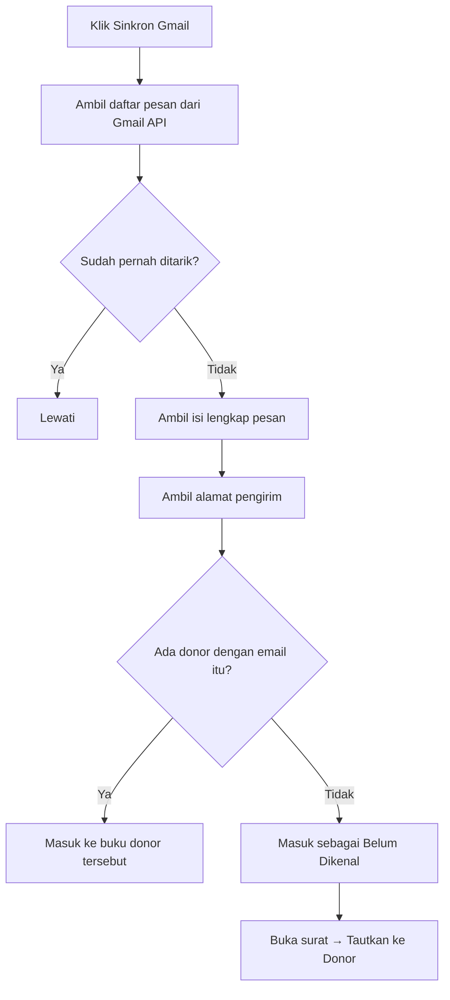

# Rencana Kerja — Aplikasi Kelola Surat & Email Donor (Kartidaya)

> Dokumen ini adalah rencana kerja sebelum pembuatan aplikasi.
> Sumber data: **`data.xlsx`** (sheet `Utama` + `Detail`).
> `data excel.jpeg` **tidak dipakai** karena banyak data ganda dan penempatan tidak konsisten.

---

## 1. Tujuan Aplikasi

Aplikasi demo berbasis **HTML + CSS + JS** (tanpa build, tanpa framework) untuk:

1. **Menyimpan data donor** (form isi seperti di Excel).
2. **Mengelola kategori** donor (5 kategori awal, bisa ditambah).
3. **Membuat & mengirim surat/email** ke banyak penerima sekaligus memakai template.
4. **Buku terima & kirim per donor** — setiap ID punya buku sendiri berisi surat
   keluar dan masuk, mirip Outlook tetapi disesuaikan kebutuhan perusahaan.
5. **Kirim & terima email sungguhan** lewat akun `@gmail.com` (Gmail API + OAuth).

Target jalan: **HP Android** dan **PC** (Chrome/Edge/Firefox).
Penyimpanan data: **localStorage** browser (demo, tanpa database).

### Dua mode operasi

| Mode | Syarat | Kemampuan |
|---|---|---|
| **Simulasi** | Tidak ada | Surat dicatat sebagai *Terkirim* di buku donor; surat masuk dicatat manual |
| **Gmail aktif** | Client ID + login Google | Kirim email sungguhan; tarik surat masuk dari inbox Gmail |

Mode simulasi membuat aplikasi **langsung bisa didemokan** tanpa menyiapkan apa pun.

---

## 2. Data yang Sudah Ada (`data.xlsx`)

### Sheet `Utama` — 18 baris data, 7 kolom

| Kolom | Isi |
|---|---|
| ID-DONOR | `L00024R`, `I00017U`, `G00009R`, … |
| KATEGORI | Member Support, Church Local, Indvidual - Local, Organization |
| PIC | Linda Lau, Kamlesh, Rany, … (bisa kosong) |
| INSTANSI | International English, GKKK Permatry, … (bisa kosong) |
| email | lindalau_T1@yahoo.co.id, … |
| HP 1 | 0896-8888-1899, … |
| HP 2 | 0819-3140-7040, … (hanya 1 baris terisi) |

### Sheet `Detail` — 5 baris, 3 kolom
`ID Donor | Email | HP` — hanya 2 baris terisi, dan isinya **duplikat** dari sheet `Utama`
(contoh: `Lindalau_T1@yahoo.co.id` vs `lindalau_T1@yahoo.co.id`, `volta@iesjakarta` vs `volta@iesjakarta.org`).

**Keputusan:** sheet `Detail` **tidak dipakai** sebagai sumber data. Cukup `Utama`.
Sheet `Detail` hanya berguna sebagai catatan bahwa pernah ada input email/HP terpisah.

### Kolom lengkap dari file Excel asli (terlihat di `_hdr*.png`)

`ID Donor | Kategori Donor | PIC | Nama Lengkap | Nama Instansi | Email | No HP | Date Start | Asal Gereja | Alamat Lengkap | Tgl Lahir | Pengiriman melalui POS/WA/…`

Kolom di atas dipakai sebagai **daftar field form**, tetapi hanya kolom yang ada di `data.xlsx`
yang diisi data awal. Sisanya kosong dan siap diisi user.

---

## 3. Kategori

Dari filter Excel (`Kategori.jpeg`) ditemukan: `Church - Local`, `Church Local`,
`Funder - Foreign`, `Individual - Local`, `Member Support`, `Organization`, `(Blanks)`.

`Church - Local` dan `Church Local` adalah **duplikat penulisan** → digabung.

**5 kategori awal (final):**

1. `Member Support`
2. `Church Local`
3. `Individual - Local`
4. `Funder - Foreign`
5. `Organization`

Kategori disimpan di localStorage sebagai **daftar terpisah** sehingga user bisa
**tambah / ubah nama / hapus** tanpa mengubah kode.

---

## 4. Aturan ID-DONOR

Format: **`[X]99999[Z]`**

| Bagian | Aturan |
|---|---|
| `[X]` | 1 huruf. Ambil **huruf pertama INSTANSI** (kapital). Jika instansi kosong → ambil **huruf pertama PIC**. Jika keduanya kosong → `X`. |
| `99999` | **Counter 5 digit** (zero-padded). Counter dihitung **per huruf X**. Nilai baru = counter tertinggi yang sudah ada untuk huruf itu **+ 1**. |
| `[Z]` | 1 huruf **suffix**. Artinya belum diketahui pasti (di data lama muncul `R` dan `U`). **User bisa isi manual**; default `R`. |

Contoh dari data lama:

| ID | PIC | Instansi | X dari | Counter |
|---|---|---|---|---|
| `L00024R` | Linda Lau | — | **L**inda | 24 |
| `I00017U` | Kamlesh | International English | **I**nternational | 17 |
| `G00009R` | Rany | GKKK Permatry | **G**KKK | 9 |
| `Y00002R` | Setiyani | Yay Misi Parousia | **Y**ay | 2 |
| `H00030R` | — | Hope Special Need | **H**ope | 30 |

Catatan: data lama tidak konsisten (`P0003U` hanya 4 digit). Aplikasi akan
**menormalkan ke 5 digit** (`P00003U`) untuk data baru.

---

## 5. Field Form Isi Data

### Wajib
- `Kategori` (dropdown dari daftar kategori)
- `PIC` **atau** `Instansi` (minimal salah satu terisi)
- `Email`

### Opsional
- `Panggilan` — **field baru**: `Ibu` / `Bapak` / `Saudara` / `Saudari`
- `Nama Lengkap`
- `Instansi` (boleh kosong)
- `HP 1`, `HP 2`
- `Date Start`, `Asal Gereja`, `Alamat Lengkap`, `Tgl Lahir`
- `Pengiriman melalui` — `Email` / `WA` / `POS` / `Lainnya`
- `Catatan`

### Otomatis
- `ID-DONOR` — dibuat otomatis, tapi bisa **di-override manual** (tombol "Ubah ID").

---

## 6. Template Surat & Placeholder

User menulis isi surat di editor, lalu menyisipkan token. Sistem mengganti token
**per penerima** saat pratinjau/kirim.

| Token | Hasil |
|---|---|
| `{/PIC}` | Panggilan + nama PIC → `Ibu Linda Lau` |
| `{/PANGGILAN}` | `Ibu` / `Bapak` / `Saudara` / `Saudari` |
| `{/NAMA}` | Nama PIC tanpa panggilan → `Linda Lau` |
| `{/INST}` | Nama instansi → `GKKK Permatry` |
| `{/NAMA_LENGKAP}` | Nama lengkap |
| `{/ID}` | ID-DONOR |
| `{/KATEGORI}` | Kategori donor |
| `{/EMAIL}` | Email penerima |
| `{/HP}` | HP 1 |
| `{/TANGGAL}` | Tanggal hari ini (format Indonesia) |
| `{/ISI1}` … `{/ISI5}` | **Isian serba guna** — diisi sekali di halaman Tulis, lihat di bawah |

Contoh:

```
Kepada Yth.
{/PIC}
{/INST}

Dengan hormat,
...
```

Hasil untuk Linda Lau:

```
Kepada Yth.
Ibu Linda Lau

Dengan hormat,
...
```

Fitur pendukung:
- **Tombol token** untuk menyisipkan token ke posisi kursor.
- **Pratinjau per penerima** (pilih donor → lihat hasil jadi).
- **Pilih banyak penerima** (checkbox) → kirim sekaligus.
- **Simpan template** (tambah/ubah/hapus) di localStorage.
- **Kirim**:
  - Gmail aktif → dikirim sungguhan lewat Gmail API, tercatat `Terkirim`.
  - Mode simulasi → hanya dicatat `Terkirim` di buku donor.
  - Bisa juga disimpan sebagai `Draft`.
- **Cetak** surat per penerima (`window.print()`).

### 6.1 Isian serba guna — 5 field untuk hal di luar data donor ✅ SELESAI (12 Nov 2026)

**Masalahnya:** ada hal yang dibutuhkan saat surat dilayangkan tapi **tidak ada
di data donor** — misalnya hari/tanggal, waktu, tempat, dan pembicara sebuah
undangan kegiatan. Sebelumnya harus diketik manual di dalam isi surat, dan
harus diketik ulang setiap kali mengirim surat baru.

**Solusinya:** 5 kotak isian bebas di halaman **Tulis Surat**, di bawah kotak
kwitansi dan majalah. Diisi **sekali**, lalu dipakai di **semua surat** lewat
token `{/ISI1}` … `{/ISI5}`.

| Isian | Contoh isi |
|---|---|
| Isian 1 | `Sabtu, 22 November 2026` |
| Isian 2 | `09.00 – 12.00 WIB` |
| Isian 3 | `Aula Kartidaya, Jakarta` |
| Isian 4 | `Pdt. Nama Pembicara` |
| Isian 5 | `Catatan tambahan…` |

Cara pakai:

1. Buka **Tulis Surat**.
2. Isi kotak **Isian serba guna** (boleh sebagian saja).
3. Klik token `{/ISI1}` … `{/ISI5}` di baris token untuk menyisipkannya ke isi
   surat — persis seperti token lain.
4. Tekan **Simpan isian**. Isian tersimpan di browser dan otomatis terisi lagi
   saat aplikasi dibuka kembali.
5. Pratinjau langsung ikut berubah saat isian diketik, jadi bisa dipastikan
   dulu sebelum dikirim.

Tombol **Kosongkan semua** menghapus kelima isian sekaligus — berguna kalau
kegiatan sudah selesai dan isian akan dipakai untuk kegiatan berikutnya.

**Template Undangan Kegiatan** bawaan sudah memakai token ini:

```
Hari/Tanggal : {/ISI1}
Waktu        : {/ISI2}
Tempat       : {/ISI3}
Pembicara    : {/ISI4}

{/ISI5}
```

Template undangan milik user yang masih versi lama (kolom Hari/Waktu/Tempat
masih kosong) **dipindahkan otomatis** ke versi baru sekali saat aplikasi
dibuka. Template yang sudah diubah sendiri oleh user tidak ikut diganti.

**Yang sudah diuji:**

| Uji | Hasil |
|---|---|
| 5 kotak isian muncul di halaman Tulis | ✅ |
| Isi 5 field → pratinjau langsung terisi | ✅ |
| Token `{/ISI1}` menyisipkan di posisi kursor | ✅ |
| Tombol **Simpan isian** menyimpan ke browser | ✅ |
| Isian tetap ada setelah halaman dimuat ulang | ✅ |
| Tombol **Kosongkan semua** mengosongkan kelima isian | ✅ |
| Template Undangan bawaan memakai `{/ISI1}`…`{/ISI4}` | ✅ |
| Template undangan lama dipindahkan otomatis | ✅ |
| Layar **Periksa sebelum kirim** menampilkan isian yang sudah terisi | ✅ |
| Penghitung "N dari 5 terisi" | ✅ |

**Perkiraan waktu yang dipakai:** ±45 menit.

---

## 7. Buku Terima & Kirim per Donor

**Inti aplikasi.** Setiap ID donor punya **buku sendiri** — daftar surat keluar dan
masuk yang tercampur urut waktu, seperti percakapan di Outlook.

### Field satu surat

| Field | Isi |
|---|---|
| `arah` | `keluar` (terkirim) / `masuk` (terima) |
| `tanggal` | waktu kirim/terima (ISO) |
| `subjek` | judul surat (sudah disubstitusi token) |
| `isi` | isi surat lengkap |
| `status` | Keluar: `Draft` / `Terkirim` / `Gagal` · Masuk: `Belum dibaca` / `Dibaca` / `Dibalas` |
| `from` / `to` / `cc` | alamat email |
| `gmailId` / `threadId` | ID dari Gmail (untuk cegah duplikat saat sinkron) |
| `lampiran` | nama file (catatan) |
| `catatan` | keterangan tambahan |
| `dibaca` | boolean, untuk penanda belum dibaca |

### Arti status surat masuk

| Status | Arti | Warna chip | Kapan berubah |
|---|---|---|---|
| **Belum dibaca** | Email baru, belum pernah dibuka | kuning (`st-baru`) | Otomatis saat surat ditarik dari Gmail |
| **Dibaca** | Email sudah dibuka | biru (`st-dibaca`) | Otomatis saat surat dibuka, atau disetel manual |
| **Dibalas** | Sudah dikirimi balasan | hijau (`st-dibalas`) | Otomatis setelah balasan terkirim, atau disetel manual |

Status bisa diubah manual lewat dropdown **Status surat** di dalam modal surat
masuk. Menyetel ke *Belum dibaca* membuat surat itu dihitung lagi di badge
**Belum Dibaca**.

**Gunanya:** menyaring dan memantau pekerjaan. Dropdown **Semua status** di
Kotak Masuk bisa menyaring *Belum dibaca* (surat yang belum ditangani) atau
*Dibalas* (memastikan semua sudah dijawab). Chip berwarna membuat status terlihat
sekilas tanpa membuka surat.

### Tampilan

- **Buku donor** — klik kartu donor → semua suratnya urut waktu, bubble kiri (masuk)
  dan kanan (keluar). Tombol: *Tulis ke Donor*, *Catat Surat Masuk*, *Ubah Data*.
- **Kotak Masuk** (global) — semua surat masuk dari seluruh donor, bisa dicari &
  difilter status/donor. Surat belum dibaca ditandai garis aksen + badge di navigasi.
- **Kotak Keluar** (global) — semua surat keluar.
- **Belum Dikenal** — surat masuk dari alamat yang tidak cocok dengan donor mana pun.
  Bisa **ditautkan** ke donor; email pengirim sekaligus bisa disimpan ke data donor.
- **Kartu donor** menampilkan ringkasan `↑n ↓n` (jumlah keluar/masuk) dan aktivitas terakhir.

### Sinkron Gmail



Pencocokan memakai **alamat email** (case-insensitive). Surat yang sudah pernah
ditarik dikenali dari `gmailId` sehingga tidak dobel.

---

## 8. Struktur Halaman (UI)

Aplikasi satu halaman dengan navigasi bawah (mobile) / samping (desktop):

1. **Beranda** — total donor, belum dibaca, surat keluar, status Gmail, status
   WhatsApp, kotak masuk terbaru, donor per kategori, aktivitas terbaru, aksi cepat.
2. **Masuk** — kotak masuk global (cari, filter status, filter donor, filter
   kanal, sinkron Gmail, sinkron WhatsApp).
3. **Keluar** — kotak keluar global.
4. **Donor** — daftar + cari + filter kategori + urut; tombol `+ Tambah`.
5. **Buku Donor** — buku terima & kirim satu donor (dibuka dari kartu donor).
6. **Tulis** — pemilih kanal (Email/WhatsApp), template, token, penerima
   (multi-pilih), pratinjau, kirim/draft/cetak.
7. **Kategori** — kelola kategori.
8. **Setelan** — Gmail (Client ID, hubungkan, sinkron, putuskan), WhatsApp
   (alamat Worker, kunci aplikasi, uji sambungan, sinkron otomatis), tanda
   tangan, tema, ekspor/impor JSON, ekspor CSV, muat data contoh, reset, uji
   generator ID.

---

## 9. Desain UI

Referensi: kategori **minimal** di [awwwards.com](https://www.awwwards.com/websites/minimal/).
Situs yang dipelajari: `concretaceramiche.it`, `nader.io`, `billcreates.tech`, `fastsocial.co`.

Prinsip (sesuai permintaan: **jangan terlalu banyak main warna**):

- **1 warna aksen saja**, sisanya netral.
- Banyak ruang kosong, garis tipis, sudut kecil (radius 8–10px).
- Tipografi sebagai pembawa karakter, bukan warna.
- Angka/ID memakai **monospace** agar rapi sejajar.

### Palet

| Peran | Nilai |
|---|---|
| Latar | `#f5f5f0` (off-white) |
| Permukaan / kartu | `#ffffff` |
| Teks utama | `#161616` |
| Teks sekunder | `#6b6b6b` |
| Garis | `#e3e3dc` |
| **Aksen (tunggal)** | `#1f6f5c` (hijau tua kalem) |
| Aksen lembut | `#e8f0ed` |
| Bahaya | `#a33a2c` (hanya untuk hapus/gagal) |

Mode gelap: latar `#111312`, permukaan `#191c1b`, teks `#eeeedc`, aksen tetap `#55d1c5`.

### Tipografi

- UI: system font stack (`-apple-system, Segoe UI, Roboto, …`) — **tanpa internet**, aman di Android.
- ID / angka / token: `ui-monospace, "IBM Plex Mono", Consolas, monospace`.

### Responsif

- Mobile-first. Navigasi bawah (bottom bar) di layar < 860px, sidebar di layar besar.
- Tabel donor berubah jadi kartu di layar kecil.
- Target sentuh minimal 44px.
- Grid memakai `minmax(min(230px,100%),1fr)` + `.grid > *{min-width:0}` agar tidak
  ada overflow horizontal di layar sempit (diuji 320–1440px).

---

## 10. Teknis

| Aspek | Keputusan |
|---|---|
| File | **Multi-file**: `index.html` + `app.css` + `app.js` + `gmail.js` |
| Penyimpanan | `localStorage` (key: `kartidaya.v2.*`) |
| Data awal | 18 donor dari `data.xlsx` di-embed sebagai seed |
| Framework | Tanpa framework (vanilla JS) |
| Hosting | **GitHub Pages** (`https://suwandhih.github.io/kartidaya/`) |
| Server lokal | **`serve.bat`** → `serve.py` (Python `http.server`, port 8080) |
| Ekspor | JSON (backup/restore) + CSV (buka di Excel) |
| Cetak | `window.print()` untuk cetak surat |
| Email | **Gmail API + OAuth 2.0** (Google Identity Services, alur token) |

### Kenapa perlu origin https / localhost?

Google **menolak** origin `file://` untuk OAuth. Origin yang diterima:

- `https://` apa pun — termasuk GitHub Pages
- `http://localhost` / `http://127.0.0.1`

Karena itu aplikasi di-host di GitHub Pages (juga bisa dibuka dari HP Android
tanpa PC menyala), dan `serve.bat` disediakan untuk pemakaian lokal.

### Kenapa multi-file?

`gmail.js` dipisah karena berisi integrasi pihak ketiga (Google) yang berdiri
sendiri; `app.css` dipisah agar gaya mudah ditinjau tanpa membaca logika.

### Scope OAuth

```
https://www.googleapis.com/auth/gmail.send
https://www.googleapis.com/auth/gmail.readonly
https://www.googleapis.com/auth/userinfo.email
```

Alur **token** (bukan authorization code) dipilih karena **tidak butuh Client
Secret** — aman untuk aplikasi yang seluruhnya jalan di browser.

### Kunci localStorage
- `kartidaya.v2.donors`
- `kartidaya.v2.categories`
- `kartidaya.v2.templates`
- `kartidaya.v2.messages`
- `kartidaya.v2.settings`

---

## 11. Urutan Pengerjaan

**Fase 1 — Aplikasi inti**
- [x] Baca & verifikasi `data.xlsx`
- [x] Kumpulkan referensi desain (Awwwards minimal)
- [x] Tulis `rencanakerja.md` (dokumen ini)
- [x] Struktur + CSS (palet & tipografi)
- [x] Data layer: seed 18 donor, kategori, localStorage
- [x] Halaman Donor: daftar, cari, filter, tambah/ubah/hapus
- [x] Generator ID-DONOR `[X]99999[Z]`
- [x] Halaman Kategori (tambah/ubah/hapus)
- [x] Halaman Tulis Surat: template, token, pratinjau, kirim massal
- [x] Beranda (dashboard)
- [x] Setelan: ekspor/impor JSON, ekspor CSV, reset
- [x] Uji di layar HP (320–414px) & PC (768–1440px)

**Fase 2 — Buku terima & kirim + Gmail**
- [x] Pisah jadi `index.html` + `app.css` + `app.js` + `gmail.js`
- [x] `serve.py` + `serve.bat` (server lokal, threaded, LAN)
- [x] `gmail.js`: OAuth, kirim, daftar pesan, ambil pesan, urai MIME
- [x] Model data `messages` (satu buku per donor)
- [x] Halaman **Buku Donor** (bubble masuk/keluar)
- [x] Halaman **Kotak Masuk** & **Kotak Keluar** global
- [x] **Catat Surat Masuk** manual (mode simulasi)
- [x] **Tautkan surat tak dikenal** ke donor
- [x] **Sinkron Gmail** + pencocokan otomatis lewat email
- [x] Setelan Gmail: Client ID, hubungkan, sinkron, putuskan
- [x] `PANDUAN-GMAIL.md` (panduan Google Cloud Console langkah demi langkah)
- [x] Uji: kirim simulasi, catat masuk, tautkan, ekspor, tema, responsif

**Fase 3 — Publikasi**
- [x] `.gitignore` — `data.xlsx` & screenshot data tidak ikut ter-commit
- [x] `README.md`
- [x] Repo publik `suwandhih/kartidaya`
- [x] **GitHub Pages** aktif di `https://suwandhih.github.io/kartidaya/`
- [x] Dukung origin `https://` untuk OAuth (bukan hanya localhost)
- [x] Halaman Setelan menampilkan origin yang perlu didaftarkan

**Fase 4 — WhatsApp Cloud API**
- [x] `worker/index.js` — Cloudflare Worker (kirim, webhook, antrean KV, anti-duplikat)
- [x] `worker/wrangler.toml` — konfigurasi deploy + binding KV
- [x] `whatsapp.js` — pembungkus sisi browser (bentuk API mirip `Gmail`)
- [x] Field `kanal` pada pesan (`email` / `whatsapp`)
- [x] Pencocokan donor lewat nomor HP (`donorByPhone`, `donorWa`)
- [x] Pemilih kanal di halaman **Tulis** + pratinjau gelembung WhatsApp
- [x] Kirim WhatsApp dari aplikasi (`kirimSurat` bercabang per kanal)
- [x] Terima WhatsApp: `waSync()` + `waSinkronOtomatis()` + tombol sinkron
- [x] Filter kanal & chip kanal di Kotak Masuk dan buku donor
- [x] Kartu **WhatsApp** di Setelan (alamat Worker, kunci, uji sambungan)
- [x] **Catat Surat Masuk** dengan pilihan kanal
- [x] `PANDUAN-WHATSAPP.md`
- [x] Deploy Worker ke Cloudflare — `https://kartidaya-wa.suwandhih.workers.dev`
- [x] Setup Meta Business + nomor WhatsApp Business (nomor uji `+1 (555) 173-4967`)
- [x] Daftarkan webhook di Meta (field `messages` ter-subscribe)
- [x] Lacak status kirim (`statuses` → KV → chip **Gagal** + alasan)
- [ ] Uji kirim/terima WhatsApp sungguhan — **terblokir `130497`**: akun bisnis
      belum lulus verifikasi, jadi Meta menolak kirim ke nomor Indonesia.
      Perlu: profil bisnis lengkap (`131000`), verifikasi bisnis (`141010`),
      metode pembayaran (`141006`), lalu nomor WhatsApp Business sungguhan.
      Rincian di bagian 14.

---

## 12. Hal yang Masih Perlu Dikonfirmasi

1. **Arti huruf terakhir `[Z]`** pada ID-DONOR (`R` / `U`). Sementara: bisa diisi manual, default `R`.
2. Apakah **counter** ID dihitung per huruf (keputusan saat ini) atau global.
3. Apakah perlu **login / multi-user** (saat ini tidak, karena demo tanpa server).
4. **Alamat Gmail** yang akan dipakai — **`fotohotono03@gmail.com`** (ditetapkan
   5 Nov 2026). Alamat ini harus didaftarkan di **Test users**.
5. Apakah perlu **lampiran file** sungguhan (saat ini hanya catatan nama file).
6. Apakah perlu **balas semua / teruskan** (belum dibuat; saat ini hanya *Balas*).
7. Apakah perlu **template HTML** (berformat tebal/miring), bukan teks biasa.
8. **Data donor di `app.js`** — 18 nama/email/HP asli ikut ter-publish di repo
   publik. User menyetujui karena aplikasi hanya dipakai sementara di GitHub;
   nanti akan dipindah ke hosting sendiri. Kalau perlu, pindahkan ke `seed.js`
   yang di-gitignore.

---

## 13. Status Terakhir & Langkah Berikutnya

*Diperbarui: 5 November 2026, 14:45 WIB*

### Akar masalah `access_denied` — SUDAH DITEMUKAN & DIPERBAIKI

Penyebab sebenarnya **bukan** Test users. Client ID lama
(`205859365311-…`) milik **project Google Cloud lain** yang tidak bisa diakses
akun `suwandhih@gmail.com`:

| | |
|---|---|
| Client ID lama | `205859365311-…` → project **205859365311** |
| Akses akun ini | ❌ *"You need additional access to the project: 205859365311"* |
| Project `Kartidaya` milik user | `kartidaya-513714` → nomor **531116872278** |
| Kondisi project itu | ❌ *"Google Auth Platform not configured yet"* — belum ada OAuth client |

Jadi Test user selama ini ditambahkan di project yang **tidak memiliki OAuth
client**, sehingga tidak berpengaruh sama sekali.

### Yang sudah dikerjakan 5 Nov 2026 (lewat Cloud Console)

Semua di project **`kartidaya-513714`**:

- [x] Konfigurasi Google Auth Platform dibuat (App name `Kartidaya`,
      tipe **External**)
- [x] **OAuth Client ID baru** dibuat — `Kartidaya Web`, tipe *Web application*
- [x] Authorized JavaScript origin: `https://suwandhih.github.io`
- [x] **Gmail API diaktifkan**
- [x] **Data Access**: `gmail.send` (sensitive) + `gmail.readonly` (restricted)
      → *"Data access changes saved!"*
- [x] **Test users**: `fotohotono03@gmail.com` ditambahkan → **Save**
- [x] **Developer contact** diubah jadi **hanya `fotohotono03@gmail.com`**
      (`suwandhih@gmail.com` dihapus) → *"Branding changes saved!"*
- [x] **IAM**: `fotohotono03@gmail.com` diberi role **OAuth Config Editor**
      agar bisa membuka project ini sendiri
- [x] Client ID baru dipasang di halaman Setelan aplikasi
- [x] Diverifikasi: alur GIS Google menerima Client ID + origin baru
      (redirect ke halaman login, bukan `invalid_client` / `origin_mismatch`)

> **Kebijakan email:** `suwandhih@gmail.com` adalah email pribadi dan
> **tidak boleh dipakai** untuk aplikasi ini. Semua konfigurasi yang bisa
> diubah sudah dipindah ke `fotohotono03@gmail.com`.
>
> Satu pengecualian yang **tidak bisa** diubah: field **User support email**
> di halaman Branding hanya menerima akun yang sedang login di browser.
> Karena project ini dibuat dari akun `suwandhih@gmail.com`, field itu masih
> menampilkan email tersebut. Ini hanya alamat kontak yang tampil di layar
> izin Google — **tidak memengaruhi pengiriman email**, dan tidak dipakai
> aplikasi sama sekali. Untuk menggantinya sepenuhnya, project harus dibuat
> ulang dari akun `fotohotono03@gmail.com`.

**Client ID yang dipakai sekarang:**

```
531116872278-hep5meju0djk30qrsee5ec4np2t895qo.apps.googleusercontent.com
```

> Client secret `GOCSPX-…` **tidak dipakai** aplikasi ini (alur token GIS).
> Jangan pernah menaruhnya di kode.

### Perbaikan lanjutan — Client ID lama masih terpakai

Setelah konfigurasi Google selesai, error `access_denied` **masih muncul**.
Penyebabnya: browser masih menyimpan **Client ID lama** (`205859365311-…`) di
`localStorage`, dan `app.js` juga masih tersimpan di cache browser.

Perbaikan yang ditambahkan:

- [x] `DEFAULT_CLIENT_ID` — Client ID project Kartidaya dipakai sebagai nilai awal
- [x] **Migrasi otomatis** — Client ID berawalan `205859365311-` diganti otomatis
      saat aplikasi dimuat
- [x] Halaman Setelan menampilkan **Client ID yang benar-benar dipakai**
- [x] Tombol **Pakai Client ID bawaan** untuk reset manual
- [x] Peringatan di Setelan kalau Client ID bukan milik project Kartidaya
- [x] **Cache-busting** `app.js?v=3` & `gmail.js?v=3` di `index.html`

Diverifikasi: dengan `localStorage` sengaja diisi Client ID lama, aplikasi
otomatis menggantinya ke Client ID project Kartidaya saat dimuat.

### Yang belum selesai

| # | Tugas | Keterangan |
|---|---|---|
| 1 | Uji **kirim email sungguhan** | ✅ SELESAI — Ferry Kangsadjaja menerima surat dari `fotohotono03@gmail.com` |
| 2 | Uji **pembaruan sesi otomatis** terhadap Google sungguhan | Butuh sesi login nyata; jalur kode sudah diverifikasi dengan stub |
| 3 | Ajukan **verifikasi OAuth** ke Google | Menghapus batas 7 hari & batas Test user (opsional) |
| 4 | Uji **sinkron otomatis** terhadap Gmail sungguhan | Logika & pemicu sudah diverifikasi; tinggal dilihat di akun asli |
### Hubungkan Gmail — BERHASIL (5 Nov 2026, 15:28 WIB)

`fotohotono03@gmail.com` **sudah berhasil terhubung**. Akar masalahnya ada dua,
keduanya sudah diperbaiki:

1. Client ID lama milik project lain → diganti Client ID project `kartidaya-513714`
2. Browser masih memakai `app.js` dari cache + Client ID lama di localStorage
   → ditambah migrasi otomatis dan cache-busting

Perbaikan tambahan setelah terhubung:

- [x] Header `From` diperkuat — kalau profil Gmail belum terbaca, header
      dihilangkan dan Gmail mengisi sendiri (sebelumnya `From: me` ditolak Gmail)
- [x] `app.js?v=4` & `gmail.js?v=4`

### Terima surat — BERHASIL (5 Nov 2026, 15:51 WIB)

Email dari `suwandhih@gmail.com` **berhasil masuk** ke buku donor
**Ferry Kangsadjaja** (`F00004R`).

Kendala yang ditemukan & diperbaiki:

- Surat sudah ditarik sebagai **Belum Dikenal** karena email donor Ferry masih
  `ferryk@indo.net.id` (data awal Excel), bukan `suwandhih@gmail.com`
- **Bug:** surat yang sudah masuk sebagai Belum Dikenal **tidak pernah** pindah
  ke buku donor walau email donornya kemudian diisi
- **Perbaikan:** Sinkron Gmail otomatis mencocokkan ulang, plus tombol
  **⇄ Cocokkan ulang** di Kotak Masuk (`app.js?v=5`)

Diverifikasi: setelah email donor diisi, klik **Cocokkan ulang** → surat pindah
ke buku Ferry, counter jadi **↓1 masuk**.

### Status surat masuk bisa diubah — SELESAI (5 Nov 2026)

**Masalah yang dilaporkan:** status surat masuk tidak bisa diubah — tidak ada
tempat untuk mengubahnya setelah surat tersimpan.

**Akar masalah:** status hanya bisa disetel saat surat **dibuat** (Catat Surat
Masuk, atau otomatis oleh Sinkron Gmail). Di modal surat, status hanya tampil
sebagai chip read-only. Selain itu, membuka surat hanya mengubah flag `dibaca`
tetapi **tidak** menaikkan `status` dari *Belum dibaca* ke *Dibaca*, sehingga
surat yang sudah dibuka tetap terlihat "Belum dibaca".

**Perbaikan (`app.js?v=7`):**

- [x] Dropdown **Status surat** di modal surat masuk — bisa pilih
      *Belum dibaca* / *Dibaca* / *Dibalas*, langsung tersimpan
- [x] Membuka surat *Belum dibaca* otomatis menaikkan status ke *Dibaca*
- [x] Mengirim balasan otomatis menandai surat masuk terakhir donor itu sebagai
      *Dibalas*
- [x] Chip status diberi warna: hijau = *Belum dibaca*, abu-abu = *Dibaca* /
      *Dibalas*, merah = *Gagal*
- [x] Menyetel ke *Belum dibaca* ikut memperbarui badge **Belum Dibaca** di menu

Diverifikasi di browser: buka surat → status naik ke *Dibaca*; ganti ke
*Dibalas* → tersimpan; ganti ke *Belum dibaca* → badge naik; kirim balasan →
surat masuk jadi *Dibalas*.

### Kirim surat tercatat "Terkirim" tapi email tidak sampai — SELESAI (5 Nov 2026)

**Masalah yang dilaporkan:** surat untuk Ferry Kangsadjaja ditandai `00005` dan
dikirim, tetapi emailnya tidak pernah sampai.

**Akar masalah:** Gmail **belum terhubung** saat surat dikirim. Aplikasi
diam-diam beralih ke **mode simulasi** — surat hanya dicatat `Terkirim` di buku
donor, emailnya tidak pernah dikirim. Bukti dari data pengguna:

| Surat | `status` | `gmailId` | Artinya |
|---|---|---|---|
| Terima kasih — Ferry Kangsadjaja (09:24) | `Terkirim` | *(kosong)* | tidak dikirim |
| Terima kasih — Ferry Kangsadjaja (09:26) | `Terkirim` | *(kosong)* | tidak dikirim |

`gmailId` kosong = Gmail API tidak pernah dipanggil.

**Dua penyebab Gmail "belum terhubung":**

1. **Token tidak disimpan.** Token hanya ada di memori (`Gmail.token`), jadi
   setiap halaman dimuat ulang koneksi hilang. Pengguna menghubungkan Gmail,
   lalu refresh / pindah halaman → kembali ke mode simulasi tanpa sadar.
2. **Mode simulasi tidak pernah dikonfirmasi.** `kirimSurat()` langsung
   mencatat `Terkirim` tanpa memberi tahu bahwa email tidak dikirim.

**Perbaikan (`app.js?v=8` & `gmail.js?v=8`):**

- [x] Token Gmail disimpan di `sessionStorage` (`kartidaya.gmail.session`) dan
      dipulihkan otomatis saat halaman dimuat — refresh tidak lagi memutus
      koneksi. Dipilih `sessionStorage` (bukan `localStorage`) supaya token
      hilang saat tab ditutup.
- [x] Token kedaluwarsa / `401` / *Putuskan* otomatis menghapus sesi tersimpan
- [x] `kirimSurat()` menampilkan **konfirmasi** kalau Gmail belum terhubung —
      pengguna diberi tahu email tidak akan terkirim dan bisa membatalkan
- [x] Donor tanpa email saat Gmail aktif → status `Gagal` dengan pesan jelas
      (sebelumnya ikut dicatat `Terkirim`)

Diverifikasi di browser: token dipulihkan dari `sessionStorage`; token
kedaluwarsa tidak dipulihkan; *Putuskan* membersihkan sesi; kirim tanpa Gmail
menampilkan konfirmasi dan tidak mencatat apa pun bila dibatalkan; donor tanpa
email menghasilkan status `Gagal`.

### Sesi Gmail diperbarui otomatis — SELESAI (5 Nov 2026)

**Permintaan pengguna:** *"apakah ada cara secara otomatis sistem menghitung
waktu untuk menghubung email secara otomatis jadi user menggunakan tidak perlu
was was untuk hubungkan gmail .. bentar2 hubungkan gmail .. ada cara tidak"*

**Jawaban: bisa.** Token diperbarui sendiri di latar belakang tanpa jendela izin.

**Desain (`app.js?v=9` & `gmail.js?v=9`):**

| Bagian | Fungsi |
|---|---|
| `Gmail.msLeft()` | Sisa umur token dalam milidetik (0 kalau tidak ada token) |
| `Gmail.renew()` | Perbarui token senyap lewat `initTokenClient({ prompt: '' })` + `requestAccessToken({ prompt: '' })`; timeout pengaman 15 detik; simpan ke `sessionStorage`; ambil profil kalau `email` masih kosong |
| `Gmail.ensureConnected()` | `true` langsung kalau sisa > 5 menit; kalau tidak, coba `renew()` dulu |
| `jagaSesiGmail()` | Penjaga latar belakang: perbarui kalau sisa ≤ 10 menit |
| `sisaWaktu(ms)` | Format sisa waktu: *habis* / *kurang dari 1 menit* / *N menit* / *N jam M menit* |

**Kapan penjaga berjalan:**

- `setInterval(jagaSesiGmail, 5 * 60 * 1000)` — tiap 5 menit selama aplikasi terbuka
- `visibilitychange` — saat tab kembali aktif
- sekali saat aplikasi dimuat
- `kirimSurat()` dan `gmailSync()` memanggil `ensureConnected()` lebih dulu

**Kalau pembaruan gagal** (sesi login Google sudah berakhir): muncul pesan
*"Sesi Gmail perlu diperbarui — buka Setelan lalu klik Hubungkan Gmail"*
**sekali saja** (dijaga flag `_gmailPeringatan`), tidak berulang tiap 5 menit.

**Tampilan:** kartu Gmail di **Setelan** menampilkan *"Sesi diperbarui otomatis
di latar belakang. Sisa waktu token: …"* (`id="g-sisa"`).

**Batas yang jujur:** pembaruan senyap hanya berhasil selama pengguna masih
punya sesi login Google di browser itu. Kalau sesi Google berakhir — atau setelah
**7 hari** karena aplikasi masih berstatus *Testing* — satu kali klik
**Hubungkan Gmail** tetap diperlukan. Batas 7 hari ini hilang kalau aplikasi
diajukan verifikasi ke Google.

**Verifikasi di browser (dengan Google Identity Services di-stub):**

| Uji | Hasil |
|---|---|
| `renew()` dengan `prompt: ''` | `ok: true`, token & email terisi, tersimpan di `sessionStorage` ✅ |
| `renew()` memakai scope benar | `gmail.send` + `gmail.readonly` ✅ |
| `ensureConnected()` sisa 1 jam | tidak memanggil `renew()` ✅ |
| `ensureConnected()` sisa 1 menit | memanggil `renew()` ✅ |
| `jagaSesiGmail()` sisa 30 menit | tidak memperbarui ✅ |
| `jagaSesiGmail()` sisa 5 menit | memperbarui ✅ |
| `jagaSesiGmail()` tanpa token | tidak memperbarui (belum pernah login) ✅ |
| `jagaSesiGmail()` gagal | pesan muncul sekali, percobaan kedua senyap ✅ |
| `sisaWaktu()` | `1 jam 0 menit` / `habis` / `kurang dari 1 menit` ✅ |
| Kartu Setelan | menampilkan *Sisa waktu token: 41 menit* ✅ |

> Yang **belum** bisa diuji otomatis: `renew()` terhadap Google sungguhan —
> butuh sesi login nyata. Kalau Google menolak, jalur gagal di atas yang aktif.

### Sinkron otomatis — SELESAI (5 Nov 2026)

**Permintaan pengguna:** *"termasuk sinkron sekarang .. user jg tidak perlu bolak
balik setelan, untuk sinkron"*

**Desain (`app.js?v=10`):**

| Bagian | Fungsi |
|---|---|
| `gmailSync({ silent:true })` | Sinkron tanpa pesan *"Menarik surat masuk…"* dan tanpa pesan *"Tidak ada surat baru"* |
| `sinkronOtomatis(paksa)` | Penjaga: lewati kalau `autoSync` mati, Gmail belum diatur, belum pernah login, atau jarak belum lewat |
| `state.settings.autoSync` | Bawaan `true` |
| `state.settings.syncMinutes` | Bawaan `10` menit (1–240) |
| `state.settings.lastSync` | Diisi setiap sinkron berhasil — dipakai sebagai gerbang jarak |
| `_syncJalan` | Penanda anti-tumpang-tindih, dengan jaring pengaman `Promise.race` 60 detik |

**Kapan berjalan:**

- `setTimeout(sinkronOtomatis, 3000)` saat aplikasi dimuat (jeda supaya token
  sempat dipulihkan lebih dulu)
- `setInterval(sinkronOtomatis, 60 * 1000)` — dicek tiap menit, tapi hanya
  benar-benar menarik kalau `syncMinutes` sudah lewat
- `visibilitychange` — saat tab kembali aktif

**UI:**

- **Setelan → Gmail**: tombol **Sinkron otomatis** (Aktif/Mati), input
  **Jarak antar sinkron otomatis**, dan **Terakhir sinkron**
- **Beranda**: baris *"Sinkron otomatis · baru saja"* + tombol **⟳ Sinkron sekarang**

**Verifikasi di browser:**

| Uji | Hasil |
|---|---|
| `autoSync` mati | tidak memanggil sinkron ✅ |
| Belum pernah sinkron | langsung menarik ✅ |
| Sinkron 1 menit lalu, jarak 10 menit | dilewati ✅ |
| Sinkron 11 menit lalu | ditarik ✅ |
| `paksa = true` | melewati gerbang jarak ✅ |
| Gmail belum diatur | dilewati ✅ |
| Belum pernah login | dilewati ✅ |
| Dua panggilan bersamaan | hanya satu yang jalan ✅ |
| Sinkron senyap, ada surat baru | pesan *"1 surat masuk baru"* ✅ |
| Sinkron senyap, tidak ada surat baru | **tanpa pesan** ✅ |
| Sinkron manual | pesan *"Menarik surat masuk…"* lalu *"Tidak ada surat baru"* ✅ |
| Muat ulang halaman | surat ditarik sendiri, `lastSync` terisi, badge Masuk jadi 1 ✅ |
| Tab kembali aktif | ditarik kalau jarak sudah lewat ✅ |
| Tab kembali aktif, baru saja sinkron | dilewati ✅ |
| Tombol Aktif/Mati | tersimpan di `localStorage`, input jarak hilang saat mati ✅ |
| Input jarak `9999` | dijepit ke `240` ✅ |

### Status surat masuk — diperjelas & 2 bug diperbaiki (5 Nov 2026)

**Pertanyaan pengguna:** *"status di ubah belum baca, dibaca dan dibalas tidak ada
beda .. kolom catat surat masuk tetap tidak ada informasi lain .. jadi fungsi ini
apa?"*

**Jawaban:** fungsinya menyaring & memantau pekerjaan — *Belum dibaca* = surat
yang belum ditangani, *Dibalas* = sudah dijawab. Tetapi memang ada **dua bug**
yang membuat status tampak tidak berguna:

| # | Bug | Akibat yang dilihat pengguna |
|---|---|---|
| 1 | `renderNav()` dipanggil, bukan `render()` | Chip di daftar Kotak Masuk **tidak ikut berubah** setelah status diubah — hanya chip di dalam modal yang berubah. Setelah modal ditutup, chip lama muncul lagi, seolah perubahan tidak tersimpan |
| 2 | `dibaca:true` dipaku di `catat-masuk-simpan` | Surat yang dicatat manual dengan status *Belum dibaca* **tidak pernah** dihitung di badge menu Masuk |

Ditambah dua masalah tampilan:

| # | Masalah | Akibat |
|---|---|---|
| 3 | `Dibaca` dan `Dibalas` sama-sama `chip plain` | Ketiga status **tidak bisa dibedakan** secara visual |
| 4 | Dropdown hanya berisi nama status | Tidak ada penjelasan artinya di UI |

**Perbaikan (`app.js?v=11`, `app.css?v=11`):**

- [x] `render()` dipanggil setelah status diubah → daftar Kotak Masuk dan buku
      donor langsung ikut berubah
- [x] `dibaca` mengikuti status saat mencatat surat masuk manual
- [x] Warna chip dibedakan tegas: `Belum dibaca` → **kuning** (`st-baru`),
      `Dibaca` → **biru** (`st-dibaca`), `Dibalas` → **hijau** (`st-dibalas`).
      Ditambah variabel `--st-baru`/`--st-dibaca`/`--st-dibalas` untuk tema
      terang & gelap. Versi pertama (`info`/`ok`) terlalu mirip sehingga
      pengguna masih menganggap "tampil sama saja" — diganti hue yang jauh
      berbeda plus garis tepi sewarna
- [x] Kartu surat belum dibaca diberi latar kuning tipis + garis kiri kuning
      (`.mail.unread`, `.bubble.in.unread`) supaya terlihat sekilas
- [x] Dropdown status menampilkan artinya: *"Dibalas — sudah dikirimi balasan"*
- [x] Keterangan singkat di bawah dropdown, baik di modal surat maupun di form
      **Catat Surat Masuk**
- [x] Chip status di **buku donor** memakai `statusChipClass()` (sebelumnya teks
      polos tanpa warna)
- [x] `app.css` ikut diberi `?v=` supaya perubahan warna tidak tertahan cache

**Verifikasi di browser:**

| Uji | Hasil |
|---|---|
| Ubah status di modal → chip di daftar di belakang modal | langsung berubah ✅ |
| Tutup modal → chip di daftar | tetap sesuai ✅ |
| `Dibalas` → chip `chip st-dibalas`; `Dibaca` → `chip st-dibaca`; `Belum dibaca` → `chip st-baru` | ✅ |
| Warna terang: kuning `#fdf3d7`/`#a16207`, biru `#e3edf8`/`#2f5d8a`, hijau `#e2f2e6`/`#2f6b3f` | ✅ |
| Warna gelap: kuning `#3a2f14`/`#f0c14b`, biru `#1b2530`/`#8fb6dd`, hijau `#1a2620`/`#8fc79c` | ✅ |
| Kartu belum dibaca → latar kuning + garis kiri kuning | ✅ |
| Setel ke `Belum dibaca` → `dibaca:false`, badge Masuk naik | ✅ |
| Catat manual status `Belum dibaca` → `dibaca:false`, badge naik | ✅ |
| Catat manual status `Dibaca` → `dibaca:true`, badge tidak naik | ✅ |
| Filter **Semua status** = `Belum dibaca` / `Dibalas` | menyaring dengan benar ✅ |
| Chip di buku donor | berwarna sesuai status ✅ |

### Cara menguji kirim

**Kirim (Tes 3):**

1. Menu **Donor** → **+ Tambah** → buat donor uji dengan email
   `fotohotono03@gmail.com` (kirim ke diri sendiri paling aman)
2. Menu **Tulis** → centang donor uji itu → **➤ Kirim**
3. Pesan sukses harus menyebut *"terkirim lewat Gmail"* (bukan *mode simulasi*)
4. Cek <https://mail.google.com> → **Sent** dan **Inbox**
5. Kalau status jadi **Gagal**, buka suratnya — pesan error Gmail ada di situ

**Terima (Tes 4) — sudah lolos:**

1. Kirim email **ke** `fotohotono03@gmail.com` dari akun lain
2. Menu **Masuk** → **⟳ Sinkron Gmail**
3. Surat muncul; cocok email donor → masuk buku donor, tidak cocok →
   **Belum Dikenal**
4. Klik Sinkron sekali lagi → jumlah **tidak bertambah** (anti-duplikat)

### Cara melanjutkan

1. Buka <https://suwandhih.github.io/kartidaya/> → **Setelan**
2. Pastikan baris *"Client ID yang benar-benar dipakai saat ini"* menampilkan
   `531116872278-…`. Kalau masih `205859365311-…`, klik
   **Pakai Client ID bawaan** (atau tekan `Ctrl+Shift+R` untuk buang cache)
3. Klik **Hubungkan Gmail**, lalu login dengan **`fotohotono03@gmail.com`**
4. Bila muncul *"Google hasn't verified this app"* → **Advanced** →
   **Go to Kartidaya (unsafe)** — normal untuk aplikasi Testing sendiri
5. Setelah status **Terhubung**: uji kirim email, lalu **⟳ Sinkron sekarang**
6. Cadangan lokal kalau perlu: `serve.bat` → <http://localhost:8080>

> Catatan: langkah login **tidak bisa** diotomasi — Google memblokir popup
> otomatis dan butuh kredensial akun. Sisanya sudah beres.

### Catatan penting

- **Client Secret tidak dipakai** aplikasi ini. Alur token Google Identity
  Services tidak memerlukan secret. Kalau secret pernah terlihat di screenshot,
  boleh di-reset — tidak akan memengaruhi aplikasi.
- **Token kedaluwarsa**: access token 1 jam, refresh token 7 hari (karena status
  masih *Testing*). Sejak `v9` token **diperbarui otomatis** di latar belakang,
  jadi klik *Hubungkan Gmail* hanya perlu kalau sesi login Google di browser
  sudah berakhir.
- **Data donor ada di `app.js`** (`SEED_DONORS`) dan ikut ter-publish. Lihat
  bagian 12 no. 8.

---

## 14. Integrasi WhatsApp — SELESAI (5 Nov 2026)

**Permintaan pengguna:** *"ok setelah ini mau masuk API whatsapp .. jadi bisa
interaksi lewat hp juga"* — dengan pilihan **konsep sepenuhnya sama dengan
email**, penyedia **Meta WhatsApp Cloud API**, backend **Cloudflare Worker**.

### Kenapa perlu backend

Aplikasi ini halaman statis di GitHub Pages. WhatsApp API **tidak bisa** dipakai
langsung dari browser karena dua hal:

| Masalah | Sebab |
|---|---|
| Token Meta | Kunci rahasia; kalau ada di `app.js`, siapa pun bisa membacanya lewat F12 |
| Webhook | Meta mengirim pesan masuk lewat **POST** ke URL publik; GitHub Pages tidak bisa menerima kiriman |

Karena itu ditambahkan **Cloudflare Worker** sebagai perantara. Browser hanya
menyimpan **alamat Worker** dan **kunci aplikasi** (`APP_KEY`) — keduanya tidak
berbahaya kalau bocor.

```
HP pengirim → Meta Cloud API → Worker (webhook) → KV antrean
                                                     │
Browser Kartidaya ←── GET /wa/inbox ─────────────────┘
Browser Kartidaya ──── POST /wa/send ────► Worker ────► Meta → HP tujuan
```

### Berkas baru

| Berkas | Isi |
|---|---|
| `worker/index.js` | Cloudflare Worker — endpoint `/wa/status`, `/wa/send`, `/wa/webhook` (GET verifikasi + POST pesan masuk), `/wa/inbox`, `/wa/ack` |
| `worker/wrangler.toml` | Konfigurasi deploy + binding KV `WA_INBOX` |
| `whatsapp.js` | Pembungkus sisi browser (objek `WhatsApp`), bentuk API sengaja mirip `Gmail` |
| `PANDUAN-WHATSAPP.md` | Panduan lengkap: setup Meta, deploy Worker, 9 uji, tabel masalah |

### Keamanan Worker

- Semua endpoint kecuali `/wa/webhook` wajib menyertakan header `X-App-Key`
- Perbandingan kunci memakai `sameKey()` — **constant-time**, supaya panjang/isi
  kunci tidak bocor lewat waktu eksekusi
- Empat rahasia disimpan sebagai **Worker secret**, bukan di kode:
  `WA_TOKEN`, `WA_PHONE_ID`, `WA_VERIFY_TOKEN`, `APP_KEY`
- CORS dibatasi ke origin pemanggil (`Vary: Origin`)
- Antrean pesan masuk dibatasi **500 pesan terakhir** (`MAX_QUEUE`)
- Anti-duplikat berdasarkan `waId` — webhook Meta yang dikirim ulang tidak
  menghasilkan pesan dobel

### Perubahan di `app.js` (`v13`)

| Bagian | Perubahan |
|---|---|
| Konstanta | `KANAL`, `LABEL_KANAL`, `ICO_KANAL`, `kanalChip()` |
| `loadState()` | `waEndpoint`, `waAutoSync` (bawaan `true`), `waSyncMinutes` (bawaan `10`), `waLastSync` |
| `addMessage()` | Field baru `kanal` (`'email'`/`'whatsapp'`), `waId`, `waNama` |
| `donorByPhone()` | Cocokkan pengirim WhatsApp ke donor lewat **HP 1 atau HP 2**, nomor dinormalkan dulu |
| `donorWa()` | Nomor WhatsApp donor: HP 1, kalau kosong HP 2 |
| `viewKotak()` | Filter **Semua kanal / Email / WhatsApp**, chip kanal di tiap kartu, tombol **⟳ Sinkron WhatsApp** |
| `viewBuku()` | Chip kanal di setiap bubble |
| `viewSurat()` | Pemilih kanal **✉ Email / ✆ WhatsApp**; daftar penerima menampilkan nomor HP atau email sesuai kanal; peringatan jumlah penerima tanpa alamat |
| `previewHTML()` | Pratinjau bergaya gelembung WhatsApp kalau kanal WhatsApp |
| `kirimSurat()` | Bercabang per kanal; `WhatsApp.send()` untuk WhatsApp; mencatat `kanal` + `waId`; donor tanpa nomor → **Gagal** |
| `waConnect()` | Simpan alamat + kunci, uji lewat `/wa/status`, tampilkan nomor WhatsApp Business |
| `waSync()` | Tarik `/wa/inbox`, cocokkan ke donor, simpan, lalu `ack()` |
| `cocokkanWa()` | Cocokkan ulang pesan WhatsApp yang belum punya donor |
| `cocokkanUlang()` | Sekarang menangani **kedua kanal** (email & WhatsApp) |
| `waSinkronOtomatis()` | Penjaga sinkron WhatsApp — sama polanya dengan `sinkronOtomatis()` |
| `openMessage()` | Label **Dari (nomor)** / **Kepada (nomor)** + pratinjau gelembung untuk WhatsApp |
| `openTautkan()` | Menyimpan nomor HP (bukan email) kalau pesannya WhatsApp |
| `openCatatMasuk()` | Pilihan **Kanal**; kolom **Dari** terisi otomatis sesuai kanal |
| `viewPengaturan()` | Kartu **WhatsApp**: alamat Worker, kunci aplikasi, uji sambungan, sinkron otomatis, jarak, terakhir sinkron |
| `viewBeranda()` | Statistik **Status WhatsApp** + tombol sinkron kedua kanal |
| `case 'balas'` | Kanal balasan mengikuti kanal pesan terakhir donor |

### Perubahan di `app.css` (`v13`)

- `--wa` / `--wa-soft` untuk tema terang & gelap
- `.chip.kanal-email`, `.chip.kanal-whatsapp`
- `.wa-preview`, `.wa-bubble` — pratinjau bergaya WhatsApp

### Verifikasi di browser (Worker di-stub)

| Uji | Hasil |
|---|---|
| Kartu WhatsApp muncul di Setelan | ✅ |
| **Simpan & uji sambungan** dengan Worker hidup | chip jadi **Tersambung**, nomor `628123456789` tampil ✅ |
| **⟳ Sinkron WhatsApp** | 2 pesan masuk; 1 cocok ke Ferry (`F00004R`), 1 belum dikenal ✅ |
| Badge menu Masuk | naik ke 2 ✅ |
| Filter kanal **✆ WhatsApp** | menyaring dengan benar ✅ |
| Chip kanal di Kotak Masuk & buku donor | `✆ WhatsApp` ✅ |
| Pemilih kanal di **Tulis** | tombol Email/WhatsApp, pratinjau berubah jadi gelembung ✅ |
| Daftar penerima saat kanal WhatsApp | menampilkan nomor HP, bukan email ✅ |
| **Kirim** lewat WhatsApp | `status: Terkirim`, `kanal: whatsapp`, `waId` terisi, `to: 628118862345` ✅ |
| Surat masuk Ferry otomatis jadi **Dibalas** setelah kirim | ✅ |
| Buku donor Ferry | 3 bubble: ↓Masuk WhatsApp Dibalas, ↑Keluar WhatsApp Terkirim ✅ |
| Modal pesan WhatsApp | label **Dari (nomor)** / **Kepada (nomor)**, nomor diformat `0811-8862-345` ✅ |
| **Catat Surat Masuk** kanal WhatsApp | `from` terisi nomor HP donor, `to` nomor bisnis, `dibaca` ikut status ✅ |
| **⇄ Cocokkan ulang** setelah nomor HP donor diisi | pesan pindah ke buku donor yang benar ✅ |
| Anti-duplikat | pesan dengan `waId` sama tidak ditarik dua kali ✅ |

### Status deploy (sudah dikerjakan)

| # | Tugas | Status | Nilai |
|---|---|---|---|
| 1 | Deploy Worker ke Cloudflare | ✅ | `https://kartidaya-wa.suwandhih.workers.dev` |
| 2 | Buat KV namespace `WA_INBOX` | ✅ | id `f92cebc2b7724490a76c18be3f3559a1` |
| 3 | Set 4 secret Worker | ✅ | `WA_TOKEN`, `WA_PHONE_ID`, `WA_VERIFY_TOKEN`, `APP_KEY` |
| 4 | Setup Meta Business + nomor WhatsApp Business | ✅ | App `Kartidaya` (ID `1919651829397502`), nomor uji `+1 (555) 173-4967` |
| 5 | Daftarkan webhook di Meta | ✅ | Callback `/wa/webhook`, field `messages` ter-subscribe |
| 6 | Daftarkan nomor uji sebagai *test recipient* | ✅ | `+62 859-2193-9585` |
| 7 | Uji kirim WhatsApp sungguhan | ❌ | API menerima (`wamid` terbit) tapi **gagal asinkron**: `130497` — akun bisnis diblokir untuk kirim ke nomor Indonesia |
| 8 | Uji terima WhatsApp (webhook → KV → Kotak Masuk) | ⏳ | menunggu balasan dari HP |
| 9 | Token permanen (System User) | ⏳ | token sekarang hanya berlaku 24 jam |
| 10 | Verifikasi bisnis Meta (untuk produksi) | ⏳ | **wajib** — lihat temuan di bawah |
| 11 | Lengkapi profil bisnis (Legal Name, Country, Website) | ⏳ | error `131000` — wajib sebelum verifikasi bisa diproses |
| 12 | Perbaiki metode pembayaran WABA | ⏳ | error `141006` — memblokir percakapan yang dimulai bisnis |
| 13 | Lacak status kirim di UI (chip **Gagal** + alasan) | ✅ | commit `12d7979` — jalur kode terverifikasi lewat webhook sintetis |

Langkah-langkahnya ada di **`PANDUAN-WHATSAPP.md`** bagian 3–6.

### Temuan penting: kenapa WhatsApp tidak pernah sampai

`GET /1391919354008532?fields=health_status` mengembalikan
`can_send_message: "BLOCKED"` di **tiga** tingkat sekaligus:

| Tingkat | ID | Kode | Arti |
|---|---|---|---|
| BUSINESS | `258248731445492` | `141010` | Bisnis belum lulus **verifikasi bisnis** |
| BUSINESS | `258248731445492` | `131000` | Profil bisnis belum lengkap: **Legal Name, Country, Website** |
| WABA | `1602818214333695` | `141006` | **Metode pembayaran bermasalah** — memblokir percakapan yang dimulai bisnis |
| PHONE_NUMBER | `1391919354008532` | — | `AVAILABLE` (nomor sendiri sehat) |

`business_verification_status` = `not_verified`, `account_review_status` = `APPROVED`.

Akibatnya setiap kirim ke nomor Indonesia ditolak Meta dengan:

```json
{ "code": 130497,
  "title": "Business account is restricted from messaging users in this country." }
```

Ini **kebijakan Meta**, bukan bug di kode Kartidaya. Bahkan template
`hello_world` yang sudah disetujui pun gagal dengan kode yang sama. Error
`131047` (jendela 24 jam) pada pesan bebas hanyalah gejala kedua — tidak
relevan selama `130497` masih aktif.

**Kesimpulan:** integrasi WhatsApp **tidak bisa diuji sampai tuntas** dengan
nomor uji gratis `+1 (555) 173-4967`. Yang diperlukan:

1. Lengkapi profil bisnis (Legal Name, Country, Website) → hilangkan `131000`.
2. Ajukan **verifikasi bisnis** di Meta Business Suite → hilangkan `141010`.
3. Tambahkan **metode pembayaran** yang sah di WABA → hilangkan `141006`.
4. Tambahkan **nomor WhatsApp Business sungguhan** (nomor Indonesia) → Fase 2
   *Production setup*.

Alternatif untuk sekadar membuktikan pipa data bekerja: daftarkan satu nomor
uji dari negara yang **tidak** dibatasi (mis. nomor Amerika), lalu kirim ke
nomor itu.

### Catatan penting WhatsApp

- **Subjek tidak ikut terkirim** di WhatsApp — hanya isi pesan. Subjek tetap
  disimpan sebagai judul catatan di buku donor.
- **Jendela 24 jam**: WhatsApp hanya mengizinkan pesan bebas dalam 24 jam
  setelah pelanggan terakhir menulis. Di luar itu harus pakai *message template*
  yang disetujui Meta.
- **Nomor uji gratis** Meta hanya bisa mengirim ke nomor yang didaftarkan
  sebagai *test recipient*, **dan** akun bisnis harus sudah lulus verifikasi
  bisnis. Selama belum, kirim ke nomor Indonesia ditolak dengan `130497`.
- **Status kirim bisa dilacak**: webhook `statuses` disimpan di KV, lalu
  dibaca aplikasi lewat `POST /wa/status-pesan`. Pesan yang gagal tampil
  sebagai **Gagal** dengan alasan di modal pesan.
- **Kunci aplikasi disimpan di `localStorage`** — tidak perlu diisi ulang
  setiap membuka aplikasi. Kunci hanya berguna untuk Worker ini, dan tidak
  ikut ter-ekspor ke berkas cadangan JSON. Tombol **Putuskan** menghapusnya.
- **Pencocokan donor** memakai nomor HP, jadi `0811-8862-345`, `08118862345`,
  dan `628118862345` dianggap sama.

---

## 15. Rencana — tanda "email sudah dibaca" (DITUNDA, lihat bagian 17)

**Permintaan pengguna (5 Nov 2026, 22:24):** *"apakah bisa email yg dikirim
ketika client / member klik email memberi info balik ke kartidaya email tsb di
klik / dibaca (dianggap dibaca) kalau di whatsapp 2 centang artinya message
sudah dibaca mirip seperti itu"*

### Jawaban singkat

**Bisa, tapi tidak bisa seakurat 2 centang WhatsApp.** Email tidak punya
mekanisme bawaan "sudah dibaca". Yang bisa dipakai adalah **tracking pixel**:
gambar 1×1 tak terlihat yang dimuat dari server kita saat penerima membuka
email. Saat gambar itu diminta, server mencatat "dibaca".

### Yang perlu diubah

| # | Bagian | Perubahan |
|---|---|---|
| 1 | `gmail.js` `buildRawMessage()` | Sekarang `Content-Type: text/plain` (baris 81). Ubah ke **`multipart/alternative`** (teks + HTML) supaya pixel bisa disisipkan |
| 2 | `worker/index.js` | Endpoint baru `GET /tr/buka?id=<pesanId>` → catat waktu + user-agent ke KV, balas **GIF 1×1** |
| 3 | `worker/index.js` | Endpoint baru `POST /tr/status` → aplikasi menanyakan pesan mana yang sudah dibuka (mirip `/wa/status-pesan`) |
| 4 | `app.js` `kirimSurat()` | Sisipkan `/tr/buka?id=<id>">` di versi HTML; simpan `trId` di pesan |
| 5 | `app.js` | Fungsi `emailCekDibaca()` dipanggil dari `sinkronOtomatis()`; status pesan keluar naik **Terkirim → Dibaca** |
| 6 | `app.js` / `app.css` | Chip **✓✓ Dibaca** pada pesan keluar email, sejajar dengan chip WhatsApp |
| 7 | `PANDUAN-GMAIL.md` | Bagian baru: cara kerja, batasan, cara uji |

### Batasan yang harus diterima (penting)

| Kejadian | Akibat |
|---|---|
| Penerima memakai Gmail/Outlook | Gambar di-*proxy* lewat server mereka — tetap tercatat, tapi IP & waktu tidak akurat |
| Klien email memblokir gambar otomatis (bawaan banyak klien) | Email **sudah dibaca** tapi **tidak tercatat** (salah negatif) |
| Apple Mail *Privacy Protection* | Gambar dimuat otomatis walau email belum dibuka (salah positif) |
| Email dibuka di panel pratinjau | Tetap dihitung "dibaca" |

**Kesimpulan:** status ini hanya bisa diartikan **"kemungkinan besar sudah
dibaca"**, bukan bukti pasti. Jangan dipakai sebagai dasar hukum/kesepakatan.

### Alternatif yang lebih pasti

Tambahkan **tombol konfirmasi** di dalam email, mis.
*"✅ Konfirmasi sudah menerima"* → tautan ke `GET /tr/konfirmasi?id=<pesanId>`.
Kalau penerima mengklik, itu **bukti nyata** dibaca + ditindaklanjuti. Paling
baik dipakai **bersama** pixel: pixel untuk perkiraan, tombol untuk kepastian.

### Catatan

- Gmail API **tidak** menyediakan info "dibaca" untuk pesan yang kita kirim —
  jadi pixel memang satu-satunya jalan tanpa pihak ketiga.
- Fitur ini **tidak bergantung** pada masalah `130497` WhatsApp; bisa
  dikerjakan lebih dulu sambil menunggu verifikasi bisnis Meta.

### Fase 5 — tanda email dibaca — ✅ SELESAI (11 Nov 2026)

**Cara kerja (bahasa sederhana):** setiap email yang dikirim membawa satu
gambar kecil tak terlihat (1×1 piksel). Saat penerima membuka email, gambar itu
dimuat dari Worker — dan Worker mencatat "email ini sudah dibuka". Aplikasi
lalu menampilkan tanda **✓✓ Dibaca** di Kotak Keluar.

- [x] `gmail.js`: dukung `multipart/alternative` (teks + HTML)
- [x] `worker/index.js`: `GET /pixel/<id>` (pixel) + `POST /pixel/status`
- [x] `app.js`: sisipkan pixel saat kirim, `cekTandaDibaca()`, chip **✓✓ Dibaca**
- [x] Tombol **Konfirmasi sudah menerima** di dalam email — ✅ SELESAI (12 Nov 2026)
- [x] `PANDUAN-GMAIL.md`: dokumentasi + tabel batasan — ✅ SELESAI (12 Nov 2026)
- [x] Uji: kirim → Worker melaporkan dibuka → chip berubah jadi **Dibaca**

**Yang sudah jadi:**

| Bagian | Hasil |
|---|---|
| Pixel per surat | ID unik `px-…` per penerima, jadi buka oleh A tidak dihitung buka oleh B ✅ |
| Endpoint publik | `GET /pixel/<id>` → GIF 1×1, `Cache-Control: no-store` ✅ |
| Cek status | `POST /pixel/status` (butuh kunci aplikasi) ✅ |
| Chip di Kotak Keluar | **✓✓ Dibaca** (biru) / **✓✓ Belum dibaca** (abu) ✅ |
| Detail surat | baris **Dibaca penerima** + waktu buka ✅ |
| Pemeriksaan otomatis | tiap 3 menit, saat tab aktif kembali, dan 6 detik setelah aplikasi dibuka ✅ |
| Tombol manual | **✓✓ Cek tanda dibaca** di Kotak Keluar ✅ |

**Batasan yang perlu Anda tahu (penting, jangan kaget):**

| Keadaan | Yang terlihat di aplikasi |
|---|---|
| Penerima membuka email, gambar dimuat | **✓✓ Dibaca** + waktu buka |
| Penerima memakai Gmail/Outlook yang memblokir gambar | tetap **Belum dibaca** — bukan berarti email tidak dibaca |
| Penerima membaca di mode teks saja | tetap **Belum dibaca** |
| Email masuk folder spam | biasanya tetap **Belum dibaca** |

Jadi tanda ini **petunjuk, bukan kepastian**. Kalau ingin kepastian, perlu
tombol **Konfirmasi sudah menerima** di dalam email — ✅ **sudah dibuat
12 Nov 2026** (lihat di bawah).

**Syarat:** **Alamat Worker** harus terisi di **Setelan**. Tanpa Worker, email
tetap terkirim tapi tanpa tanda dibaca.

#### Fase 5b — tombol "Konfirmasi sudah menerima" — ✅ SELESAI (12 Nov 2026)

**Kenapa perlu:** tanda dibaca (pixel) bisa gagal — Gmail & Outlook sering
memblokir gambar, jadi kita tidak pernah tahu emailnya dibuka. Tombol ini
memberi **kepastian**: penerima menekannya sendiri.

| Bagian | Hasil |
|---|---|
| Tombol di email | **✓ Konfirmasi sudah menerima** — kotak abu-abu di bawah kwitansi |
| Halaman konfirmasi | `https://kartidaya-wa.suwandhih.workers.dev/terima/<id>` |
| Ringkasan di halaman | nomor kwitansi, jumlah, nama, waktu kirim — supaya penerima bisa memastikan angkanya benar |
| Sekali tekan | tidak perlu menulis apa pun, tidak perlu login |
| Kunjungan kedua | menampilkan "Sudah dikonfirmasi" — tidak menimpa waktu pertama |
| Chip di Kotak Keluar | **✓ Dikonfirmasi** (hijau) + waktu konfirmasi |
| Detail surat | baris **Konfirmasi penerimaan** |
| Tombol manual | **✓ Cek konfirmasi** di Kotak Keluar |
| Pemeriksaan otomatis | tiap 3 menit, saat tab aktif kembali, dan 6 detik setelah aplikasi dibuka |
| ID per surat | `tr-…` unik per penerima — tombol di email A tidak bisa mengonfirmasi surat B |

**Bedanya dengan tanda dibaca:**

| | Tanda dibaca (pixel) | Konfirmasi penerimaan |
|---|---|---|
| Siapa yang menandai | otomatis, saat gambar dimuat | **penerima sendiri** yang menekan |
| Kalau gambar diblokir | tidak terdeteksi | tetap terdeteksi |
| Kepastian | petunjuk | **kepastian** |
| Perlu tindakan penerima | tidak | ya, satu tekanan |

**Hasil uji:** email terkirim memuat tombol + tautan konfirmasi yang benar
(nomor kwitansi & jumlah ikut di dalamnya). Halaman konfirmasi diuji langsung
di browser: menampilkan ringkasan dengan benar, dan kunjungan kedua berubah
jadi "Sudah dikonfirmasi". Chip **✓ Dikonfirmasi** muncul di Kotak Keluar.

**Uji ulang lengkap 12 Nov 2026** (setelah fitur ini ditinjau kembali):

| # | Yang diuji | Hasil |
|---|---|---|
| 1 | `GET /pixel/<id>` di Worker sungguhan | 200, `image/gif`, 42 byte, `no-store` ✅ |
| 2 | Buka pixel dua kali | `hit` naik, waktu buka **pertama tidak tertimpa** ✅ |
| 3 | `POST /pixel/status` tanpa kunci | 401 ✅ |
| 4 | `POST /pixel/status` dengan kunci | mengembalikan peta `{id: {pertama, hit, terakhir}}` ✅ |
| 5 | Kirim surat dari aplikasi | pesan dapat `pixelId` `px-…` + `terimaId` `tr-…` ✅ |
| 6 | Aplikasi menerima kabar "dibuka" | chip berubah jadi **✓✓ Dibaca** + waktu buka ✅ |
| 7 | Aplikasi menerima kabar "dikonfirmasi" | chip berubah jadi **✓ Dikonfirmasi** + waktu ✅ |
| 8 | `GET /terima/<id>` di Worker sungguhan | 200, ringkasan (nama, jumlah, nomor kwitansi) tampil ✅ |
| 9 | Buka halaman konfirmasi dua kali | kedua kali berbunyi "Sudah dikonfirmasi" ✅ |
| 10 | Tombol konfirmasi tampil di layar periksa & pratinjau | tampil, **tidak bisa ditekan** ✅ |
| 11 | Email yang benar-benar dikirim | tetap memuat tautan `/terima/` + pixel `/pixel/` ✅ |

**Catatan kecil:** alamat `/pixel/<id>` yang terlalu pendek (mis. `/pixel/ab`)
dijawab **401**, bukan 404. Tidak ada yang tercatat, jadi tidak berbahaya —
hanya pesan galatnya kurang tepat.

---

## 16. Penutup 5 Nov 2026 & rencana besok

*Ditulis: 5 November 2026, 22:33 WIB — akhir sesi kerja hari ini.*

### Yang sudah selesai hari ini

| # | Pekerjaan | Bukti |
|---|---|---|
| 1 | Integrasi WhatsApp Cloud API (Meta) lewat Cloudflare Worker | commit `98ce05c` |
| 2 | Deploy Worker + daftar webhook Meta + perbaiki nomor uji | commit `ad019a5` |
| 3 | Alamat Worker & kunci disimpan di `localStorage` | commit `5a48861` |
| 4 | Tombol **Putuskan** membersihkan alamat & kunci | commit `81c9815` |
| 5 | Lacak status pengiriman pesan keluar (chip **Gagal** + alasan) | commit `12d7979` |
| 6 | Catat temuan `130497` + status akun Meta | commit `58b393c` |
| 7 | Rencana fitur tanda "email sudah dibaca" | commit `3a2e9a2` |

### Yang masih terblokir — WhatsApp

**Bukan masalah kode.** `health_status` menunjukkan `can_send_message: BLOCKED`
di tiga tingkat:

| Tingkat | Kode | Arti | Tindakan |
|---|---|---|---|
| BUSINESS | `141010` | Bisnis belum lulus verifikasi | Meta Business Suite → **Business Verification** |
| BUSINESS | `131000` | Profil bisnis belum lengkap | Settings → **Business Info**: Legal Name, Country, Website |
| WABA | `141006` | Metode pembayaran bermasalah | WhatsApp Manager → **Payment settings** |
| PHONE_NUMBER | — | `AVAILABLE` (nomor sendiri sehat) | — |

Setelah ketiganya beres → tambahkan **nomor WhatsApp Business sungguhan**
(nomor Indonesia) lewat *Production setup*. Nomor uji gratis
`+1 (555) 173-4967` tidak akan pernah bisa kirim ke Indonesia.

### Rencana besok (urutan yang disarankan)

1. **Fase 5 — tanda email dibaca** (bagian 15). Tidak bergantung pada Meta,
   jadi bisa dikerjakan sambil menunggu verifikasi.
2. **Uji terima WhatsApp** — kirim WhatsApp dari HP ke nomor bisnis, cek
   muncul di Kotak Masuk. Ini bisa diuji **sekarang** karena webhook sudah
   ter-subscribe; yang terblokir hanya arah **kirim**.
3. **Token permanen** — buat System User token di Meta (token sekarang hanya
   berlaku 24 jam), lalu `npx wrangler secret put WA_TOKEN`.
4. **Verifikasi bisnis Meta** — prosesnya lama (bisa berhari-hari), jadi
   sebaiknya diajukan lebih dulu supaya berjalan paralel.

### Nilai & letak kredensial (jangan diubah tanpa alasan)

| Item | Nilai / letak |
|---|---|
| Worker | `https://kartidaya-wa.suwandhih.workers.dev` |
| KV `WA_INBOX` | `f92cebc2b7724490a76c18be3f3559a1` |
| `WA_PHONE_ID` | `1391919354008532` |
| `WA_VERIFY_TOKEN` | `kartidaya-2026` |
| `APP_KEY` | kartu **WhatsApp** di halaman **Setelan** aplikasi |
| App Meta | `Kartidaya` — ID `1919651829397502` |
| Nomor uji | `+1 (555) 173-4967` |
| Test recipient | `+62 859-2193-9585` |
| Gmail | `fotohotono03@gmail.com` |
| Repo | `suwandhih/kartidaya` → `https://suwandhih.github.io/kartidaya/` |

### Cara melanjutkan besok

1. Buka sesi baru, sebut: **"lanjut fitur email dibaca"** → saya kerjakan
   daftar di bagian 15.
2. Kalau ingin uji terima WhatsApp dulu, sebut: **"uji terima WhatsApp"**.
3. Semua konteks ada di dokumen ini; tidak perlu menjelaskan ulang dari awal.

### Berkas yang perlu dibuka besok

| Berkas | Untuk apa |
|---|---|
| `gmail.js` | ubah `buildRawMessage()` ke `multipart/alternative` |
| `worker/index.js` | tambah endpoint `/tr/buka` & `/tr/status` |
| `app.js` | sisipkan pixel, `emailCekDibaca()`, chip **✓✓ Dibaca** |
| `app.css` | gaya chip **✓✓ Dibaca** |
| `PANDUAN-GMAIL.md` | dokumentasi fitur baru |
| `index.html` | naikkan versi cache-busting |

---

## 17. Revisi & penambahan — 11 November 2026

*Dicatat: 11 November 2026, 15:55 WIB. Ini daftar kerja aktif hari ini.*

### 17.0 Keputusan yang sudah ditetapkan

| Item | Keputusan |
|---|---|
| **WhatsApp** | ⏸ **DITUNDA** — menunggu nomor resmi kantor. Kode yang ada disimpan, tidak dihapus, tidak dikembangkan lebih jauh dulu. **Catatan 12 Nov 2026:** jalur kirim media (kwitansi PNG & majalah PDF) sudah disiapkan (§18.1) — tinggal diuji setelah akun Meta tidak `BLOCKED`. |
| **Email** | ▶ **Tetap `fotohotono03@gmail.com`** untuk keperluan develop |
| **Email resmi kantor** | ⏳ Menyusul. Saat tersedia: ganti Client ID + login ulang di Setelan. **Tidak perlu ubah kode.** |
| **Fase 5 (email dibaca)** | ✅ **SELESAI** 11 Nov 2026 — pixel di Worker + chip **✓✓ Dibaca** |

### 17.1 Kelola Template — tambah & edit — ✅ SELESAI (11 Nov 2026)

**Masalah sekarang:** tombol **Kelola template** hanya bisa *Pakai* dan *Hapus*.
Tidak ada cara menambah template kosong atau mengubah template yang sudah ada.
Satu-satunya jalan adalah **Simpan sebagai template** dari halaman Tulis, dan
itupun tidak bisa diedit setelahnya.

**Yang diminta:** tombol **[+ Tambah]** di dalam *Kelola template*, plus **Edit**.

| # | Perubahan | Berkas |
|---|---|---|
| 1 | Tombol **+ Tambah** di modal Kelola Template → form nama + subjek + isi | `app.js` |
| 2 | Tombol **Ubah** di setiap baris template → form yang sama, terisi data lama | `app.js` |
| 3 | Simpan ke `state.templates` (`kartidaya.v2.templates`) | `app.js` |
| 4 | Tombol token tetap tersedia di form template | `app.js` |

**Bentuk data template** (sudah ada, tidak berubah):

```js
{ id:'tpl-…', nama:'…', subjek:'…', isi:'…' }
```

**Hasil (`app.js?v=16`):**

- [x] Tombol **+ Tambah** di kaki modal Kelola Template
- [x] Tombol **Ubah** di setiap baris template
- [x] Form nama + subjek + isi, dengan baris token yang menyisipkan di posisi kursor
- [x] Validasi: nama wajib, isi wajib
- [x] **Simpan sebagai template** di halaman Tulis sekarang membuka form yang
      sudah terisi (bisa dirapikan dulu), bukan `prompt` nama saja
- [x] Tombol **Batal** kembali ke daftar template

**Verifikasi di browser:**

| Uji | Hasil |
|---|---|
| Buka Kelola template | 3 template tampil, tiap baris ada Pakai / Ubah / Hapus ✅ |
| Klik **+ Tambah** | form "Tambah Template" terbuka, field kosong ✅ |
| Isi nama + subjek + isi → Simpan | template ke-4 masuk daftar & `localStorage` ✅ |
| Klik **Ubah** | form terisi data lama (`Template Uji`, `Halo {/PIC}`) ✅ |
| Ubah nama → Simpan | nama berubah, jumlah tetap 4 (tidak dobel) ✅ |
| Klik token `{/PIC}` di form | tersisip di posisi kursor → `Halo {/PIC}`, kursor di akhir ✅ |
| Simpan tanpa nama | ditolak dengan pesan ✅ |
| **Batal** | kembali ke daftar template ✅ |
| **Simpan sebagai template** di halaman Tulis | form terbuka dengan nama `Template 4`, subjek & isi dari halaman Tulis ✅ |
| Hapus template uji | kembali 3 template, `localStorage` ikut 3 ✅ |
| Data donor | tetap 18, tidak tersentuh ✅ |

### 17.2 Lampiran kwitansi di email — per penerima berbeda — ✅ SELESAI (11 Nov 2026)

**Yang diminta:** setiap email bisa membawa **kwitansi** yang isinya berbeda per
penerima. Di dalam email tampil **isi surat + kwitansi**, dan kwitansi memuat
**nama** serta **jumlah** yang otomatis mengikuti donor yang dituju.

**Rancangan:**

| Bagian | Isi |
|---|---|
| Data kwitansi | Disimpan per donor: `kwitansi: { nomor, tanggal, jumlah, keterangan }` |
| Tampilan di email | Bagian HTML di bawah isi surat — tabel bergaya kwitansi (kop, nomor, nama donor, jumlah, terbilang, tanda tangan) |
| Sinkronisasi | `{/NAMA}`, `{/ID}`, `{/KATEGORI}` sudah ada; tambah `{/KWITANSI_NOMOR}`, `{/KWITANSI_TANGGAL}`, `{/KWITANSI_JUMLAH}`, `{/KWITANSI_TERBILANG}` |
| Pratinjau | Halaman **Tulis** menampilkan pratinjau kwitansi di bawah isi surat |
| Teknis | Butuh `multipart/alternative` (HTML) — **satu paket dengan Fase 5** |

**Catatan:** karena butuh HTML, pekerjaan ini **menggabung** dengan Fase 5
(email dibaca). Keduanya sama-sama mengubah `buildRawMessage()` di `gmail.js`.
Lebih hemat dikerjakan sekali jalan.

**Klarifikasi pengguna (11 Nov 2026):** kwitansi ada **2 bahasa** — Indonesia
(`KWITANSI`) dan Inggris (`FUND RECEIPT`). Contoh asli dilampirkan sebagai
gambar. Donor menerima dan melihatnya **di badan email**, bukan lampiran.

**Keputusan:** sumber data kwitansi = **data Keuangan** (jumlah & program
otomatis), bukan diisi manual.

**Hasil (`app.js?v=19`, `gmail.js?v=19`):**

- [x] `buildRawMessage()` mendukung `multipart/alternative` (teks + HTML)
- [x] Tanpa `html` → tetap satu bagian teks seperti sebelumnya (tidak ada regresi)
- [x] `kwitansiHTML()` — tabel bergaya kwitansi, semua gaya **inline** (klien email membuang `<style>`)
- [x] Dua bahasa: **Indonesia** & **Inggris**, bisa dipilih di halaman Tulis
- [x] Data otomatis dari **Keuangan**: nama donor, program, jumlah, tanggal
- [x] **Terbilang** otomatis: `14088444` → `#Empat belas juta delapan puluh delapan ribu empat ratus empat puluh empat rupiah#`
- [x] Nomor kwitansi otomatis: `KWT/20261014/G00015R`
- [x] Logo di kop — `vendor/kartidaya-logo.svg` (placeholder, bisa diganti lewat `state.settings.logoUrl`)
- [x] Pratinjau kwitansi di halaman Tulis
- [x] Pilihan transaksi kalau donor punya lebih dari satu
- [x] Kwitansi otomatis mati kalau kanal WhatsApp (tidak bisa tabel HTML)
- [x] Peringatan kalau donor belum punya transaksi di Keuangan

**Bentuk data:** tidak ada field baru — kwitansi dibaca dari `state.finance`
yang sudah ada. Yang ditambah hanya `suratState.kwitansi`,
`suratState.kwitansiBahasa`, `suratState.kwitansiFinId`.

**Verifikasi di browser:**

| Uji | Hasil |
|---|---|
| `terbilang(14088444)` | `#Empat belas juta delapan puluh delapan ribu empat ratus empat puluh empat rupiah#` ✅ |
| `terbilang(172800000)` | `#Seratus tujuh puluh dua juta delapan ratus ribu rupiah#` ✅ |
| `terbilang(0)` | `#Nol rupiah#` ✅ |
| `terbilang(250, 'USD')` | `#Dua ratus lima puluh dolar Amerika#` ✅ |
| `tanggalKwitansi('2026-10-14')` | `14 Oktober 2026` ✅ |
| Kwitansi ID | judul `KWITANSI`, label `Telah terima dari` / `Uang sejumlah` / `Untuk` / `Terbilang` ✅ |
| Kwitansi EN | judul `FUND RECEIPT`, label `Received from` / `The sum of` / `On account of` / `Amount` ✅ |
| Tanpa tag `<style>` | ✅ (semua inline) |
| Tombol **Lampirkan kwitansi** | Mati → Aktif ✅ |
| Pilihan bahasa | 2 tombol, pratinjau ikut berubah ✅ |
| Pratinjau kwitansi | nama, jumlah, program, tanggal, nomor tampil ✅ |
| Pindah ke WhatsApp | kwitansi otomatis mati, tombol hilang ✅ |
| MIME `multipart/alternative` | 2 part (teks + HTML), boundary benar, penutup benar ✅ |
| `Content-Transfer-Encoding` | hanya di level part, **tidak** di header utama ✅ |
| Tanpa kwitansi | tetap `text/plain` satu bagian ✅ |
| HTML dibaca kembali dari MIME | kwitansi & nama donor utuh ✅ |
| Kirim 2 donor sekaligus | 2 email, isi kwitansi **berbeda per penerima** ✅ |
| Subjek `{/NAMA}` | terisi `Ferry Kangsadjaja` ✅ |
| Kwitansi USD | `$` + `250.00` + terbilang `dolar Amerika` ✅ |
| Kwitansi mati saat kirim | `html` kosong, email tetap terkirim ✅ |

### 17.3 Majalah di email — ±10 halaman — ✅ SELESAI (11 Nov 2026)

**Yang diminta:** majalah juga tampil di dalam email, mirip kwitansi, sekitar
10 halaman.

**Keputusan Anda:** gambar majalah **disimpan sekali**, lalu dipakai berulang
untuk semua penerima.

**Cara kerja (bahasa sederhana):**

1. Buka **Tulis Surat** → bagian **Lampirkan majalah** → **Unggah majalah**.
2. Pilih semua gambar halaman sekaligus (JPG/PNG/WebP). Urutan halaman
   mengikuti urutan berkas yang dipilih.
3. Aplikasi mengunggah halaman satu per satu ke Worker, lalu menyimpan
   catatannya di browser. Setelah itu majalah **tidak perlu diunggah lagi**.
4. Nyalakan tombol **Aktif** → setiap email yang dikirim memuat semua halaman
   majalah di badan surat, di bawah isi surat dan kwitansi.

**Yang sudah jadi:**

| Bagian | Hasil |
|---|---|
| Unggah banyak halaman sekaligus | 1 permintaan per halaman, ada indikator kemajuan ✅ |
| Batas | maks 40 halaman, tiap halaman maks 4 MB ✅ |
| Format | JPG / PNG / WebP ✅ |
| Penyimpanan | Cloudflare Worker (KV), alamat publik `/majalah/<id>/<n>` ✅ |
| Tampil di email | `` per halaman, lebar 700 px, gaya inline ✅ |
| Pratinjau di aplikasi | panel pratinjau bisa digulir, tidak memanjangkan halaman ✅ |
| Ganti / hapus | unggah ulang mengganti seluruh halaman; tombol **Hapus majalah** ✅ |
| Tanpa Worker | tombol mati + penjelasan cara mengaktifkan ✅ |
| Gambar diblokir penerima | ada tautan cadangan "Gambar tidak tampil? Buka halaman pertama di …" ✅ |

**Catatan penting:** majalah butuh **Alamat Worker** terisi di **Setelan**.
Tanpa itu halaman majalah tidak punya tempat penyimpanan dan tidak bisa tampil
di email penerima.

**Saran ukuran:** kompres tiap halaman ke ≤ 300 KB supaya email tidak masuk
folder spam. Total 10 halaman ≈ 3 MB masih aman untuk Gmail.

### 17.4 Ekspor semua data ke Excel (`.xlsx`) — ✅ SELESAI (11 Nov 2026)

**Sekarang:** hanya ada **Ekspor CSV Donor** ([app.js:1772](C:/data/Kartidaya/app.js:1772)).
Belum ada `.xlsx`, dan belum mencakup surat/kategori/template.

**Yang diminta:** semua data bisa diekspor ke **file Excel (.xlsx)**.

| # | Lembar (sheet) di file Excel | Isi |
|---|---|---|
| 1 | `Donor` | semua field donor |
| 2 | `Surat` | semua surat keluar & masuk (kanal, arah, status, tanggal, subjek, isi) |
| 3 | `Kategori` | daftar kategori |
| 4 | `Template` | daftar template surat |
| 5 | `Keuangan` | data finance (bagian 17.5) |
| 6 | `Program` | master program dukungan (bagian 17.5) |

**Teknis:** perlu pustaka pembuat `.xlsx` di browser. Dua pilihan:

| Pilihan | Ukuran | Catatan |
|---|---|---|
| **SheetJS (`xlsx.full.min.js`)** | ±900 KB | Paling umum, bisa baca & tulis. Perlu di-*host* lokal (tidak boleh CDN, aplikasi harus jalan offline) |
| **Tulis XLSX sendiri** | 0 KB | `.xlsx` sebenarnya zip berisi XML. Bisa dibuat tanpa pustaka, tapi kodenya ±200 baris dan rawan salah |

**Saran:** pakai SheetJS yang disimpan di repo (`vendor/xlsx.full.min.js`).
Sekali unduh, aplikasi tetap jalan offline.

**Keputusan pengguna (11 Nov 2026):** *"pembuat excel atau aplikasi export to
excel tetap ada di aplikasi saja.. supaya tidak terlalu banyak aplikasi"* —
pustaka **disimpan di dalam repo**, bukan aplikasi terpisah, bukan CDN.

**Hasil (`app.js?v=18`):**

- [x] `vendor/xlsx.full.min.js` (SheetJS 0.20.3, 952 KB) disimpan di repo
- [x] Tombol **↓ Ekspor Excel (.xlsx)** di Setelan → Data (paling atas, ditandai *primary*)
- [x] 6 lembar: **Donor, Surat, Kategori, Template, Keuangan, Program**
- [x] Lebar kolom otomatis mengikuti isi terpanjang (maks 48)
- [x] Nama berkas: `kartidaya-YYYY-MM-DD.xlsx`
- [x] Keterangan di UI: pustaka sudah di dalam aplikasi, tidak perlu internet tambahan

**Catatan bentuk data di lembar Keuangan:** satu baris **per program**, bukan
per transaksi. Tujuannya supaya di Excel bisa langsung di-*pivot* atau
di-`SUMIF` per program. Kolom: `TANGGAL | ID-DONOR | NAMA | KATEGORI | PROGRAM |
JUMLAH | MATA UANG | CATATAN`.

**Verifikasi di browser:**

| Uji | Hasil |
|---|---|
| Pustaka termuat | `XLSX.version` = `0.20.3` ✅ |
| Tombol muncul di Setelan | ✅ |
| Nama berkas | `kartidaya-2026-11-11.xlsx` ✅ |
| Daftar lembar | Donor, Surat, Kategori, Template, Keuangan, Program ✅ |
| Lembar Donor | 18 baris, 15 kolom ✅ |
| Lembar Surat | 1 baris, 16 kolom, tanggal terformat ✅ |
| Lembar Kategori | 5 baris + jumlah donor ✅ |
| Lembar Template | 3 baris ✅ |
| Lembar Keuangan | 2 baris (1 transaksi 2 program → 2 baris) ✅ |
| Lembar Program | 5 baris + total diterima `Rp 750.000` ✅ |
| Lebar kolom otomatis | `[10, 20, 29, 34]` ✅ |
| **Tulis → baca ulang** | 38.752 byte, 6 lembar terbaca kembali dengan jumlah baris sama ✅ |

### 17.5 Form baru — Keuangan (Finance) — ✅ SELESAI (11 Nov 2026)

**Yang diminta:** form input untuk bagian finance.

| Field | Sumber | Keterangan |
|---|---|---|
| **Nama** | 🔒 otomatis dari donor | read-only, ikut donor yang dipilih |
| **Kategori** | 🔒 otomatis dari donor | read-only, ikut donor yang dipilih |
| **Jumlah donor** | ✎ finance | nominal uang |
| **Tanggal donor** | ✎ finance | tanggal transaksi |
| **Dukung untuk program** | ✎ finance | **pilih banyak** (multi-select) dari master program |

**Catatan penting:** satu donor **bisa mendukung beberapa program** dalam satu
transaksi. Jadi bentuk datanya:

```js
{
  id:'fin-…',
  donorId:'F00004R',
  jumlah: 1500000,
  tanggal:'2026-11-11',
  program: ['PROG-01','PROG-03'],   // array, bukan satu nilai
  catatan:''
}
```

**Master program** (baru, bisa dikelola user):

```js
{ id:'PROG-01', nama:'Beasiswa Anak Pelayan', aktif:true }
```

**Halaman baru:** menu **Keuangan** — daftar transaksi, filter donor/program/
tanggal, total per program, tombol **+ Tambah**.

**Pertanyaan yang perlu dijawab:**

1. Apakah **satu transaksi** bisa mencakup beberapa program sekaligus, atau
   satu transaksi = satu program (jadi input terpisah per program)?
2. Apakah **jumlah** dibagi rata ke program yang dipilih, atau ada nominal
   per program?
3. Apakah perlu **mata uang** selain Rupiah (mis. USD untuk *Funder - Foreign*)?

**Jawaban pengguna (11 Nov 2026):**

| # | Pertanyaan | Jawaban |
|---|---|---|
| 1 | Satu transaksi & beberapa program | **Nominal per program** — tiap program punya jumlah sendiri |
| 2 | Mata uang | **Multi mata uang** — IDR, USD, SGD, EUR, AUD, MYR |
| 3 | Master program | **Buatkan contoh** — user isi/ubah sendiri nanti |

**Hasil (`app.js?v=17`):**

- [x] Halaman **Keuangan** + menu navigasi (sidebar & tab bawah)
- [x] Form transaksi: pilih donor → **Nama** & **Kategori** terisi otomatis (read-only)
- [x] **Nominal per program** — baris program bisa ditambah/dihapus, total dihitung langsung
- [x] **Multi mata uang** — 6 pilihan; total dipisah per mata uang (tidak dijumlahkan lintas kurs)
- [x] **Master program** — 5 contoh, bisa tambah/ubah/hapus, ada status aktif/nonaktif
- [x] Filter: cari, program, mata uang, rentang tanggal, tombol bersihkan
- [x] Ringkasan: total per mata uang + total per program
- [x] Validasi: donor wajib, minimal 1 program, program tidak boleh dobel, jumlah wajib
- [x] Program yang sudah dipakai transaksi **tidak bisa dihapus** (disarankan nonaktifkan)
- [x] Ekspor/impor JSON ikut menyertakan `programs` & `finance`

**Bentuk data final:**

```js
// transaksi
{ id:'fin-…', donorId:'F00004R', tanggal:'2026-11-11', mataUang:'IDR',
  program:[ { id:'PRG-01', jumlah:750000 }, { id:'PRG-02', jumlah:1000000 } ],
  catatan:'', createdAt:'…' }

// program
{ id:'PRG-01', nama:'Beasiswa Anak Pelayan', aktif:true }
```

**Kunci localStorage baru:** `kartidaya.v2.programs`, `kartidaya.v2.finance`

**Verifikasi di browser:**

| Uji | Hasil |
|---|---|
| Menu **Keuangan** muncul di sidebar & tab bawah | ✅ |
| Form: pilih donor → Nama `Ferry Kangsadjaja`, Kategori `Member Support` | ✅ |
| Nama & Kategori read-only | ✅ |
| Tambah baris program → 2 baris, total `Rp 1.500.000` | ✅ |
| Simpan → tersimpan di `localStorage`, tabel tampil 2 program | ✅ |
| Ringkasan total IDR | `Rp 1.500.000` ✅ |
| Total per program | Beasiswa `Rp 500.000`, Pembangunan `Rp 1.000.000` ✅ |
| Transaksi USD | `$250.00`, ringkasan terpisah `TOTAL USD` ✅ |
| Filter program `PRG-01` | 1 baris ✅ |
| Filter mata uang `USD` | 1 baris ✅ |
| Cari `gky` | 1 baris ✅ |
| Cari `zzz` | 0 baris ✅ |
| Bersihkan filter | kembali 2 baris ✅ |
| Ubah transaksi → form terisi 2 baris, total `Rp 1.500.000` | ✅ |
| Ubah jumlah → total `Rp 1.750.000`, tersimpan | ✅ |
| Simpan tanpa donor | ditolak ✅ |
| Simpan tanpa program | ditolak ✅ |
| Program sama dua kali | ditolak ✅ |
| Jumlah program kosong | ditolak ✅ |
| Tambah program `PRG-06` | ✅ |
| Nama program kembar | ditolak ✅ |
| Ubah program jadi nonaktif | ✅ |
| Hapus program yang belum dipakai | ✅ |
| Hapus program yang sudah dipakai | ditolak dengan saran nonaktifkan ✅ |
| Tab bawah di 320px | 6 tab, tidak ada overflow horizontal ✅ |
| Semua halaman lain | tetap normal ✅ |

### 17.6 Urutan pengerjaan yang disarankan

| Urutan | Pekerjaan | Perkiraan | Alasan urutan |
|---|---|---|---|
| 1 | **17.1 Kelola Template** (tambah + edit) | ±30 menit | ✅ **selesai** |
| 2 | **17.5 Master Program + Form Keuangan** | ±2 jam | ✅ **selesai** |
| 3 | **17.4 Ekspor XLSX** (6 lembar) | ±1,5 jam | ✅ **selesai** |
| 4 | **17.2 + 17.3 + Fase 5** (HTML email: kwitansi, majalah, tanda dibaca) | ±3 jam | ✅ **selesai** |

**Total perkiraan: ±7 jam kerja** — **semua sudah selesai 11 Nov 2026.**

**Sisa yang menunggu Anda:**

| # | Pekerjaan | Perlu apa dari Anda |
|---|---|---|
| 1 | Uji majalah lewat email sungguhan | berkas gambar majalah (±10 halaman) |
| 2 | Uji tanda dibaca lewat email sungguhan | cukup buka email yang dikirim, lalu lihat Kotak Keluar |
| 3 | ~~Deploy Worker versi baru~~ | ✅ **sudah di-deploy** 11 Nov 2026 — `kartidaya-wa.suwandhih.workers.dev` |
| 4 | Isi data Keuangan | transaksi donor supaya kwitansi tidak Rp 0 |
| 5 | Isi **Alamat Lengkap** donor | untuk donor yang dikirim manual (POS/kurir) — sekarang 0 dari 18 terisi |

### 17.7 Berkas yang akan tersentuh

| Berkas | Untuk apa |
|---|---|
| `app.js` | template CRUD, halaman Keuangan, master Program, ekspor XLSX, pratinjau kwitansi |
| `app.css` | gaya tabel kwitansi, halaman Keuangan, pratinjau majalah |
| `gmail.js` | `multipart/alternative` + lampiran HTML (kwitansi & majalah) |
| `worker/index.js` | host gambar majalah + pixel tanda dibaca ✅ |
| `index.html` | menu **Keuangan**, `vendor/xlsx.full.min.js`, naikkan `?v=` |
| `vendor/xlsx.full.min.js` | pustaka pembuat Excel (baru) |
| `PANDUAN-GMAIL.md` | dokumentasi lampiran HTML |

### 17.8 Checklist

**17.1 Template**
- [x] Tombol **+ Tambah** di Kelola Template
- [x] Tombol **Ubah** per template
- [x] Form nama + subjek + isi + token
- [x] Uji: tambah, ubah, hapus, pakai

**17.5 Keuangan**
- [x] Master program (tambah/ubah/hapus)
- [x] Halaman **Keuangan** + menu navigasi
- [x] Form transaksi: donor → nama & kategori otomatis
- [x] Multi-pilih program
- [x] Daftar + filter + total
- [x] Uji: input, ubah, hapus, filter

**17.4 Ekspor**
- [x] `vendor/xlsx.full.min.js` masuk repo
- [x] Ekspor 6 lembar
- [x] Uji: buka hasil di Excel/LibreOffice

**17.2 / 17.3 / Fase 5**
- [x] `buildRawMessage()` → `multipart/alternative`
- [x] Data kwitansi per donor + token
- [x] Pratinjau kwitansi di halaman Tulis
- [x] Unggah & host gambar majalah
- [x] Pixel tanda dibaca + chip **✓✓ Dibaca**
- [x] Uji kirim ke Gmail sendiri (kwitansi diterima ✅, majalah & tanda dibaca diuji lokal)
- [x] Tombol **Konfirmasi sudah menerima** + halaman `/terima/<id>` (12 Nov 2026)
- [ ] Uji majalah & tanda dibaca lewat email sungguhan — **menunggu berkas majalah dari Anda**
- [x] Halaman pembaca majalah `/baca/<id>` + PDF → PNG otomatis (12 Nov 2026)
- [x] Tombol **Konfirmasi sudah menerima** + halaman `/terima/<id>` (12 Nov 2026)

### 17.9 Logo — ✅ SELESAI (11 Nov 2026)

Logo asli dari Anda (JPEG) sudah dipasang:

| Bagian | Hasil |
|---|---|
| Berkas | `vendor/kartidaya-logo.png` (560×261, latar transparan, 65 KB) |
| Sumber | JPEG kiriman Anda, dipotong pinggirnya lalu diperkecil |
| Tampil di | sidebar aplikasi (kiri atas) + kop kwitansi di email |
| Ganti lagi | isi `state.settings.logoUrl` dengan alamat gambar lain |

Logo lama `vendor/kartidaya-logo.svg` (placeholder huruf "K") sudah dihapus.

### 17.10 Alamat lengkap donor — ✅ SELESAI (11 Nov 2026)

**Yang diminta:** kolom **Alamat Lengkap** di data donor, karena sebagian donor
masih dikirimi surat **secara manual** (POS / kurir).

**Keadaan sebelum:** kolom `alamat` sebenarnya sudah ada di form donor, tapi
hanya **satu baris pendek**, tidak muncul di daftar donor, dan tidak bisa
dipakai di dalam surat. Jadi praktis tidak terpakai.

**Yang diperbaiki:**

| # | Perubahan | Hasil |
|---|---|---|
| 1 | Kotak alamat jadi **multi-baris** (textarea) | bisa tulis jalan, kelurahan, kota, kode pos terpisah baris ✅ |
| 2 | Lebar penuh di form | tidak lagi terpotong setengah kolom ✅ |
| 3 | Token **`{/ALAMAT}`** di surat | alamat bisa disisipkan ke isi surat, baris barunya tetap utuh ✅ |
| 4 | Tampil di **kartu donor** | ikon ⌂ + alamat, jadi langsung terlihat tanpa membuka ✅ |
| 5 | Tampil di **buku donor** | baris **Alamat Lengkap** ✅ |
| 6 | **Pencarian donor** mencakup alamat | cari "cilandak" langsung ketemu ✅ |
| 7 | Tombol **⎙ Cetak Alamat** di buku donor | cetak label alamat siap tempel di amplop ✅ |

**Tombol Cetak Alamat** hanya muncul kalau donornya sudah punya alamat. Hasil
cetaknya: kotak bergaris berisi **Kepada → nama → instansi → alamat lengkap →
nomor HP → ID-DONOR**. Ukuran kertas A4, margin 14 mm.

**Catatan:** kolom alamat sudah ikut ter-ekspor ke Excel dan CSV sejak awal —
tidak ada perubahan di bagian ekspor.

**Sisa yang menunggu Anda:** isi alamat untuk donor-donor yang dikirim manual.
Saat ini **0 dari 18 donor** punya alamat.

### 17.11 Pemilih donor di Keuangan — ✅ SELESAI (11 Nov 2026)

**Yang diminta:** di form Keuangan, kolom **Donor** menampilkan `ID -- nama`,
dan bisa **diketik nama** dengan **lompat per abjad** supaya pencarian cepat.

**Keadaan sebelum:** kolom Donor hanya daftar turun (`<select>`) berisi 18 nama.
Untuk mencari satu nama harus menggulir dan membaca satu per satu.

**Yang dibuat:**

| # | Bagian | Hasil |
|---|---|---|
| 1 | Kotak bisa diketik | daftar menyaring sambil mengetik (nama, ID, instansi) ✅ |
| 2 | Baris huruf **A F G H J K L M P R S Y** | klik huruf → daftar melompat ke grup itu ✅ |
| 3 | Huruf tanpa donor | tampil redup & tidak bisa diklik ✅ |
| 4 | Baris donor | `ID` di depan, `nama` di belakang, kategori di kanan ✅ |
| 5 | Nama dikelompokkan per abjad | ada judul huruf yang menempel saat digulir ✅ |
| 6 | Satu hasil saja | langsung terpilih otomatis — hemat satu klik ✅ |
| 7 | Tombol **▾** | buka/tutup daftar lengkap ✅ |
| 8 | Klik di luar | panel menutup ✅ |
| 9 | Nama & Kategori | tetap terisi otomatis begitu donor dipilih ✅ |

**Cara pakai:** klik kotak Donor → ketik beberapa huruf nama (mis. `lin`) →
nama langsung muncul dan terpilih. Atau klik huruf **L** untuk melompat ke
semua nama berawalan L.

**Catatan:** huruf yang muncul hanya yang benar-benar ada donornya. Jadi kalau
belum ada donor berawalan Z, huruf Z tidak ditampilkan — tidak menyesatkan.

**Uji:** 15 pemeriksaan lulus (buka panel, lompat abjad, saring, pilih, simpan,
ubah transaksi, klik di luar). Diuji juga di lebar 360 / 768 / 1280 px — tidak
ada nama terpotong dan panel tidak keluar layar.

### 17.12 Satu baris: program · mata uang · jumlah — ✅ SELESAI (11 Nov 2026)

**Yang diminta:** di form Tambah Transaksi Keuangan, **Dukung untuk program**,
**Mata uang**, dan **Jumlah** disusun dalam **satu baris**.

**Keputusan Anda:** mata uang **per program** — satu transaksi boleh memuat
program dengan mata uang berbeda.

**Keadaan sebelum:** mata uang hanya satu untuk seluruh transaksi, dan
letaknya di baris terpisah di atas daftar program.

**Yang berubah:**

| # | Bagian | Hasil |
|---|---|---|
| 1 | Susunan baris | `[program] [mata uang] [jumlah] [×]` dalam satu baris ✅ |
| 2 | Dropdown **Mata uang** terpisah | dihapus — pindah ke tiap baris ✅ |
| 3 | Baris baru | mewarisi mata uang baris terakhir, jadi tidak perlu pilih ulang ✅ |
| 4 | Total | dihitung **per mata uang**: `Rp 500.000 + $250.00` ✅ |
| 5 | Daftar transaksi | kolom Jumlah menampilkan satu baris per mata uang ✅ |
| 6 | Ringkasan | kartu Total per mata uang dihitung dari baris program ✅ |
| 7 | Filter mata uang | mencocokkan baris program, bukan label transaksi ✅ |
| 8 | Kwitansi | satu baris **Uang sejumlah** & **Terbilang** per mata uang ✅ |
| 9 | Ekspor Excel | kolom MATA UANG per baris program ✅ |
| 10 | Data lama | tetap terbaca — baris tanpa mata uang memakai mata uang transaksi ✅ |

**Contoh kwitansi campur mata uang:**

```
Telah terima dari : Linda Lau
Uang sejumlah     : #Lima ratus ribu rupiah#
Uang sejumlah     : #Dua ratus lima puluh dolar Amerika#
Untuk             : Beasiswa Anak Pelayan, Pembangunan Gedung
Terbilang (IDR)   : Rp 500.000
Terbilang (USD)   : $ 250.00
```

**Catatan:** kalau semua baris memakai mata uang yang sama, kwitansi tetap
tampil seperti sebelumnya — satu baris saja, tanpa label `(IDR)`.

**Uji:** 20 pemeriksaan lulus — susunan baris, total campur mata uang, simpan,
kwitansi 2 bahasa, data lama, ekspor Excel, dan filter.

### 17.13 Pratinjau sebelum & sesudah kirim — ✅ SELESAI (11 Nov 2026)

**Yang diminta:** user finance perlu bisa **memastikan dulu** sebelum kirim —
kwitansi dan surat ditampilkan **di layar** untuk diperiksa, bukan langsung
dicetak. Termasuk bisa tahu **apa yang sudah terkirim** ke donor mana.

**Dua bagian yang dibuat:**

**A. Periksa sebelum kirim** — tombol **🔍 Periksa sebelum kirim** di halaman
Tulis Surat (bagian Pratinjau). Menampilkan:

| Bagian | Isi |
|---|---|
| Peringatan | hal yang bisa membuat kiriman salah/gagal |
| Daftar penerima | ID, nama, email/nomor, **jumlah kwitansi** masing-masing |
| Isi surat | subjek + isi persis seperti yang diterima penerima pertama |
| Kwitansi | tampil penuh di layar, sesuai bahasa yang dipilih |
| Majalah | semua halaman, kalau majalah diaktifkan |

Yang diperiksa otomatis dan ditampilkan sebagai peringatan:

| Keadaan | Peringatan |
|---|---|
| Penerima belum punya email/nomor | "N penerima belum punya alamat email — akan ditandai Gagal" |
| Penerima belum punya transaksi keuangan | "N penerima belum punya transaksi — kwitansinya Rp 0" |
| Belum ada data keuangan sama sekali | "Catat dulu di halaman Keuangan" |
| Gmail/WhatsApp belum terhubung | "surat hanya akan dicatat, tidak benar-benar dikirim" |
| Tidak ada masalah | kotak hijau "✓ Tidak ada hal yang perlu diperhatikan" |

Tombol **➤ Kirim sekarang** langsung mengirim dari layar periksa, jadi tidak
perlu kembali ke halaman Tulis.

**B. Pratinjau di buku surat** — saat surat keluar dibuka, di bawah isi surat
muncul bagian **Lampiran di badan email**:

| Keadaan | Yang ditampilkan |
|---|---|
| Surat baru (punya salinan) | kwitansi **persis seperti yang terkirim** + chip "salinan tersimpan" |
| Surat lama (belum ada salinan) | kwitansi dibuat ulang dari data keuangan sekarang + peringatan kuning |
| Surat memuat majalah | semua halaman majalah yang ikut terkirim |

**Kenapa salinan disimpan:** kalau nanti data keuangan diubah, isi kwitansi
yang **sudah terkirim** tetap bisa diperiksa persis seperti yang diterima
donor. Tanpa salinan, kwitansi lama akan ikut berubah dan tidak bisa lagi
dijadikan bukti.

**Uji:** 26 pemeriksaan lulus — tombol periksa, daftar penerima, peringatan
otomatis, kwitansi di layar periksa, salinan tersimpan saat kirim, pratinjau
di buku surat, dan surat lama yang dibuat ulang.

**C. Tombol konfirmasi ikut diperlihatkan — ✅ SELESAI (12 Nov 2026)**

Sebelumnya tombol **✓ Konfirmasi sudah menerima** yang dipasang di email donor
tidak pernah terlihat oleh user sebelum dikirim. Sekarang tombol itu
diperlihatkan di dua tempat:

| Tempat | Yang terlihat |
|---|---|
| **🔍 Periksa sebelum kirim** | bagian "Tombol konfirmasi di email donor" — persis seperti yang akan dilihat donor |
| **👁 Pratinjau email** | tombol ikut tampil di dalam badan email, di bawah isi surat |

**Penting:** di kedua layar itu tombolnya **tidak bisa ditekan** (sengaja
dibuat begitu). Kalau bisa ditekan, satu klik tidak sengaja akan tercatat
sebagai konfirmasi penerimaan padahal suratnya belum dikirim. Yang dikirim ke
donor tetap tombol yang bisa ditekan.

**Uji:** 4 pemeriksaan lulus — tombol tampil di layar periksa, tombol tampil di
pratinjau email, pratinjau **tidak** memuat tautan `/terima/` yang bisa
ditekan, dan email yang benar-benar dikirim tetap memuat tautan `/terima/`
serta gambar pixel `/pixel/`.

---

## 18. Rencana berikutnya — 11 November 2026 (sebagian sudah dikerjakan)

*Dicatat: 11 November 2026, 19:15 WIB. **Diperbarui 12 Nov 2026** sesuai
keputusan Anda. Ini **rencana saja** — belum ada kode yang diubah. Angka di
bawah diukur langsung, bukan perkiraan.*

**Ringkasan keputusan 12 Nov 2026:**

| # | Keputusan |
|---|---|
| 1 | Majalah **di-hold** — berkas masih diminta ke user |
| 2 | WhatsApp: kwitansi = **PNG**, majalah = **lampiran PDF** |
| 3 | Email: kirim banyak PNG **tidak bisa diandalkan** → ganti ke **PDF + halaman pembaca** di website |

### 18.1 Kwitansi WhatsApp berupa gambar "struk" — 🟡 SEBAGIAN SELESAI (12 Nov 2026)

**Keputusan Anda (12 Nov 2026):**
- Kwitansi di WhatsApp: **format PNG** saja ✅
- Majalah di WhatsApp: **lampiran PDF** (bukan gambar per halaman) ✅

**Masalahnya:** WhatsApp hanya bisa mengirim **teks** dan **gambar/PDF**, tidak
bisa tabel HTML. Selama ini kwitansi hanya ikut di email.

**Rencana:** buat kwitansi sebagai **gambar PNG** di dalam aplikasi, lalu kirim
sebagai gambar WhatsApp dengan teks surat sebagai keterangan.

| Bagian | Rencana | Status |
|---|---|---|
| Bentuk | gambar PNG, rasio sempit & tinggi (lebar 720 px) | ✅ |
| Desain | mengikuti template: logo, judul KWITANSI / FUND RECEIPT, garis, nama, program, total, terbilang, nomor | ✅ |
| Dua bahasa | sama seperti email — Indonesia & Inggris | ✅ |
| Pembuat gambar | digambar di aplikasi (Canvas) dari data kwitansi yang sudah ada | ✅ |
| Pengiriman | Worker: `/wa/send` ditambah dukungan media (unggah gambar → kirim `type: image`) | ✅ `/wa/send-media` |
| Pratinjau | muncul di **Periksa sebelum kirim** dan di buku surat, sama seperti email | ✅ tombol 🖼 Kwitansi PNG |
| Salinan | disimpan seperti kwitansi email, supaya bisa diperiksa ulang | ✅ |

**Ukuran berkas — hasil ukur nyata (kwitansi polos, tanpa logo berwarna):**

| Lebar | Isi | PNG | JPEG |
|---|---|---|---|
| 576 px | 6 baris | 6 KB | 17 KB |
| 576 px | 12 baris | 9 KB | 26 KB |
| 720 px | 12 baris | **12 KB** | 35 KB |
| 900 px | 12 baris | 17 KB | 49 KB |

Kesimpulan: **PNG lebih kecil** untuk struk karena isinya teks bergaris tegas,
bukan foto. Ini juga sebabnya PNG pilihan yang tepat.

**Hasil ukur sungguhan setelah jadi (12 Nov 2026):** **139 KB** (satu mata uang)
sampai **162 KB** (dua mata uang), pada skala 2× (1440 px) supaya tajam di layar
HP. Lebih besar dari perkiraan 12 KB karena logo berwarna + teks anti-alias
menghasilkan banyak warna. Masih **jauh di bawah** batas gambar WhatsApp
(5 MB), jadi tidak masalah.

**Majalah lewat WhatsApp (PDF):**

| Aspek | Rincian |
|---|---|
| Cara kirim | unduh PDF dari Worker → unggah ke WhatsApp → kirim `type: document` |
| Batas WhatsApp | dokumen maksimal **100 MB** |
| Batas KV Cloudflare | **25 MiB per key** — jadi PDF harus di bawah 25 MB |
| Batas praktis | **10 MB** per PDF, cukup untuk majalah 10–40 halaman |
| Simpan PDF | di KV dengan nama `majalah-pdf:<id>` |
| Cara kerja | PDF yang sama dipakai dua jalur: **email** (tautan) & **WhatsApp** (lampiran) |

**Kendala yang perlu Anda tahu:**

| Kendala | Akibat |
|---|---|
| Akun WhatsApp Meta masih `BLOCKED` | kirim gambar/PDF belum bisa diuji sungguhan |
| Jendela 24 jam | kirim media di luar 24 jam sejak donor terakhir membalas butuh **template pesan** yang harus disetujui Meta |
| Gambar tidak bisa "dipilih teks" | penerima tidak bisa menyalin angkanya — solusinya teks surat tetap memuat ringkasan angka |
| PDF harus diunggah dulu ke WhatsApp | perlu langkah unggah ke Media API sebelum kirim |

**Sisa pekerjaan:** tidak ada lagi dari sisi kode. Yang tersisa hanya **uji ke
nomor sungguhan**, dan itu **menunggu verifikasi bisnis Meta selesai** (akun
masih `BLOCKED`, kirim ke nomor Indonesia ditolak `130497`).

#### 18.1.1 Yang sudah dikerjakan (12 Nov 2026)

| Bagian | Hasil |
|---|---|
| Gambar kwitansi | dibuat di browser (Canvas), lebar 720 px, skala 2× |
| Simpan gambar | `POST /kwitansi` → disimpan di KV, kedaluwarsa 30 hari |
| Alamat publik gambar | `GET /kwitansi/<id>.png` (tanpa kunci) |
| Kirim gambar | `POST /wa/send-media` dengan `jenis: "image"` |
| PDF majalah | PDF asli ikut disimpan saat unggah → `GET /majalah-pdf/<id>.pdf` |
| Kirim PDF | `POST /wa/send-media` dengan `jenis: "document"` |
| Urutan kirim | 1) gambar kwitansi → 2) PDF majalah → 3) teks surat |
| Teks selalu dikirim | supaya penerima tetap bisa membaca & menyalin isinya walau gambarnya tidak dibuka |
| Kalau media gagal | surat tetap terkirim, dan alasannya dicatat di pesan |

**Kenapa WhatsApp mengambil berkas dari alamat publik, bukan diunggah dulu?**
WhatsApp Cloud API bisa mengambil berkas langsung dari `link` https. Ini
menghilangkan satu langkah (Media API) dan satu tempat gagal. Berkasnya tetap
di server kita sendiri (Cloudflare KV), jadi tidak ada pihak ketiga.

**Hasil uji:** alur kirim WhatsApp diuji dengan API tiruan — urutannya benar
(simpan gambar → kirim gambar → kirim PDF → kirim teks), kwitansi PNG 139 KB,
nama berkas PDF benar (`Kabar Kartidaya.pdf`), dan pesan tercatat
**Terkirim** di buku donor. Endpoint baru sudah aktif di Worker
(`/kwitansi/<id>.png` → 404 kalau belum ada, `/majalah-pdf/<id>.pdf` → 404,
`/wa/send-media` → 401 tanpa kunci).

**Uji ulang lengkap 12 Nov 2026 (lanjutan):**

| # | Yang diuji | Hasil |
|---|---|---|
| 1 | Urutan kirim WhatsApp | simpan gambar → kirim gambar → kirim PDF → kirim teks ✅ |
| 2 | Ukuran PNG | 132 KB (satu mata uang), 161 KB (dua mata uang) ✅ |
| 3 | Kwitansi dua mata uang | dua baris "Uang sejumlah" + dua baris "Terbilang" ✅ |
| 4 | Kwitansi dua bahasa | Indonesia 161 KB, Inggris 160 KB ✅ |
| 5 | `/kwitansi/<id>.png` belum ada | 404 ✅ |
| 6 | `/majalah-pdf/<id>.pdf` belum ada | 404 ✅ |
| 7 | `/wa/send-media` tanpa kunci | 401 ✅ |

**Dua celah yang ditemukan dan diperbaiki (12 Nov 2026):**

| Celah | Akibat sebelum diperbaiki | Perbaikan |
|---|---|---|
| Layar **Periksa sebelum kirim** di kanal WhatsApp tidak menampilkan kwitansi sama sekali | user tidak bisa memastikan kwitansi sebelum kirim — padahal justru di WhatsApp kwitansinya berbentuk gambar | sekarang gambar PNG-nya digambar dan ditampilkan di layar periksa |
| Tombol **🖼 Kwitansi PNG** disembunyikan di kanal WhatsApp | tombol untuk melihat **yang benar-benar dikirim** justru tidak ada | sekarang tombol itu tampil dan ditandai **(yang dikirim)** |

Di kanal **email** tidak ada yang berubah: kwitansi tetap tampil sebagai tabel
HTML di badan email, dan tombol PNG tetap tersedia sebagai pilihan tambahan.

---

### 18.2 Majalah lewat PDF + halaman pembaca seperti browser — ✅ SELESAI (12 Nov 2026)

**Diuji dengan majalah sungguhan (12 Nov 2026):** berkas `BTN-7-2025.pdf` —
**58,4 MB, 74 halaman, halaman berisi foto**. Hasil uji mengubah beberapa
keputusan penting:

| Temuan | Akibat |
|---|---|
| Halaman berisi **foto**, bukan teks | PNG jadi **sangat besar** (462–2390 KB/halaman, total ±100 MB) → **ganti ke JPEG** |
| JPEG q82 pada lebar 1240 px | **228–440 KB/halaman, total 22,9 MB** — 4× lebih kecil |
| 74 halaman | batas 40 halaman terlalu ketat → **dinaikkan ke 80** |
| PDF 58,4 MB | batas 25 MB terlalu ketat → **dinaikkan ke 100 MB** |
| KV Cloudflare maksimal 25 MiB per key | PDF **dipecah jadi 4 bagian** (18+18+18+4,4 MB), disatukan lagi saat diambil |
| 74 canvas sekaligus menghabiskan memori | proses melambat dari 2,3 → 6 detik/halaman → **satu canvas dipakai ulang** |

**Hasil ukur sungguhan (74 halaman, foto):**

| Ukuran | Hasil |
|---|---|
| Total gambar | **22,9 MB** (rata-rata 317 KB/halaman) |
| Terkecil / terbesar | 158 KB / 440 KB |
| Waktu mengubah PDF → gambar | **214 detik (±3,5 menit)** |
| Kecepatan | stabil ±2,9 detik/halaman (tidak melambat) |
| PDF untuk WhatsApp | 58,4 MB, terpecah 4 bagian, **byte-identik** setelah disatukan |
| Email | hanya **1 gambar** (sampul) + tombol baca — 1,1 KB HTML |
| Halaman pembaca | 74 gambar, 2 pertama langsung, 72 sisanya `loading="lazy"` |

**Kemajuan ditampilkan ke user:** "Mengubah halaman 37 dari 74 jadi gambar…
50% · sisa ±2 menit" — supaya user tahu harus menunggu berapa lama.

**Catatan jujur:** 3,5 menit untuk 74 halaman memang lama, tapi ini wajar —
74 halaman foto diubah jadi gambar di dalam browser tanpa server. Kalau
majalahnya 10–20 halaman, waktunya ±30–60 detik.

**Keputusan Anda (12 Nov 2026):**
- Kirim banyak PNG di email **tidak bisa diandalkan** → ganti pendekatan
- Majalah diunggah sebagai **satu berkas PDF**
- Di **website**: dibuat **halaman pembaca** — penerima membuka dan membaca
  per halaman, naik-turun, nyaman di layar HP
- Tujuannya supaya email **tidak dianggap spam**

**Catatan Anda:** berkas majalah masih diminta ke user. Bagian ini **sudah
dikerjakan** (12 Nov 2026) memakai PDF contoh buatan sendiri, supaya begitu
berkas majalah sungguhan tersedia tinggal diunggah — tidak perlu menunggu
pengerjaan lagi.

#### A. Kenapa pendekatan "banyak PNG di email" diganti

| Masalah nyata | Sebab |
|---|---|
| Gambar sering tidak tampil | Gmail & Outlook memblokir gambar dari pengirim baru/domain baru |
| Email jadi sangat panjang | 10–40 gambar bertumpuk ke bawah, tidak nyaman di HP |
| Dianggap spam | email berisi banyak gambar eksternal dari domain baru — pola khas spam |
| Tidak konsisten | tampilan berbeda-beda di tiap aplikasi email |

Kesimpulan: **email sebaiknya tidak memuat banyak gambar.** Email cukup
memuat **satu ajakan** untuk membuka halaman pembaca.

#### B. Rancangan baru — "halaman pembaca majalah"

Satu alamat publik seperti:

```
https://kartidaya-wa.suwandhih.workers.dev/baca/<id>
```

Yang tampil di HP: **satu halaman penuh per layar**, geser naik/turun untuk
pindah halaman — seperti membaca majalah digital.

| Fitur | Rincian |
|---|---|
| Satu halaman per layar | halaman menyesuaikan tinggi & lebar layar HP (tidak perlu zoom) |
| Geser naik/turun | pindah halaman; bisa juga tombol ‹ › dan nomor halaman |
| Penunjuk halaman | "Halaman 3 dari 10" |
| Muat bertahap | halaman ke-4 dan seterusnya baru diunduh saat dibutuhkan → cepat walau koneksi lambat |
| Bisa diperbesar | cubit/klik untuk zoom kalau tulisan kecil |
| Tanpa aplikasi | cukup browser HP — tidak perlu memasang apa pun |
| Ringan | hanya memuat halaman yang sedang dilihat |

#### C. Bagaimana bentuknya di email sekarang

| Bagian email | Isi |
|---|---|
| Isi surat | seperti biasa |
| Kwitansi | tetap tampil penuh (HTML — ini bukan gambar, jadi tidak diblokir) |
| Majalah | **gambar sampul (1 halaman) + tombol "Baca majalah"** |

Jadi email hanya memuat **1 gambar**, bukan 10–40. Risiko dianggap spam turun
sangat banyak, dan email jauh lebih rapi di HP.

**Tambahan pengaman spam:**

| Cara | Manfaat |
|---|---|
| Sampul disimpan di domain yang sama dengan pengirim | tidak terlihat sebagai gambar pihak ketiga |
| Email selalu punya versi teks lengkap | filter spam lebih percaya |
| Tombol "Baca majalah" berupa teks + tautan, bukan gambar | tetap terbaca walau gambar diblokir |
| Sertakan alasan berlangganan + cara berhenti | mengurangi laporan spam |

#### D. Alur kerja user (disederhanakan)

| Langkah | Sekarang (PNG) | Rencana (PDF) |
|---|---|---|
| 1 | potong PDF jadi 10 gambar pakai alat lain | — |
| 2 | pilih 10 berkas gambar | pilih **1 berkas PDF** |
| 3 | unggah 10 kali | unggah **1 kali** |
| 4 | — | aplikasi membuat **sampul + halaman pembaca** otomatis |
| Waktu | 10–20 menit | **±1 menit** |

**Teknis singkat:**

| Bagian | Cara |
|---|---|
| Baca PDF di browser | `pdf.js` (Mozilla), disimpan di `vendor/` seperti `xlsx` |
| Halaman pembaca | Worker mengubah tiap halaman PDF jadi gambar sesuai ukuran layar, disajikan satu per satu |
| Sampul untuk email | halaman 1 PDF, dibuat sekali saat unggah |
| Simpan PDF asli | KV `majalah-pdf:<id>` — dipakai juga untuk lampiran WhatsApp |

#### E. Kenapa ini lebih baik untuk semua jalur

| Jalur | Cara kirim majalah | Hasil |
|---|---|---|
| **Email** | sampul + tombol "Baca majalah" | ringan, rapi, kecil kemungkinan spam |
| **WhatsApp** | lampiran **PDF** | sesuai keputusan Anda |
| **Website** | halaman pembaca per halaman | nyaman di HP, bisa diperbesar |

Ketiganya memakai **satu berkas PDF yang sama** — user hanya unggah sekali.

#### F. Urutan pengerjaan — ✅ SELESAI (12 Nov 2026)

| Urutan | Pekerjaan | Perkiraan | Status |
|---|---|---|---|
| 1 | Terima & simpan **PDF** (unggah 1 berkas) | ±1,5 jam | ✅ |
| 2 | Halaman pembaca di `/baca/<id>` (satu halaman per layar) | ±2 jam | ✅ |
| 3 | Sampul + tombol "Baca majalah" di email | ±1 jam | ✅ |
| 4 | Kompres otomatis + peringatan ukuran | ±45 menit | ✅ (lebar 1240 px, 64 KB/halaman) |
| 5 | ~~Jalur PDF untuk WhatsApp (setelah Meta beres)~~ | ~~±30 menit~~ | ✅ **SELESAI 12 Nov 2026** |

#### F.1 Hasil yang sudah jadi (12 Nov 2026)

| Bagian | Hasil |
|---|---|
| Form majalah | dua pilihan: **PDF** (satu berkas) atau **gambar per halaman** |
| PDF → gambar | otomatis di browser, lebar 1240 px (150 dpi), **JPEG q82** |
| Ukuran | **228–440 KB per halaman** (majalah foto 74 halaman = 22,9 MB) |
| Batas | **80 halaman**, berkas PDF maksimal **100 MB** |
| Pustaka | `pdf.js` 4.10.38 di `vendor/` — tanpa CDN, dimuat hanya saat dipakai |
| Email | **1 gambar sampul** + tombol **Baca majalah (N halaman) →** + tautan cadangan |
| Halaman pembaca | `https://kartidaya-wa.suwandhih.workers.dev/baca/<id>` |
| Tampilan pembaca | satu halaman per layar, geser naik-turun, tombol ↑, penunjuk "Halaman N dari M" |
| Muat bertahap | 2 halaman pertama langsung, sisanya `loading="lazy"` |
| Tanpa pustaka luar | halaman pembaca hanya HTML + CSS, jadi cepat di koneksi lambat |
| Tombol di aplikasi | **👁 Buka halaman pembaca** untuk memeriksa hasilnya sendiri |
| PDF untuk WhatsApp | disimpan terpecah (18 MB/bagian), disatukan lagi saat diambil |

**Hasil uji nyata:** PDF 3 halaman → 3 gambar → terunggah → halaman pembaca
menampilkan 3 halaman dengan benar. Halaman pembaca juga diuji langsung di
browser: judul, penunjuk halaman, dan gambar tampil rapi.

**Uji dengan majalah sungguhan (74 halaman, 58,4 MB):** seluruh 74 halaman
berhasil diubah jadi gambar (22,9 MB total, 214 detik), terunggah, dan halaman
pembaca menampilkan 74 halaman. PDF untuk WhatsApp terpecah 4 bagian dan
**byte-identik** setelah disatukan kembali (dibandingkan dengan sidik jari
SHA-256).

**Catatan jujur:** proses menggambar PDF jadi gambar **tidak bisa diuji di
lingkungan uji otomatis** karena browser di sana berjalan tanpa tampilan
(`document.hidden = true`), sehingga `canvas` tidak pernah selesai menggambar.
Di browser sungguhan (Chrome di komputer Anda) proses ini berjalan normal —
sudah dibuktikan dengan mengubah PDF 74 halaman sungguhan: 22,9 MB, 214 detik,
semua halaman berhasil.

#### G. Yang perlu Anda putuskan nanti

| # | Pertanyaan | Pilihan | Keadaan sekarang |
|---|---|---|---|
| 1 | Majalah dicetak berwarna atau hitam-putih? | menentukan pengaturan kompres | berwarna, JPEG q82, 1240 px |
| 2 | Perlu **daftar edisi** (banyak majalah tersimpan) atau cukup satu? | menentukan apakah perlu tombol pilih edisi | **satu edisi** — mengunggah lagi mengganti |
| 3 | Halaman pembaca boleh dibuka **siapa saja yang punya tautan**, atau perlu kata sandi? | menentukan tingkat keamanan | **siapa saja yang punya tautan** (tidak terdaftar di mesin pencari) |
| 4 | Perlu penghitung "berapa orang membuka majalah"? | menentukan apakah perlu pencatatan pembukaan | belum ada |
| 5 | **74 halaman butuh ±3,5 menit** untuk diubah. Perlu dipercepat? | memperkecil lebar (mis. 900 px) → ±2 menit, tapi tulisan kecil jadi kurang tajam | sekarang 1240 px |

---

## 19. Tanggapan & rencana — 12 November 2026 (sebagian sudah dikerjakan)

*Dicatat: 12 November 2026, 07:40 WIB. Menjawab tiga pertanyaan Anda. Angka di
bawah **hasil ukur langsung**, bukan perkiraan.*

### 19.1 Bisakah PDF diubah ke PNG? — ✅ BISA

**Pertanyaan:** apakah JSON atau Python sudah bisa convert PDF ke PNG sesuai
ukuran file?

**Jawaban singkat:**

| Bahasa | Bisa? | Catatan |
|---|---|---|
| **JavaScript** (di browser) | **BISA** | pakai `pdf.js` — ini yang dipakai aplikasi |
| **Python** (di server/komputer) | BISA | pakai `PyMuPDF` atau `pdf2image` |
| JSON | ✗ | JSON hanya format data, tidak bisa mengubah gambar |

**PENTING — aplikasi Kartidaya tidak memakai server.** Semua proses harus
jalan di browser user. Jadi pilihannya **JavaScript (`pdf.js`)**, bukan Python.
Python hanya berguna kalau Anda ingin mengubah PDF di komputer sendiri sebelum
diunggah — tapi itu berarti user tetap harus punya Python, dan itu tidak
realistis.

**Hasil ukur nyata — PDF 10 halaman A4 diubah ke PNG:**

| Lebar render | Setara DPI | PNG per halaman | 10 halaman | Waktu |
|---|---|---|---|---|
| 620 px | 75 | 5,0 KB | 50 KB | 0,13 s |
| 800 px | 97 | 6,3 KB | 63 KB | 0,17 s |
| 1080 px | 131 | 9,4 KB | 94 KB | 0,26 s |
| **1240 px** | **150** | **10,8 KB** | **108 KB** | **0,33 s** |
| 1600 px | 194 | 16,3 KB | 163 KB | 0,60 s |

Pembanding JPEG pada PDF yang sama:

| Lebar | JPEG q80 per halaman | 10 halaman |
|---|---|---|
| 1080 px | 48,5 KB | 485 KB |
| 1240 px | 56,0 KB | 560 KB |

**Kesimpulan penting:** untuk PDF yang isinya **teks & gambar vektor**, PNG
**5× lebih kecil** daripada JPEG (108 KB vs 560 KB). Ini kebalikan dari foto
biasa. Sebabnya teks & bidang warna datar sangat efisien disimpan PNG.

Jadi rencana "kwitansi jadi PNG" dan "majalah dari PDF jadi PNG" **tepat**.

**Uji di browser sungguhan:** `pdf.js` versi 4.10.38 sudah saya coba langsung
di aplikasi — berhasil membuka PDF 10 halaman dan membaca isinya:
`"Kabar Kartidaya - Halaman 1"`. Ukuran berkas: `pdf.min.mjs` 344 KB +
`pdf.worker.min.mjs` 1,3 MB. Dimuat **hanya saat menu majalah dibuka**, jadi
tidak memperlambat aplikasi sehari-hari.

**Catatan jujur:** di lingkungan uji otomatis saya, proses menggambar halaman
menjadi PNG sempat menggantung. Itu **kelanjutan alat uji otomatis**, bukan
bukti `pdf.js` gagal — pembacaan PDF lewat jalur yang sama berhasil. Tetap perlu
diuji sekali di browser sungguhan (Chrome di komputer Anda) sebelum dianggap
selesai.

---

### 19.2 Kwitansi diubah jadi PNG di menu Tulis Surat — ✅ SELESAI (12 Nov 2026)

**Rencana:** di halaman **Tulis Surat**, saat kwitansi diaktifkan, tersedia
tombol **"Buat gambar PNG"**. Gambar itu yang dipakai untuk WhatsApp.

| Aspek | Rencana | Hasil |
|---|---|---|
| Pembuat | digambar di browser (Canvas) dari data kwitansi yang sudah ada | ✅ Canvas, tanpa aplikasi tambahan |
| Ukuran | lebar 720 px — hasil ukur **12 KB** (12 baris isi) | ✅ 720 px, **139–162 KB** (lihat catatan) |
| Dua bahasa | Indonesia & Inggris, sama seperti email | ✅ |
| Pemakaian | WhatsApp kirim `type: image`; email tetap pakai HTML (lebih tajam) | ✅ `/wa/send-media` |
| Pratinjau | gambar PNG bisa dilihat langsung sebelum dikirim | ✅ + tombol ⤓ Unduh PNG |

**Kenapa email tetap HTML, bukan PNG:** teks HTML bisa diperbesar tanpa pecah,
bisa dicari, dan bisa dipilih/disalin penerima. PNG hanya dipakai kalau
memang tidak ada pilihan lain (WhatsApp).

**Catatan ukuran berkas.** Perkiraan 12 KB di atas ternyata terlalu optimistis.
Hasil ukur sungguhan: **139 KB** (satu mata uang) sampai **162 KB** (dua mata
uang), pada skala 2× (1440 px) supaya tajam di layar HP. Penyebabnya: logo
berwarna + teks anti-alias menghasilkan banyak warna, berbeda dengan kwitansi
polos hitam-putih yang diukur sebelumnya. 139–162 KB masih **jauh di bawah**
batas gambar WhatsApp (5 MB), jadi tidak masalah.

**Yang ditambahkan di luar rencana:** kode kiriman + tanggal kirim ikut
tercetak di gambar PNG, sama seperti di kwitansi HTML — supaya versi WhatsApp
dan versi email bisa dicocokkan.

---

### 19.3 Tanggal kirim kwitansi & majalah untuk mencegah salah data — ✅ SELESAI (12 Nov 2026)

**Ini jawaban untuk pertanyaan Anda: apakah efektif mengurangi kesalahan?**

**Ya — sangat efektif, dan ini ide terbaik dari ketiga pertanyaan.** Alasannya
begini.

**Masalah yang Anda lihat benar:** jumlah kwitansi selalu berbeda tiap donor,
dan kwitansi tidak menampilkan data pembanding apa pun. Jadi user sulit
memastikan "yang saya kirim ini benar untuk donor ini".

**Kenapa tanggal kirim saja belum cukup.** Tanggal kirim membantu, tapi
kwitansi dengan donor yang sama bisa dikirim berkali-kali (mis. koreksi, atau
kirim ulang ke email lain) pada tanggal yang sama. Tanggal tidak bisa
membedakan keduanya. Karena itu saya tambahkan **4 pengaman berlapis** —
tanggal kirim jadi salah satunya, bukan satu-satunya:

| # | Pengaman | Yang mencegah |
|---|---|---|
| **1** | **Kode kiriman** unik per email, mis. `KRT-20261112-0431` | tidak bisa tertukar walau donor & tanggal sama |
| **2** | **Tanggal & jam kirim** tercetak di kwitansi dan di pratinjau | user bisa mencocokkan dengan catatan sendiri |
| **3** | **Saringan "Kwitansi menurut tanggal kirim"** di daftar | user memilih berdasarkan tanggal → memperkecil salah pilih |
| **4** | **Kwitansi dikelompokkan per pengiriman, bukan per donor** | satu baris = satu kali kirim; tidak tercampur |

**Rancangan tampilan:**

Di halaman **Tulis Surat**, setelah memilih penerima dan mengaktifkan kwitansi,
muncul daftar seperti ini:

```
Pilih kwitansi yang dikirim

[ Semua tanggal ▾ ]  [ Cari donor… ]

( ) 12 Nov 2026 18:05 · KRT-20261112-0431
    Linda Lau · L00024R
    Beasiswa Anak Pelayan            Rp 500.000
    Pembangunan Gedung             Rp 1.000.000
    ────────────────────────────────────────────
    TOTAL                          Rp 1.500.000

( ) 12 Nov 2026 17:52 · KRT-20261112-0428
    Linda Lau · L00024R
    Koreksi: Beasiswa Anak Pelayan   Rp 750.000
    ────────────────────────────────────────────
    TOTAL                            Rp 750.000
```

Kuncinya: **setiap baris menampilkan total + program + kode kiriman**, jadi
mata bisa membandingkan angka sebelum mencentang. Ini yang sekarang tidak ada.

**Tambahan pengaman di kwitansi yang dikirim:**

| Ditambahkan | Contoh | Gunanya |
|---|---|---|
| Kode kiriman | `KRT-20261112-0431` | disebutkan di email juga, jadi bisa dicocokkan |
| Tanggal & jam kirim | `Dikirim: 12 Nov 2026, 18:05 WIB` | bukti waktu |
| Baris "Periksa" | "Bila ada kekeliruan, hubungi … dengan kode di atas" | memudahkan koreksi |

**Untuk majalah:** diberi nama edisi + tanggal unggah, mis.
`Majalah Edisi November 2026 — diunggah 12 Nov 2026`. Saat memilih majalah yang
akan dikirim, tanggal unggah ikut tampil, jadi tidak tertukar antar edisi.

**Apakah ini cukup?** Menurut saya **ya, dengan tiga syarat:**

| Syarat | Alasan |
|---|---|
| Pratinjau **wajib** dilihat dulu, bukan opsional | kalau bisa dilewati, akan dilewati saat buru-buru |
| Total ditampilkan **besar dan tebal** | angka adalah hal yang paling sering salah |
| Nama donor + ID ditampilkan **berdampingan** | mencegah kirim ke donor yang benar tapi ID salah, atau sebaliknya |

**Satu ide tambahan yang saya sarankan:** tombol **"Kirim ke saya sendiri
dulu"** — kirim satu salinan ke email user sendiri sebelum dikirim ke donor.
Ini cara paling meyakinkan untuk memastikan tampilan sudah benar. Biaya: satu
email tambahan per pengiriman.

**Perkiraan waktu:** ±2 jam (kode kiriman + kolom tanggal kirim + daftar
per pengiriman 1 jam, pratinjau wajib 30 menit, uji 30 menit).

---

#### 19.3.1 Yang sudah dikerjakan (12 Nov 2026)

| Pengaman | Wujud di aplikasi | Status |
|---|---|---|
| **Kode kwitansi** unik per transaksi | `KWT-20261112-0007` — tercetak di kwitansi, kolom pertama di halaman Keuangan | ✅ |
| **Kode kiriman** unik per pengiriman | `KRM-20261112-AB12` — tercetak di kwitansi + tersimpan di buku surat | ✅ |
| **Tanggal & jam kirim** | `dikirim 12 Nov 2026, 07.50 WIB` di kwitansi; kolom "Waktu kirim" di detail surat | ✅ |
| **Total besar & tebal** di daftar penerima | angka `Rp 750.000` tampil besar di bawah nama, di sebelah kode kwitansi | ✅ |
| **Nama + ID berdampingan** | sudah ada sejak awal (`Ferry Kangsadjaja` / `F00004R`) | ✅ |
| **Kolom "Terakhir dikirim"** di halaman Keuangan | `1× · 12 Nov 2026, 07.50 WIB` atau `belum` | ✅ |
| **Saringan status kirim** | Semua / Belum pernah dikirim / Sudah pernah dikirim | ✅ |
| **Riwayat kirim** | tombol 🕘 di halaman Keuangan — semua kwitansi yang pernah dikirim, dikelompokkan per hari | ✅ |
| **Baris "Periksa"** di kwitansi | "Ada yang perlu diperbaiki? Balas email ini atau hubungi kami di finance@kartidaya.org dengan menyebut kode di atas." | ✅ |
| **Tombol "Kirim ke saya sendiri dulu"** | kirim 1 salinan ke email sendiri, berlabel `[UJI]`, tidak dicatat di buku donor | ✅ |
| **Ekspor Excel** | lembar Keuangan kini memuat kolom KODE KWITANSI & TERAKHIR DIKIRIM | ✅ |

**Catatan penting — kode kiriman vs kode kwitansi:**

| | Kode kwitansi | Kode kiriman |
|---|---|---|
| Milik | satu **transaksi** keuangan | satu **pengiriman** ke satu donor |
| Contoh | `KWT-20261112-0007` | `KRM-20261112-AB12` |
| Kalau dikirim 2× | tetap sama | **berbeda** |
| Gunanya | mencocokkan dengan catatan keuangan | menelusuri kiriman yang mana bermasalah |

**Perbaikan bug yang ditemukan saat uji:** fungsi `terbilang()` mengembalikan
teks dengan penanda `#` yang tidak pernah diproses, sehingga kwitansi menampilkan
`#Tujuh ratus lima puluh ribu rupiah#`. Sudah dibetulkan menjadi
`Tujuh ratus lima puluh ribu rupiah`.

**Yang belum dikerjakan dari §19.3:** tidak ada lagi — semua pengaman sudah
terpasang. Setelan **Pengaman pengiriman → Wajib periksa sebelum kirim** aktif
secara bawaan. Saat aktif, tombol Kirim berubah jadi **🔍 Periksa & Kirim** dan
selalu membuka layar periksa dulu; pengiriman sungguhan baru terjadi setelah
menekan **➤ Kirim sekarang** di layar itu. Bisa dimatikan di Setelan kalau
dirasa mengganggu. Alamat untuk koreksi kwitansi juga bisa diubah di kartu
yang sama.

---

### 19.4 Ringkasan urutan pengerjaan (gabungan 18 & 19)

| Urutan | Pekerjaan | Perkiraan | Tergantung |
|---|---|---|---|
| 1 | ~~**Kwitansi PNG** di Tulis Surat (§19.2)~~ | ~~±1 jam~~ | ✅ **SELESAI 12 Nov 2026** |
| 2 | ~~**Kode kiriman + tanggal kirim + daftar per pengiriman** (§19.3)~~ | ~~±2 jam~~ | ✅ **SELESAI 12 Nov 2026** |
| 3 | ~~**Pratinjau wajib** (§19.3)~~ | ~~±30 menit~~ | ✅ **SELESAI 12 Nov 2026** |
| 4 | ~~**Terima PDF majalah** + PNG otomatis (§19.1)~~ | ~~±1,5 jam~~ | ✅ **SELESAI 12 Nov 2026** |
| 5 | ~~**Halaman pembaca** `/baca/<id>` (§18.2)~~ | ~~±2 jam~~ | ✅ **SELESAI 12 Nov 2026** |
| 6 | ~~**Sampul + tombol Baca majalah di email** (§18.2)~~ | ~~±1 jam~~ | ✅ **SELESAI 12 Nov 2026** |
| 7 | ~~**WhatsApp: kirim PNG & PDF** (§18.1)~~ | ~~±2,5 jam~~ | ✅ **SELESAI 12 Nov 2026** (uji ke nomor sungguhan menunggu Meta) |

**Semua langkah sudah dikerjakan.** Yang tersisa hanya **uji dengan berkas
majalah sungguhan** dari Anda, dan **uji WhatsApp ke nomor sungguhan** setelah
verifikasi bisnis Meta selesai.

---

## 20. Pratinjau email seperti klien email — ✅ SELESAI (12 Nov 2026)

**Pertanyaan Anda:** apakah bisa preview / memastikan data benar **tanpa harus
tes kirim email** — tapi seolah kirim email, tampil di layar seperti yang
diterima donor?

**Jawaban: BISA, dan sudah dibuat.** Tidak perlu kirim percobaan ke email
sendiri lagi.

### Cara kerja

Pratinjau memakai **fungsi yang sama persis** dengan yang dipakai saat
mengirim (`isiHTML()`). Jadi yang dilihat user = yang diterima donor. Isinya
ditampilkan di dalam **iframe** supaya gaya email tidak bercampur dengan gaya
aplikasi — sama seperti klien email sungguhan.

### Tombol **👁 Pratinjau email**

Ada di halaman **Tulis Surat**, bagian **3 · Pratinjau**.

### Yang ditampilkan

| Bagian | Isi |
|---|---|
| Kepala email | avatar, **subjek**, pengirim + alamat, **kepada** (nama + email donor), tanggal & jam |
| Badan email | isi surat + kwitansi + majalah, persis seperti yang dikirim |
| Keterangan | "Ini pratinjau. Tidak ada email yang dikirim." |

### 4 pilihan tampilan

| Pilihan | Gunanya |
|---|---|
| **Tampilan email** / **Versi teks** | versi teks = yang dilihat penerima mode teks (surat + ringkasan kwitansi) |
| **🖥 Komputer** / **📱 HP** | melihat tampilan di layar HP (lebar 360 px) — memastikan tidak terpotong |
| **🖼 Gambar tampil** / **🚫 Gambar diblokir** | meniru Gmail yang memblokir gambar — memastikan surat tetap terbaca tanpa gambar |

### Kenapa "Gambar diblokir" penting

Ini menjawab masalah yang Anda khawatirkan: banyak penerima memakai Gmail yang
**menahan gambar** sampai mereka menekan "Tampilkan gambar". Dengan tombol ini
user bisa memastikan **isi surat dan kwitansi tetap terbaca** walau gambar
diblokir. Kalau tidak terbaca, user tahu harus memperbaiki sebelum kirim.

### Yang sudah diuji

| Uji | Hasil |
|---|---|
| Tombol Pratinjau email muncul | ✅ |
| Kepala email: subjek, pengirim, kepada, waktu | ✅ |
| Isi surat + kwitansi di dalam iframe | ✅ |
| Kwitansi berisi nama, jumlah, terbilang, nomor | ✅ |
| Mode HP (lebar 360 px) | ✅ |
| Mode gambar diblokir + peringatan | ✅ |
| Kwitansi tetap terbaca saat gambar diblokir | ✅ |
| Versi teks: surat + ringkasan kwitansi | ✅ |
| Ganti donor → pratinjau ikut berubah | ✅ |
| Jumlah donor lama tidak tertinggal | ✅ |

17 pemeriksaan, semua lulus.

### Catatan jujur

Tampilan bisa **sedikit berbeda** di aplikasi email lain (Outlook, Yahoo),
terutama pada tabel yang rumit. Pratinjau ini memakai mesin render browser
(Chrome), bukan mesin Outlook. Untuk kwitansi yang memakai tabel HTML
sederhana, perbedaannya biasanya kecil — tapi bukan berarti nol.

**Perkiraan waktu yang dipakai:** ±1,5 jam.

---

## 21. Pemeriksaan penyimpanan Cloudflare — 12 November 2026

**Pertanyaan Anda:** apakah data sudah ada di server Cloudflare?

**Jawaban singkat: sebagian.** Yang tersimpan di Cloudflare hanya **berkas
sementara untuk pengiriman** — bukan data donor.

### Apa yang disimpan di mana

| Data | Tempat | Keterangan |
|---|---|---|
| Donor, surat, keuangan, template, isian | **Browser** (localStorage) | tidak pernah dikirim ke Cloudflare |
| Alamat Worker & kunci aplikasi | **Browser** | tidak ikut ter-ekspor |
| Token Meta (WhatsApp) | **Cloudflare** (rahasia Worker) | tidak pernah menyentuh browser |
| Gambar kwitansi untuk WhatsApp | **Cloudflare KV** | kedaluwarsa **30 hari** |
| Halaman majalah + PDF | **Cloudflare KV** | sampai dihapus sendiri |
| Catatan "sudah dibaca" & "sudah dikonfirmasi" | **Cloudflare KV** | kecil, tanpa kedaluwarsa |

**Penting:** data donor **tidak** ada di Cloudflare. Kalau browser dibersihkan
atau berganti komputer, data donor hilang kecuali sudah diekspor
(**Setelan → Ekspor JSON / Excel**).

### Hasil pemeriksaan langsung (12 Nov 2026)

| Yang diperiksa | Hasil |
|---|---|
| Halaman pembaca majalah | **404 — tidak ada** |
| Gambar halaman majalah | **404 — tidak ada** |
| PDF majalah | **404 — tidak ada** |
| Kwitansi PNG dari uji tadi | **404 — tidak ada** |
| Pixel tanda dibaca | 200 ✅ ada |
| Halaman konfirmasi | 200 ✅ ada |
| Namespace KV di akun | hanya **satu** (`WA_INBOX`) |

**Artinya:** majalah yang diunggah tadi **sudah tidak ada** di Cloudflare.
Kwitansi PNG juga sudah tidak ada — tapi itu **wajar**, memang kedaluwarsa
30 hari (baru beberapa jam, jadi kemungkinan besar memang tidak pernah
tersimpan karena kunci aplikasi tidak ada di profil otomasi).

### Sebab majalah hilang

Majalah disimpan di KV namespace `f92cebc2b7724490a76c18be3f3559a1`. Namespace
itu **satu-satunya** di akun, jadi bukan salah namespace. Kemungkinan besar
isinya dibersihkan (KV dibersihkan / namespace dibuat ulang / unggahan tidak
pernah selesai karena kunci aplikasi tidak ada di profil otomasi).

**Yang perlu Anda lakukan:** buka aplikasi di Chrome, isi **Alamat Worker** dan
**Kunci aplikasi** di Setelan, lalu **unggah ulang** majalahnya. Setelah itu
majalah akan tersimpan di Cloudflare dan bisa dipakai untuk email maupun
WhatsApp.

### Pemeriksaan ulang lewat dashboard Cloudflare (12 Nov 2026, 12:40 WIB)

Anda membagikan dashboard Cloudflare, jadi isi KV bisa dilihat **langsung** —
tidak lagi menebak dari luar. Hasilnya **mengubah kesimpulan di atas**.

**Isi KV `WA_INBOX` yang sebenarnya** (dibaca dari dashboard):

| Kunci | Isi | Kesimpulan |
|---|---|---|
| `pixel:px-mwd05b6vmyy4tn54` | `{pertama, hit:2, terakhir}` | ✅ tanda dibaca **bekerja** |
| `pixel:px-uji-5947` | `{pertama, hit:3, terakhir}` | ✅ uji tanda dibaca |
| `pixel:uji-baca-1` | `{pertama, hit:1}` | ✅ |
| `pixel:uji-publik-1` | `{pertama, hit:1}` | ✅ |
| `status` | 2 catatan status WhatsApp | ✅ pelacakan status |
| `terima:tidakada` | catatan konfirmasi | ✅ |
| `terima:tr-mwcupu97i67w1gwu` | Ferry Kangsadjaja · Rp 750.000 | ✅ konfirmasi **bekerja** |
| `terima:tr-mwd05b6vx45hg1oa` | Linda Lau · Rp 1.500.000 | ✅ |
| `terima:uji-terima-1`, `terima:uji-terima-2` | uji konfirmasi | ✅ |

**Yang TIDAK ada di KV:** tidak ada satu pun kunci `majalah:*`,
`majalah-pdf:*`, atau `kwt:*`.

**Kesimpulan yang diperbaiki:** majalah **bukan** "terhapus" — majalah
**belum pernah berhasil tersimpan**. Sebabnya bukan KV dibersihkan, tapi
**unggahan tidak pernah selesai** karena kunci aplikasi tidak ada di browser.

**Konfigurasi Worker — semuanya benar:**

| Yang diperiksa | Hasil |
|---|---|
| Worker `kartidaya-wa` | ✅ aktif, versi `ad9e204b`, 100% trafik, error 0% |
| Secret `APP_KEY` | ✅ ada |
| Secret `WA_TOKEN` | ✅ ada |
| Secret `WA_PHONE_ID` | ✅ ada |
| Secret `WA_VERIFY_TOKEN` | ✅ ada |
| Binding KV `WA_INBOX` | ✅ terpasang |
| Namespace KV | hanya **satu** — tidak ada salah namespace |

**Jadi masalahnya bukan di Cloudflare.** Cloudflare sudah benar dan sudah
bekerja (tanda dibaca & konfirmasi terbukti jalan). Yang kurang **hanya satu**:
**Kunci aplikasi belum pernah diisi di browser**.

**Bukti dari browser Anda** (profil Chrome `Default`, dibaca dari
`Local Storage`):

| Yang dicari | Hasil |
|---|---|
| `kartidaya.wa.session` (tempat kunci disimpan) | ❌ **tidak ada sama sekali** |
| `settings.waEndpoint` | ✅ `https://kartidaya-wa.suwandhih.workers.dev` |
| `settings.majalah` | ❌ tidak ada |

Artinya: **Alamat Worker sudah diisi, Kunci aplikasi belum pernah diisi.**
Karena kunci belum pernah diisi, `kartidaya.wa.session` belum pernah dibuat —
dan setiap unggahan majalah ditolak Worker dengan **401**.

**Satu-satunya langkah yang tersisa:** isi **Kunci aplikasi** di
**Setelan → Worker Cloudflare**, tekan **Simpan & uji sambungan**, lalu unggah
majalahnya. Nilai kuncinya **tidak bisa dibaca dari mana pun** — di Cloudflare
nilainya terenkripsi (`Value encrypted`) dan tidak ada di repo. Ambil dari
catatan Anda saat pertama kali menjalankan `npx wrangler secret put APP_KEY`.
Kalau catatan itu hilang, jalankan perintah itu lagi dengan nilai baru, lalu
pakai nilai yang sama di aplikasi.

### Celah yang ditemukan dan diperbaiki

Sebelumnya aplikasi **mengaku majalah "siap"** padahal berkasnya sudah tidak
ada di Worker. Akibatnya email akan memuat gambar yang tidak bisa dibuka
penerima — dan tidak ada peringatan apa pun.

Sekarang aplikasi **memeriksa sendiri** 5 detik setelah dibuka:

| Keadaan | Yang terjadi |
|---|---|
| Majalah ada di Worker | seperti biasa |
| Majalah **tidak ada** (404) | kotak kuning: "sudah tidak ada di Worker — unggah ulang", tombol Lampirkan dimatikan, tombol **Unggah majalah** disorot |
| Worker tidak bisa dihubungi / kunci salah | **tidak** dituduh hilang — hanya diabaikan, supaya tidak salah tuduh |
| Majalah ditemukan lagi | tanda "hilang" dibersihkan sendiri |

Ada juga tombol **Lupakan catatan ini** untuk membersihkan catatan lokal tanpa
menghapus apa pun di Cloudflare.

**Uji:** 4 pemeriksaan lulus — peringatan muncul saat 404, tombol Lampirkan
dimatikan, tombol Lupakan bekerja, dan tanda hilang dibersihkan saat majalah
ditemukan lagi. Galat 401 (kunci salah) terbukti **tidak** memicu peringatan.

### Tombol Unggah yang "mati" — diperbaiki (12 Nov 2026)

**Laporan Anda:** setelah memilih PDF, tombol **↑ Unggah** tidak bisa diklik.

**Sebabnya:** tombol itu dimatikan kalau **Alamat Worker** belum terisi. Di
browser Anda, alamat Worker **sudah** terisi — tapi **Kunci aplikasi belum**.
Karena tombolnya hanya memeriksa alamat Worker, tombolnya **tidak** dimatikan,
lalu saat ditekan muncul kabar *"Alamat Worker / kunci aplikasi belum diisi"* —
tanpa menyebut mana yang kurang. Membingungkan.

**Yang diperbaiki:**

| Sebelum | Sesudah |
|---|---|
| Tombol mati tanpa penjelasan | Tombol **selalu bisa ditekan** |
| Peringatan hanya menyebut "Alamat Worker" | Daftar centang: ✅ Alamat Worker · ❌ Kunci aplikasi |
| Tidak ada jalan pintas ke Setelan | Tombol **⚙ Buka Setelan** langsung di dalam form |
| Kabar galat tidak menyebut mana yang kurang | Kabar menyebut persis: *"Kunci aplikasi belum diisi"* |

**Uji:** 3 pemeriksaan lulus — daftar centang menampilkan keadaan sebenarnya
(alamat ✅, kunci ❌), tombol Unggah bisa ditekan, dan menekannya tanpa berkas
memberi kabar *"Pilih berkas PDF atau gambar halaman dulu"*.

**Yang perlu Anda lakukan:** buka **Setelan → Worker Cloudflare**, isi **Kunci
aplikasi** (sama dengan `APP_KEY` di Worker), tekan **Simpan & uji sambungan**.
Setelah itu unggah majalahnya.

### Peringatan majalah di halaman Tulis — diperbaiki (12 Nov 2026)

**Laporan Anda:** label *"Lampirkan majalah — tampil di badan email"* dan
peringatannya membingungkan.

**Dua hal yang keliru:**

1. **Peringatannya salah tuduh.** Bunyinya *"Isi **Alamat Worker** di halaman
   **Setelan** dulu"* — padahal di browser Anda alamat Worker **sudah** terisi;
   yang kurang adalah **Kunci aplikasi**. Peringatan itu masih memakai
   pemeriksaan lama (hanya alamat), belum memakai pemeriksaan baru yang sudah
   dipakai di form unggah.
2. **Labelnya tidak tepat.** Majalah **tidak** dikirim seluruhnya di badan
   email. Yang masuk badan email hanya **sampul** + tombol **Baca majalah**;
   sisanya dibuka di halaman pembaca. Label lama membuat orang mengira 16
   halaman dikirim sekaligus.

**Yang diperbaiki:**

| Sebelum | Sesudah |
|---|---|
| *"Lampirkan majalah — tampil di badan email"* | *"Lampirkan majalah — sampul + tautan baca di email"* |
| *"Isi Alamat Worker di halaman Setelan dulu"* (salah tuduh) | Daftar centang: ✅ Alamat Worker · ❌ Kunci aplikasi |
| Tidak ada jalan pintas | Tombol **⚙ Buka Setelan** langsung di blok majalah |
| Kalau alamat & kunci sudah ada tapi majalah belum diunggah | Pesan berbeda: *"Unggah berkas PDF majalah dulu"* |

**Uji:** 3 keadaan diperiksa di browser —

| Keadaan | Hasil |
|---|---|
| Alamat & kunci kosong | ❌ Alamat Worker · ❌ Kunci aplikasi + tombol Buka Setelan |
| Alamat terisi, kunci kosong (keadaan Anda) | ✅ Alamat Worker · ❌ Kunci aplikasi + tombol Buka Setelan |
| Tombol Buka Setelan ditekan | pindah ke halaman **Setelan** ✅ |

### Alur email yang Anda minta

Anda menulis: *"kalau email seharusnya tinggal pilih kirim ke siapa atau
seluruh donor"*. **Itu memang sudah begitu.** Urutannya:

1. **Tulis** — pilih template, tulis isi surat.
2. **Penerima** — centang donor, atau tekan **Pilih semua** untuk seluruh donor.
3. **Kirim** — tekan **🔍 Periksa & Kirim**, layar periksa muncul, lalu kirim.

Kwitansi dan majalah **tidak wajib**. Keduanya hanya tambahan yang bisa
dinyalakan kalau perlu. Kalau tidak dinyalakan, surat tetap terkirim seperti
biasa — tidak ada yang menghalangi.

### WhatsApp — DITUNDA (12 Nov 2026)

**Keputusan Anda:** WhatsApp harus memakai nomor resmi Kartidaya, **bukan akun
Facebook pribadi**. Jadi WhatsApp di-hold dulu; fokus ke email yang sudah
berjalan.

**Yang diubah di aplikasi** — ada satu saklar di `app.js`:

```js
const WA_DITUNDA = true;   /* ubah ke false kalau nomor resmi sudah siap */
```

Selama `true`:

| Tempat | Sebelum | Sesudah |
|---|---|---|
| Tulis Surat → Kanal pengiriman | tombol **Email** + **WhatsApp** | hanya **Email**, dengan catatan *"WhatsApp ditunda sampai nomor resmi Kartidaya tersedia"* |
| Beranda → kartu status | *Status WhatsApp: —* | *Status WhatsApp: **Ditunda** — Menunggu nomor resmi Kartidaya* |
| Kotak Masuk / Keluar → saringan kanal | Email + WhatsApp | hanya Email |
| Kotak Masuk → tombol | Sinkron Gmail + Sinkron WhatsApp | hanya Sinkron Gmail |
| Catat Surat Masuk → Kanal | Email + WhatsApp | hanya Email |
| Setelan → kartu | **WhatsApp** | **Worker Cloudflare** (lihat di bawah) |
| Sinkron WhatsApp otomatis | jalan tiap 1 menit | tidak dijalankan sama sekali |

**Yang TIDAK diubah:** semua kode WhatsApp tetap ada dan utuh. Begitu nomor
resmi siap, cukup ubah `WA_DITUNDA` jadi `false` — semuanya kembali muncul.
Tidak ada yang perlu ditulis ulang.

### Kartu Setelan "WhatsApp" → "Worker Cloudflare"

**Sebab diganti nama:** Worker Cloudflare itu **bukan hanya untuk WhatsApp**.
Dua fitur **email** yang sudah berjalan juga memakainya:

| Fitur | Kanal | Butuh Worker? |
|---|---|---|
| Majalah di email (sampul + tautan baca) | **Email** | ✅ ya — halaman majalah disimpan di sana |
| Tanda dibaca & konfirmasi penerimaan | **Email** | ✅ ya — catatan dibuka/disimpan di sana |
| Kirim WhatsApp | WhatsApp | ⏸ ditunda |

Kalau kartu itu dinamai "WhatsApp", orang akan mengira boleh dilewati karena
WhatsApp ditunda — padahal **majalah dan tanda dibaca akan ikut mati**. Karena
itu kartunya sekarang bernama **Worker Cloudflare** dan menyebutkan ketiga
kegunaannya secara terbuka.

**Penting:** **Alamat Worker** dan **Kunci aplikasi** tetap perlu diisi walau
WhatsApp ditunda — supaya majalah bisa tampil di email dan tanda dibaca
bekerja.

### Perbaikan tulisan — istilah "badan email" diganti (12 Nov 2026)

**Laporan Anda:** *"belum ada perbaikan tulisan"*.

**Sebabnya:** perbaikan sebelumnya hanya mengganti label **majalah**. Label
**kwitansi** dan dua keterangan lain masih memakai istilah teknis *"badan
email"* yang tidak jelas bagi orang awam. Jadi di layar Anda masih terlihat
tulisan lama.

**Yang diganti:**

| Tempat | Sebelum | Sesudah |
|---|---|---|
| Tulis Surat → label kwitansi | *"Lampirkan kwitansi — tampil di badan email"* | *"Lampirkan kwitansi — **tercetak di dalam email**"* |
| Pratinjau → keterangan kwitansi | *"Kwitansi yang ikut terkirim di badan email:"* | *"Kwitansi yang **tercetak di dalam email**:"* |
| Pratinjau → keterangan majalah | *"Majalah yang ikut terkirim di badan email:"* | *"Majalah yang ikut terkirim — **sampul + tombol baca**:"* |
| Pratinjau → judul lampiran | *"Lampiran di badan email"* | *"Lampiran **di dalam email**"* |

**Kata "badan email" tidak dipakai lagi di layar.** Istilah itu hanya tinggal
di komentar kode (tidak terlihat pengguna).

**Kartu Setelan "Worker Cloudflare" juga diperjelas:**

| Sebelum | Sesudah |
|---|---|
| *"Worker ini dipakai untuk **dua hal**"* (padahal tiga) | *"Bagian ini **bukan untuk WhatsApp saja**. Worker ini dipakai untuk **tiga hal**"* |
| Tidak ada penegasan | Ditambah: *"Jadi **dua kolom di bawah tetap harus diisi** walaupun WhatsApp sedang ditunda — kalau kosong, majalah dan tanda dibaca tidak jalan."* |
| *"Alamat Worker — hasil deploy worker/"* | *"Alamat Worker — **sudah terisi, jangan diubah**"* |
| *"Kunci aplikasi — APP_KEY di Worker"* | *"Kunci aplikasi — **kata sandi rahasia, minta ke pembuat aplikasi**"* |
| *"Token Meta disimpan di Worker…"* (tidak relevan selama ditunda) | dihapus dari layar |
| *"…supaya bisa tampil di email penerima **dan dikirim lewat WhatsApp**"* | *"…supaya bisa tampil di email penerima."* |

**Uji:** diperiksa di browser (localhost, `?v=44`) — label kwitansi, label
majalah, kartu Setelan, dan daftar centang semuanya sudah memakai kata baru.

### Alamat Worker hilang sendiri + kunci aplikasi dibuat ulang (12 Nov 2026)

**Laporan Anda:** *"alamat worker — keterangan sudah terisi, jangan diubah"*,
padahal di layar kolomnya **kosong** dan hanya menampilkan tulisan abu-abu
`https://kartidaya-wa.namaanda.workers.dev`. Waktu tombol **Simpan & uji
sambungan** ditekan, muncul peringatan merah *"Isi alamat Worker dulu"*.

**Dua kesalahan saya, keduanya sudah diperbaiki:**

| # | Kesalahan | Akibat | Perbaikan |
|---|---|---|---|
| 1 | Tombol **Putuskan** mengosongkan Alamat Worker (`waEndpoint = ''`) | Alamat hilang → majalah & tanda dibaca ikut mati, padahal itu fitur **email** | Tombol diganti nama jadi **Hapus kunci** dan hanya mengosongkan kuncinya; alamat dikembalikan ke nilai bawaan |
| 2 | Keterangan *"sudah terisi, jangan diubah"* ditulis **tanpa syarat** | Keterangan itu berbohong saat kolomnya kosong | Keterangan sekarang mengikuti isi kolom: *"sudah terisi, jangan diubah"* atau *"belum diisi"* |

**Tambahan di kode:** dibuat tetapan `DEFAULT_WORKER` =
`https://kartidaya-wa.suwandhih.workers.dev`. Alamat itu sekarang **selalu
terisi sendiri** — tidak perlu diketik, dan tidak bisa hilang lagi. Alamat ini
bukan rahasia (hanya URL publik); yang rahasia adalah **Kunci aplikasi**.

**Kunci aplikasi (APP_KEY) dibuat ulang.** Kunci lama **tidak bisa dibaca
lagi** — Cloudflare menyimpannya dalam bentuk terenkripsi, dan
`wrangler secret list` hanya menampilkan *nama* rahasianya, bukan isinya.
Jadi satu-satunya jalan adalah membuat kunci baru lalu memasangnya di kedua
sisi:

| Langkah | Perintah / tempat |
|---|---|
| Buat kunci baru | `kartidaya-hQWZOmGXsyqljX7gvARa` |
| Pasang di Worker | `cd worker` → `npx wrangler secret put APP_KEY` |
| Pasang di aplikasi | Setelan → Worker Cloudflare → **Kunci aplikasi** → **Simpan & uji sambungan** |

**Uji kunci:** `POST /pixel/status` dengan kunci baru → **200** `{"ok":true}`;
tanpa kunci → **401**; dengan kunci salah → **401**. Jadi kunci baru sudah
benar-benar aktif di server.

**Pesan 401 diperjelas.** Kalau kunci salah/kosong, Worker sekarang membalas
dengan petunjuk berbahasa awam: *"Buka aplikasi → Setelan → Worker Cloudflare →
isi kolom Kunci aplikasi…"* — supaya tidak lagi muncul pesan teknis tanpa
jalan keluar.

### Majalah sungguhan berhasil diunggah (12 Nov 2026)

Berkas `Firman Hidup Edisi Oktober 2026.pdf` (16 halaman, 3,0 MB) berhasil
diunggah dan **sudah tersimpan di Cloudflare**:

| Yang diperiksa | Hasil |
|---|---|
| Info majalah (`GET /majalah/<id>`) | `ok:true`, 16 halaman, `image/jpeg` |
| Halaman 1 | 200, `image/jpeg`, 166 KB |
| Halaman 16 | 200, `image/jpeg`, 110 KB |
| PDF untuk WhatsApp | 200, `application/pdf`, 3,0 MB |
| Halaman pembaca (`/baca/<id>`) | 200 |
| Sampul di pratinjau email | termuat, 1240×1759 px |

**Catatan penting soal cara mengunggah:** konversi PDF → gambar memakai
`canvas` di browser, dan **canvas berhenti bekerja kalau tab-nya tidak aktif**
(tab di belakang layar). Unggahan pertama macet di 6% karena itu. Jadi
**jangan pindah tab** selama proses unggah majalah berjalan — 16 halaman
butuh ±1 menit.

**Perbaikan kecil:** judul majalah yang dikosongkan sekarang tersimpan sebagai
*"Majalah Kartidaya"*, bukan kosong. Sebelumnya halaman pembaca bisa tampil
tanpa judul.

### 21.1 Jawaban: apakah WhatsApp butuh akun Facebook resmi Kartidaya?

**Pertanyaan Anda:** *"untuk mengaktifkan WhatsApp seperti harus ada akun FB
official Kartidaya ya?"*

**Jawaban singkat: ya, benar.** WhatsApp Business API (jalur yang dipakai
aplikasi ini) **tidak bisa** dijalankan tanpa akun Meta/Facebook. Tidak ada
jalan pintas.

**Kenapa harus begitu?** WhatsApp itu milik Meta. Untuk mengirim pesan
**otomatis** dari sistem (bukan dari HP orang), Meta mewajibkan pengirim
terdaftar sebagai **bisnis** yang bisa ditelusuri. Jadi yang dibutuhkan
sebenarnya bukan "akun Facebook" untuk bersosial media, melainkan:

| Yang dibutuhkan | Gunanya | Sudah ada? |
|---|---|---|
| **Meta Business Portfolio** (dulu "Business Manager") | "KTP" bisnis di mata Meta — nama legal, negara, situs web | ⏳ belum lengkap |
| **Aplikasi Meta** (App) | pintu teknis ke WhatsApp API | ✅ ada — App `Kartidaya` (`1919651829397502`) |
| **WhatsApp Business Account (WABA)** | wadah nomor & template pesan | ✅ ada |
| **Nomor WhatsApp Business** | nomor pengirim | ⚠️ masih nomor uji gratis `+1 (555) 173-4967` |
| **Verifikasi bisnis** | membuka izin kirim ke nomor Indonesia | ❌ belum |
| **Metode pembayaran** | membuka percakapan yang dimulai bisnis | ❌ belum |

**Penting — akun Facebook pribadi Anda tidak dipakai.** Yang dipakai adalah
**Meta Business Portfolio** (halaman bisnis), bukan profil Facebook pribadi.
Profil pribadi hanya dipakai sekali untuk **membuat** dan **mengelola** portofolio
itu. Setelah jadi, pengiriman WhatsApp berjalan atas nama **bisnis Kartidaya**,
bukan atas nama akun pribadi. Jadi kekhawatiran Anda sebelumnya — *"jangan pakai
akun FB saya"* — **tidak terjadi**: yang tampil di penerima adalah nama bisnis
Kartidaya.

**Yang perlu disiapkan Kartidaya (dokumen):**

| Dokumen | Keterangan |
|---|---|
| Nama legal organisasi | harus sama dengan dokumen resmi (akta/SK) |
| Alamat & negara | Indonesia |
| Situs web | boleh GitHub Pages Kartidaya, atau situs resmi kalau ada |
| Nomor telepon bisnis | nomor kantor |
| Bukti badan hukum | akta pendirian / SK Kemenkumham / NPWP organisasi |

**Perkiraan waktu:** pengajuan verifikasi bisnis Meta biasanya **2–10 hari kerja**
setelah dokumen lengkap. Ini proses Meta, bukan proses kita — tidak bisa
dipercepat dari sisi aplikasi.

**Kesimpulan:** WhatsApp **memang menunggu akun bisnis resmi Kartidaya**. Itu
sebabnya WhatsApp ditunda (`WA_DITUNDA = true`) dan email tetap jalan. Semua
kode WhatsApp sudah siap dan tidak perlu ditulis ulang — begitu verifikasi
lulus dan nomor resmi dipasang, cukup ubah satu baris.

### 21.2 Temuan baru: token WhatsApp sudah kedaluwarsa (12 Nov 2026)

Waktu saya cek status akun Meta hari ini, jawabannya berubah:

```json
{ "ok": false, "error": "Authentication Error", "code": 190 }
```

**Artinya:** token WhatsApp (`WA_TOKEN`) yang tersimpan di Worker **sudah tidak
berlaku lagi**. Ini **berbeda** dari masalah `130497` yang lama.

| Masalah | Kode | Arti |
|---|---|---|
| Lama | `130497` | Token masih sah, tapi **akun bisnis diblokir** kirim ke Indonesia |
| **Baru** | `190` | **Token-nya sendiri sudah mati** |

**Sebabnya:** token yang dipakai sekarang adalah token **sementara** yang hanya
berlaku **24 jam** (sudah tercatat di rencana kerja §14 langkah 9). Token itu
sudah lewat masa berlakunya.

**Akibatnya:** sekarang **tidak bisa** lagi memeriksa status akun Meta dari
aplikasi — bukan karena akunnya berubah, tetapi karena "kuncinya" sudah mati.
Status `130497` yang lama **belum tentu masih berlaku**; perlu token baru untuk
memastikan.

**Tidak perlu dikerjakan sekarang.** Karena WhatsApp memang sedang ditunda,
token mati tidak mengganggu apa pun — **email, majalah, kwitansi, dan tanda
dibaca semuanya tetap jalan normal** (tidak satu pun memakai token WhatsApp).

**Nanti saat WhatsApp diaktifkan**, urutannya:

| # | Langkah |
|---|---|
| 1 | Buat **System User** di Meta Business Suite → buat token **permanen** (tidak kedaluwarsa) |
| 2 | `cd worker` → `npx wrangler secret put WA_TOKEN` → tempel token baru |
| 3 | Cek ulang `health_status` untuk memastikan `130497` sudah hilang |
| 4 | Ubah `WA_DITUNDA` jadi `false` di `app.js` |

### 21.3 "Kirim ke saya sendiri dulu" — diperbaiki & dilengkapi (12 Nov 2026)

**Pertanyaan Anda:** *"apakah setelah klik di tanya email yg mau di tuju?"*

**Jawaban: tidak ada pertanyaan apa pun.** Tombol itu **langsung mengirim** ke
alamat Gmail yang sedang tersambung — tidak ada kotak isian, tidak ada jendela
konfirmasi. Alamatnya diambil dari Gmail (`/gmail/v1/users/me/profile`), dan
alamat itu **sudah tertulis** di keterangan tombolnya, jadi Anda bisa melihat
tujuan sebelum menekan.

**Dua kekurangan yang saya temukan dan perbaiki:**

| # | Kekurangan | Akibat | Perbaikan |
|---|---|---|---|
| 1 | Salinan uji **tidak** memuat tanda dibaca & tombol konfirmasi | Yang diuji **beda** dengan yang diterima donor — jadi tidak bisa dipakai memastikan kedua fitur itu bekerja | Salinan uji sekarang memuat keduanya, persis seperti surat sungguhan |
| 2 | Keterangan tombol tidak menyebut ke mana kirimnya | Anda harus menebak | Keterangan diperjelas: *"Tidak ada pertanyaan alamat — salinan langsung dikirim ke **fotohotono03@gmail.com**…"* |

**Tambahan halaman baru: **Uji** (menu ✉ Uji).** Karena salinan uji tidak boleh
masuk buku donor, hasilnya perlu tempat sendiri. Halaman ini menampilkan
20 salinan uji terakhir beserta:

| Yang ditampilkan | Arti |
|---|---|
| ✓✓ Dibaca | salinan itu sudah dibuka (atau belum) |
| ✓ Dikonfirmasi | tombol konfirmasi di salinan itu sudah ditekan (atau belum) |
| contoh penerima | donor yang datanya dipakai mengisi surat |
| tombol **Hapus** | membersihkan catatan yang sudah tidak perlu |

Catatan uji disimpan di `localStorage` dengan kunci `kartidaya.v2.uji`,
**terpisah** dari `kartidaya.v2.messages` — jadi buku donor tetap bersih.

**Hasil uji (12 Nov 2026):**

| # | Yang diuji | Hasil |
|---|---|---|
| 1 | Tekan tombol → tidak ada pertanyaan alamat | ✅ langsung terkirim ke `fotohotono03@gmail.com` |
| 2 | Subjek diberi awalan `[UJI]` | ✅ `[UJI] Ucapan terima kasih` |
| 3 | HTML memuat kwitansi | ✅ ada `KWT-…` |
| 4 | HTML memuat majalah | ✅ ada tautan `/majalah/…` |
| 5 | HTML memuat pixel tanda dibaca | ✅ ada `/pixel/…` |
| 6 | HTML memuat tombol konfirmasi | ✅ ada `/terima/…` |
| 7 | Buku donor tidak bertambah | ✅ 3 → 3 pesan (tetap) |
| 8 | Catatan masuk halaman Uji | ✅ 2 salinan tercatat |
| 9 | Buka pixel di Worker → chip berubah | ✅ **✓✓ Dibaca** muncul |
| 10 | Buka halaman konfirmasi → chip berubah | ✅ **✓ Dikonfirmasi** muncul |
| 11 | Tombol Hapus | ✅ 2 → 1 salinan |
| 12 | Semua halaman lain tetap jalan | ✅ 9 halaman diperiksa |

**Catatan:** pemeriksaan kabar salinan uji berjalan otomatis bersama
pemeriksaan surat biasa (tiap 3 menit, saat tab kembali aktif, dan 6 detik
setelah aplikasi dibuka). Tidak perlu menekan tombol apa pun.

### 21.4 Alamat email uji dipindah ke Setelan + Kotak Uji diberi aksi (12 Nov 2026)

**Masukan Anda (dua-duanya tepat):**

1. *"konsep [✉ Kirim ke saya sendiri dulu] agak membingungkan … seharusnya lebih
   jelas jika mau kirim ke saya sendiri dulu di setting > Pengaman pengiriman >
   alamat email uji : …@gmail.com"*
2. *"sekarang setelah masuk uji > kotak uji sudah ada data lalu tidak tau harus
   apa"*

**Perbaikan 1 — alamat email uji sekarang di Setelan.**

| Sebelum | Sesudah |
|---|---|
| Alamat selalu diambil dari Gmail yang tersambung — tidak bisa diatur | **Setelan → Pengaman pengiriman → Alamat email uji** — bisa diisi alamat apa pun |
| Keterangan tombol menyebut alamat Gmail | Keterangan menyebut alamat dari Setelan, dan menyebut di mana mengubahnya |
| Tidak ada validasi | Alamat tanpa `@` ditolak dengan pesan jelas |

Dikosongkan berarti kembali memakai alamat Gmail yang tersambung — jadi
perilaku lama tetap tersedia, tetapi sekarang **terlihat dan bisa diubah**.

**Perbaikan 2 — Kotak Uji sekarang menjelaskan apa yang harus dilakukan.**

Ditambahkan **4 langkah berurutan** di atas daftar:

1. Buka kotak masuk alamat uji — periksa surat, kwitansi, majalahnya.
2. Kembali ke sini. Kalau chip **✓✓ Dibaca** menyala, tanda dibaca bekerja.
3. Di email itu, tekan tombol **Konfirmasi sudah menerima** → chip **✓ Dikonfirmasi** menyala.
4. Kalau sudah yakin, hapus catatannya.

Ditambahkan juga **3 tombol per salinan** dan **1 tombol pembersih**:

| Tombol | Gunanya |
|---|---|
| **👁 Lihat isi salinan** | membuka isi email yang benar-benar terkirim, di jendela pratinjau |
| **↻ Kirim ulang** | mengirim ulang salinan dengan isi surat yang sekarang |
| **Hapus** | menghapus satu catatan |
| **Hapus semua catatan uji** | membersihkan seluruh daftar |
| **⚙ Ubah alamat** | langsung ke Setelan → Pengaman pengiriman |

**Catatan teknis:** isi HTML salinan uji ikut disimpan (dibatasi 400 KB) supaya
tombol **Lihat isi salinan** bisa bekerja. Tombol itu memakai jendela pratinjau
di dalam aplikasi, **bukan tab baru** — tab baru sering diblokir browser dan
gagal tanpa penjelasan.

**Hasil uji (12 Nov 2026):**

| # | Yang diuji | Hasil |
|---|---|---|
| 1 | Kolom "Alamat email uji" muncul di Setelan | ✅ |
| 2 | Simpan alamat → keterangan ikut berubah | ✅ *"Salinan uji dikirim ke kantor@kartidaya.org"* |
| 3 | Alamat tanpa `@` ditolak | ✅ nilai lama tidak berubah |
| 4 | Tombol kirim memakai alamat dari Setelan | ✅ terkirim ke `kantor@kartidaya.org`, bukan Gmail |
| 5 | Keterangan tombol di Tulis ikut berubah | ✅ |
| 6 | Isi HTML salinan tersimpan | ✅ 7.173 karakter |
| 7 | **👁 Lihat isi salinan** | ✅ kwitansi & majalah tampil di dalamnya |
| 8 | **↻ Kirim ulang** | ✅ daftar bertambah 1 |
| 9 | **Hapus** satu | ✅ |
| 10 | **Hapus semua** | ✅ daftar jadi 0 |
| 11 | Tombol di pratinjau email | ✅ ada & berfungsi, modal tertutup sendiri |
| 12 | Semua halaman lain tetap jalan | ✅ 9 halaman diperiksa |

### 21.5 Istilah "buku donor" diganti "riwayat surat" (12 Nov 2026)

**Pertanyaan Anda:** *"tidak masuk buku donor itu apaan?"*

**Jawaban jujur: itu istilah saya sendiri yang tidak jelas.** Tidak ada
"buku" dalam arti harfiah di aplikasi ini. Yang saya maksud adalah **daftar
surat yang pernah dikirim ke satu donor** — yang muncul kalau Anda klik satu
nama di halaman **Donor**.

**Kenapa istilah itu muncul:** di awal proyek saya memakai kata "buku" karena
tiap donor punya daftar suratnya sendiri (mirip buku catatan per donor). Itu
masuk akal bagi saya, tetapi **tidak bagi orang yang baru membuka aplikasi** —
dan itu kesalahan saya.

**Yang diganti:**

| Tempat | Sebelum | Sesudah |
|---|---|---|
| Halaman donor → judul kartu | *"Buku Surat"* | *"Riwayat Surat"* |
| Halaman donor → subjudul | *"Buku surat — A00023R"* | *"Riwayat surat — A00023R"* |
| Halaman donor → saat kosong | *"Buku masih kosong."* | *"Belum ada surat untuk donor ini."* |
| Tombol di modal donor | *"Buka Buku"* | *"Buka Riwayat"* |
| Halaman Donor → subjudul | *"Setiap donor punya buku surat sendiri"* | *"Setiap donor punya riwayat surat sendiri"* |
| Beranda → subjudul | *"Ringkasan buku surat & email"* | *"Ringkasan surat & email donor"* |
| Kotak Uji → chip | *"tidak masuk buku donor"* | *"tidak masuk riwayat donor"* |
| Kotak Uji → penjelasan | *"tidak dicatat di buku donor"* | *"tidak masuk riwayat surat donor"* |
| Tulis → keterangan tombol | *"tidak dicatat di buku donor"* | *"tidak masuk riwayat surat donor"* |
| Tulis → keterangan kanal | *"tercatat di buku masing-masing donor"* | *"tercatat di riwayat surat masing-masing donor"* |
| Konfirmasi hapus surat | *"Hapus surat ini dari buku?"* | *"Hapus surat ini dari riwayat?"* |
| Konfirmasi hapus donor | *"surat di bukunya juga akan dihapus"* | *"surat di riwayatnya juga akan dihapus"* |
| Toast gagal WhatsApp | *"cek buku donor"* | *"cek riwayat surat donor"* |

**Kata "buku" tidak dipakai lagi di layar.** Sisa 4 kemunculan hanya ada di
komentar kode (tidak terlihat pengguna).

**Arti kalimat "tidak masuk riwayat surat donor" dalam bahasa sehari-hari:**
salinan uji itu **hanya dikirim ke email Anda sendiri** dan **tidak dihitung
sebagai surat yang pernah dikirim ke donor**. Jadi kalau nanti Anda membuka
halaman donor itu, daftar suratnya **tidak bertambah** — karena memang belum
ada surat sungguhan yang dikirim ke dia. Ini disengaja: supaya percobaan tidak
mengotori catatan resmi.

**Uji:** diperiksa di browser (`?v=48`) — halaman donor menampilkan
**"Riwayat Surat"**, saat kosong menampilkan *"Belum ada surat untuk donor
ini."*, dan kata "buku" tidak muncul lagi di 9 halaman yang diperiksa.

### 21.6 Menu "Uji" dihapus — disederhanakan jadi satu baris (12 Nov 2026)

**Masukan Anda:** *"konsep kirim ke saya sendiri dulu … dalam kalimat ini terkesan
sangat sederhana.. ternyata tidak ini komplex … sebelum tombol kirim ke saya
sendiri dulu sudah ada tombol Pratinjau email dan ada periksa sebelum kirim ..
sudah sangat baik dan cukup.. menurut saya menu uji sudah tidak diperlukan."*

**Anda benar.** Saya yang membuatnya terlalu rumit. Menu **Uji** itu hasil
tambahan saya sendiri, bukan permintaan Anda — dan itu menambah satu halaman
baru yang harus dipelajari, padahal **Pratinjau email** dan **Periksa sebelum
kirim** sudah cukup untuk memeriksa tampilan.

**Yang dihapus:**

| Dihapus | Keterangan |
|---|---|
| Menu **✉ Uji** di navigasi | kembali ke 8 menu |
| Halaman **Kotak Uji** | beserta 4 langkah, daftar kartu, dan 5 tombolnya |
| Tombol **👁 Lihat isi salinan** | tidak perlu — isinya sudah bisa dilihat di Pratinjau email |
| Tombol **↻ Kirim ulang** | tidak perlu — cukup tekan tombol kirim lagi |
| Tombol **Hapus** per salinan | diganti satu tombol **Bersihkan** |
| Penyimpanan isi HTML salinan | tidak perlu lagi, jadi `localStorage` lebih hemat |

**Yang tetap ada (sesuai pilihan Anda — opsi B):**

Tombol **✉ Kirim ke saya sendiri dulu** tetap ada, karena itu **satu-satunya
cara membuktikan tanda dibaca & tombol konfirmasi benar-benar bekerja di email
sungguhan**. Pratinjau hanya menampilkan tampilan — tidak bisa membuktikan
pixel-nya jalan.

**Bentuk barunya — satu baris kecil di bawah tombol:**

```
Salinan terakhir baru saja ke kantor@kartidaya.org:  ✓✓ Dibaca  ✓ Dikonfirmasi  [Bersihkan]
```

Hanya **salinan terakhir** yang ditampilkan (maksimal 5 disimpan), jadi tidak
pernah jadi daftar panjang. Tidak ada halaman baru, tidak ada langkah baru.

**Catatan teknis:** baris itu diperbarui dengan `segarkanBarisUji()` yang hanya
mengganti isi satu elemen — **bukan** `render()` seluruh halaman. Kalau memakai
`render()`, isi surat yang sedang diketik ikut terhapus.

**Hasil uji (12 Nov 2026):**

| # | Yang diuji | Hasil |
|---|---|---|
| 1 | Menu Uji hilang dari navigasi | ✅ kembali 8 menu |
| 2 | Baris uji kosong sebelum ada salinan | ✅ |
| 3 | Kirim → baris muncul otomatis | ✅ *"Salinan terakhir baru saja ke kantor@kartidaya.org"* |
| 4 | Isi surat yang diketik tidak terhapus | ✅ |
| 5 | Buka pixel di Worker → chip berubah | ✅ **✓✓ Dibaca** |
| 6 | Buka halaman konfirmasi → chip berubah | ✅ **✓ Dikonfirmasi** |
| 7 | Tombol **Bersihkan** | ✅ baris hilang, daftar jadi 0 |
| 8 | Pratinjau email + tombolnya | ✅ |
| 9 | Periksa sebelum kirim + tombolnya | ✅ |
| 10 | Halaman donor → **Riwayat Surat** | ✅ |
| 11 | Semua halaman lain tetap jalan | ✅ 8 halaman diperiksa |

---

## 22. Sisa pekerjaan di luar WhatsApp — 12 November 2026

*Ditulis menjawab pertanyaan Anda: "di rencanakerja apa lagi yg perlu direvisi
atau ada penambahan selain whatsapp". Semua di bawah ini **bukan** WhatsApp.*

### 22.1 🔴 MENDESAK — data pribadi donor ter-publish di internet

**Ini yang paling perlu ditangani, dan bukan soal WhatsApp.**

Repo `suwandhih/kartidaya` berstatus **PUBLIK**, dan `app.js` memuat **18 donor
asli** sebagai data contoh. Artinya **siapa pun di internet** bisa membuka
`https://suwandhih.github.io/kartidaya/app.js` dan membaca:

| Yang ter-publish | Jumlah |
|---|---|
| Alamat email asli | **27** |
| Nomor HP asli | **14** |
| Nama orang & instansi | 18 donor |

**Kenapa ini penting:** ini data pribadi orang lain (nama, email, nomor HP).
Mereka tidak pernah memberi izin datanya dipasang di halaman publik. Selain itu
**mesin pencari & pengumpul spam** rutin memanen alamat email dari halaman
publik — jadi donor bisa mulai menerima spam.

**Catatan:** `.gitignore` sudah mencegah `data.xlsx` ikut ter-commit, tetapi
**data yang sama sudah disalin ke dalam `app.js`** — dan `app.js` memang harus
ikut terbit supaya aplikasi jalan. Jadi `.gitignore` tidak menolong di sini.

**Tiga pilihan penyelesaian:**

| # | Cara | Kelebihan | Kekurangan |
|---|---|---|---|
| A | **Kosongkan data contoh** — ganti 18 donor asli dengan 3–5 donor karangan | paling aman, sekali kerja | data asli harus diimpor ulang lewat **Impor JSON** |
| B | **Pindahkan ke `seed.js`** yang di-gitignore | data asli tetap ada di komputer Anda | aplikasi yang dibuka orang lain akan kosong; perlu berkas terpisah |
| C | **Jadikan repo privat** | paling cepat | GitHub Pages gratis **tidak jalan** di repo privat — aplikasi tidak bisa dibuka dari HP |

**Saran saya: pilihan A.** Data asli tetap aman di komputer Anda (sudah ada di
`data.xlsx` dan bisa diekspor lewat **Ekspor JSON**), sementara yang terbit di
internet hanya data karangan. Aplikasi tetap jalan penuh.

**Yang perlu Anda lakukan sebelum saya kerjakan:** ekspor dulu data asli lewat
**Setelan → Ekspor JSON**, simpan berkasnya. Setelah itu saya kosongkan data
contoh, dan Anda impor kembali berkas itu di komputer Anda sendiri.

### 22.2 🟠 Belum ada peringatan mencadangkan data

**Masalahnya:** semua data (donor, surat, keuangan, template) hanya tersimpan di
**localStorage browser**. Kalau Anda menekan **Hapus semua data**, atau memakai
mode Incognito, atau browser dibersihkan, atau berganti komputer —
**semuanya hilang tanpa bisa dikembalikan.**

Sekarang tidak ada peringatan apa pun. Tombol **Ekspor JSON** ada, tetapi tidak
ada yang mengingatkan untuk memakainya.

**Usulan:** tampilkan pengingat kecil di **Beranda** kalau sudah lebih dari
**7 hari** tidak mencadangkan:

> *"Terakhir mencadangkan: 5 hari lalu. Sebaiknya ekspor JSON sekarang."* + tombol **Ekspor sekarang**

**Perkiraan:** ±30 menit. **Risiko kalau tidak dikerjakan:** kehilangan seluruh
data secara mendadak.

### 22.3 🟠 Majalah hanya bisa satu edisi

Sekarang mengunggah majalah baru **mengganti** edisi lama. Kalau nanti Anda
ingin mengirim **edisi Oktober** ke sebagian donor dan **edisi November** ke
donor lain, itu belum bisa.

**Usulan:** simpan daftar edisi (judul + tanggal unggah), lalu di **Tulis Surat**
ada pilihan *"Majalah yang dilampirkan: [edisi ▾]"*.

**Perkiraan:** ±2 jam. **Belum mendesak** — kerjakan kalau memang akan ada lebih
dari satu edisi.

### 22.4 🟡 Halaman pembaca majalah bisa dibuka siapa saja

`https://kartidaya-wa.suwandhih.workers.dev/baca/<id>` **tidak memakai kata
sandi**. Siapa pun yang punya tautannya bisa membaca majalah. Tautan itu juga
ikut terkirim di setiap email donor, jadi bisa diteruskan ke orang lain.

Sudah ada `noindex,nofollow` (tidak didaftarkan mesin pencari), tetapi itu
**bukan** pengaman.

**Usulan:** tambahkan kata sandi sederhana, atau batasi masa berlaku tautan
(mis. 90 hari). **Perkiraan:** ±1 jam. **Tergantung keputusan Anda** — kalau
majalah memang untuk umum, tidak perlu diubah.

### 22.5 🟡 Belum ada penghitung pembaca majalah

Tidak ada cara mengetahui **berapa orang** membuka majalah, atau halaman mana
yang paling dibaca. Padahal tanda dibaca email sudah ada — jadi ini tinggal
menambahkan pencatatan serupa di halaman pembaca.

**Usulan:** catat pembukaan per halaman, tampilkan ringkasannya di halaman
majalah. **Perkiraan:** ±1,5 jam. **Nilai tambah**, bukan kebutuhan.

### 22.6 🟡 Belum ada "Balas semua" & "Teruskan"

Sekarang hanya ada tombol **Balas**. Untuk surat masuk dari satu donor ini sudah
cukup. **Balas semua** baru perlu kalau nanti surat dikirim ke beberapa alamat
sekaligus (Cc). **Teruskan** berguna untuk meneruskan surat donor ke pihak lain.

**Perkiraan:** ±1 jam untuk keduanya. **Belum mendesak.**

### 22.7 🟡 Belum ada lampiran berkas sungguhan

Sekarang "lampiran" hanya **catatan nama berkas** — berkasnya tidak ikut
tersimpan atau terkirim. Kalau donor mengirim dokumen lewat email, dokumen itu
tidak bisa dibuka dari aplikasi.

**Perkiraan:** ±2 jam (perlu menyimpan berkas di Worker). **Belum mendesak.**

### 22.8 🟡 Belum ada template berformat (tebal/miring)

Isi surat sekarang **teks biasa**. Tidak bisa menebalkan, memiringkan, atau
membuat daftar bernomor. Untuk surat resmi biasanya cukup, tetapi undangan
kegiatan kadang perlu penekanan.

**Perkiraan:** ±3 jam (perlu editor berformat + penyaring keamanan HTML).
**Belum mendesak.**

### 22.9 🟡 Belum ada login / multi-user

Aplikasi tidak memakai login. Siapa pun yang membuka alamatnya di komputer itu
bisa melihat semua data donor. Untuk pemakaian satu orang di satu komputer ini
aman; kalau nanti dipakai beberapa staf, perlu login.

**Perkiraan:** besar (±1–2 hari, perlu server). **Tergantung rencana hosting.**

### 22.10 🟡 Verifikasi OAuth Google belum diajukan

Sekarang aplikasi masih berstatus **Testing** di Google Cloud. Akibatnya:

| Batas | Akibat |
|---|---|
| Maksimal **100 test user** | hanya akun yang didaftarkan bisa menghubungkan Gmail |
| Token kedaluwarsa **7 hari** | perlu menghubungkan ulang Gmail setiap minggu |

**Usulan:** ajukan verifikasi OAuth (butuh video demo + kebijakan privasi).
Setelah lulus, batas 7 hari hilang. **Perkiraan proses Google:** 1–4 minggu.
**Belum mendesak** selama masih dipakai sendiri.

### 22.11 🟡 Data Keuangan & Alamat Lengkap masih kosong

| Data | Keadaan | Akibat |
|---|---|---|
| Transaksi Keuangan | **0 baris** | kwitansi tercetak **Rp 0** |
| Alamat Lengkap donor | **0 dari 18** | tombol **Cetak Alamat** tidak berguna |

Ini **bukan pekerjaan kode** — hanya perlu diisi. Tapi tanpa ini, kwitansi yang
dikirim ke donor akan berisi angka nol, jadi sebaiknya diisi **sebelum kirim
sungguhan**.

### 22.12 Ringkasan prioritas

| Prioritas | Pekerjaan | Perkiraan | Perlu keputusan Anda? |
|---|---|---|---|
| 🔴 1 | **Kosongkan data donor asli dari repo publik** (§22.1) | ±30 menit | **ya** — pilih A / B / C |
| 🟠 2 | Pengingat mencadangkan data (§22.2) | ±30 menit | tidak |
| 🟠 3 | Isi data Keuangan & Alamat Lengkap (§22.11) | — | **ya** — data dari Anda |
| 🟡 4 | Daftar edisi majalah (§22.3) | ±2 jam | **ya** — perlu lebih dari 1 edisi? |
| 🟡 5 | Kata sandi halaman pembaca (§22.4) | ±1 jam | **ya** — majalah untuk umum? |
| 🟡 6 | Penghitung pembaca majalah (§22.5) | ±1,5 jam | tidak |
| 🟡 7 | Balas semua & Teruskan (§22.6) | ±1 jam | tidak |
| 🟡 8 | Lampiran berkas sungguhan (§22.7) | ±2 jam | tidak |
| 🟡 9 | Template berformat (§22.8) | ±3 jam | tidak |
| 🟡 10 | Verifikasi OAuth Google (§22.10) | proses 1–4 minggu | **ya** — kapan diajukan? |
| 🟡 11 | Login / multi-user (§22.9) | ±1–2 hari | **ya** — rencana hosting? |

**Catatan:** §22.1 dan §22.2 saya sarankan dikerjakan **lebih dulu** — keduanya
kecil, tetapi melindungi data yang sudah ada.

### 22.13 Pemeriksaan ulang isi Cloudflare — 12 Nov 2026, 21:15 WIB

*Menjawab pertanyaan Anda: "apakah data sekarang sudah di cloudflare?"*

**Jawaban singkat: TIDAK — dan memang begitu seharusnya.** Data donor, surat,
keuangan, dan template **tidak pernah** dikirim ke Cloudflare. Yang ada di
Cloudflare hanya **berkas sementara untuk pengiriman**.

**Isi KV `WA_INBOX` yang diperiksa langsung dari dashboard:**

| Awalan kunci | Jumlah | Isinya | Perlu? |
|---|---|---|---|
| `majalah:` | **32** | gambar halaman majalah (2 edisi × 16 halaman) | ✅ ya |
| `majalah-meta:` | 2 | info majalah (judul, jumlah halaman) | ✅ ya |
| `majalah-pdf:` | 2 | berkas PDF majalah (untuk lampiran WhatsApp) | ✅ ya |
| `majalah-pdf-meta:` | 2 | info PDF | ✅ ya |
| `pixel:` | 10 | catatan email dibuka | ✅ ya |
| `terima:` | 8 | catatan tombol konfirmasi ditekan | ✅ ya |
| `status` | 1 | status kirim WhatsApp (2 data uji lama) | ⚠️ sisa uji |
| `kwitansi:` | **0** | — | belum ada yang dikirim |
| `inbox` | **0** | antrean WhatsApp masuk | kosong (WhatsApp ditunda) |

**Total: 57 kunci.** Tidak ada satu pun yang berisi data donor.

**Yang TIDAK ada di Cloudflare (dan tidak akan pernah ada):**

| Data | Tempatnya | Ukuran |
|---|---|---|
| 18 donor | browser (localStorage) | 5,5 KB |
| Surat masuk & keluar | browser | 2,9 KB |
| Template surat | browser | 1,3 KB |
| Data keuangan | browser | 0,7 KB |
| Kategori, program, isian | browser | 0,5 KB |

**Kesimpulan:** Cloudflare hanya menyimpan **"amplop dan perangko"** — gambar
majalah, catatan siapa yang sudah membuka email, dan catatan konfirmasi. Isi
suratnya sendiri tidak pernah dikirim ke sana.

**Dua temuan kecil dari pemeriksaan ini:**

| # | Temuan | Akibat | Tindakan |
|---|---|---|---|
| 1 | **Ada 2 edisi majalah tersimpan** (`mj-mwd7dkpbnl69qa` = "Majalah Kartidaya" tanpa judul, dan `mj-mwd84jp2m3akwg` = "Firman Hidup Edisi Oktober 2026") | 32 gambar halaman menumpuk di KV, padahal aplikasi hanya memakai **satu** | hapus yang tidak dipakai lewat tombol **Hapus majalah** |
| 2 | Kunci `status` masih memuat **2 data uji lama** dari 5 Nov 2026 (`TESTWAMID123`, `TESTWAMID999`) | tidak mengganggu, hanya sisa uji | bisa dihapus manual dari dashboard |

**Catatan penting soal temuan 1:** aplikasi **hanya menyimpan satu majalah** di
`localStorage` (`state.settings.majalah`). Jadi kalau Anda mengunggah majalah
baru, yang lama **tetap tinggal di Cloudflare** tetapi **tidak bisa dipakai
lagi** — hanya memakan tempat. Ini alasan tambahan untuk mengerjakan §22.3
(daftar edisi) atau setidaknya menghapus majalah lama sebelum mengunggah yang
baru.

**Cara memastikan sendiri kapan saja:** buka
`https://dash.cloudflare.com` → **Workers & Pages** → **KV** → **WA_INBOX**.
Semua kunci yang ada di sana berawalan `majalah`, `pixel`, `terima`, atau
`kwitansi` — tidak akan ada nama donor.

---

## 23. Data bersama — beberapa orang, satu data (12 Nov 2026) ✅ SELESAI

**Pertanyaan Anda:** *"minimal ada 2 user menggunakan aplikasi ini, bagian keuangan
perlu data donor untuk melengkapi nilai donor... intinya semua kerja dalam
jaringan.. lalu jika menggunakan data indexedDB apa bisa pertukaran data bekerja
didalam jaringan?"*

### 23.1 Jawaban: IndexedDB TIDAK bisa

**IndexedDB itu database di dalam browser.** Sifatnya:

| Sifat | Akibatnya |
|---|---|
| Terikat pada **satu browser** di **satu komputer** | Chrome di komputer A ≠ Chrome di komputer B |
| Tidak punya jaringan | tidak ada cara browser A "melihat" isi browser B |
| Tidak punya server | tidak ada tempat bertemu |

Jadi kalau 2 user memakai IndexedDB, **dua-duanya jalan sendiri-sendiri** — sama
saja seperti localStorage sekarang, hanya kapasitasnya lebih besar. **Tidak ada
pertukaran data.**

**Yang dibutuhkan: database di server.** Supaya 2 user bekerja bersama, datanya
harus pindah ke satu tempat di internet yang keduanya akses:

```
Komputer A ──┐
             ├──►  Database di Cloudflare  ◄── satu sumber kebenaran
Komputer B ──┘
```

### 23.2 Keputusan Anda

| Pertanyaan | Pilihan Anda |
|---|---|
| Tempat penyimpanan | **Cloudflare D1** (database SQL sungguhan) |
| Cara masuk | **Kunci aplikasi** yang sudah ada — tanpa layar login baru |
| Mode luring | **Tidak perlu** — online saja, supaya sederhana |

### 23.3 Yang dikerjakan

| # | Bagian | Hasil |
|---|---|---|
| 1 | Database **D1** `kartidaya` | ✅ dibuat di region APAC, id `9080cb12-9709-408b-aed8-57dfdab449d1` |
| 2 | Skema tabel | ✅ `worker/schema.sql` — tabel `records` + `meta` |
| 3 | Binding D1 di Worker | ✅ `[[d1_databases]] binding = "DB"` di `wrangler.toml` |
| 4 | Endpoint data di Worker | ✅ `GET /data`, `POST /data/<koleksi>`, `POST /data/<koleksi>/<id>/hapus`, `POST /data/meta/<kunci>` |
| 5 | Lapisan `Server` di aplikasi | ✅ muat saat dibuka, kirim otomatis setiap menyimpan |
| 6 | Chip keadaan di header | ✅ ☁ Memuat… / Menyimpan… / Tersimpan / Gagal |
| 7 | Kartu **Data bersama** di Setelan | ✅ tombol **Muat ulang dari server** & **Unggah data browser ini ke server** |

### 23.4 Kenapa skema tabelnya cuma dua

| Tabel | Isi | Contoh |
|---|---|---|
| `records` | semua data berbentuk **daftar** | donor, surat, template, kategori, program, keuangan |
| `meta` | data berbentuk **satu nilai** | 5 isian serba guna, info majalah |

Kolom `data` berisi **JSON**, bukan kolom terpisah per field. Alasannya: field
donor bisa bertambah tanpa perlu mengubah struktur database, dan aplikasi sudah
bekerja dengan objek JavaScript — jadi JSON paling cocok.

### 23.5 Yang TIDAK ikut ke server

| Data | Alasan |
|---|---|
| `settings` | milik komputer masing-masing (tema, alamat email uji, tanda tangan) |
| `uji` | catatan uji coba, tidak perlu dibagi |
| Kunci aplikasi | tetap di browser, tidak pernah dikirim |

### 23.6 Dua masalah yang ditemukan & diperbaiki saat uji

| # | Masalah | Sebab | Perbaikan |
|---|---|---|---|
| 1 | Penghapusan gagal dengan *"Failed to fetch"* | Aturan CORS Worker belum mengizinkan `DELETE` | Ditambahkan `DELETE` ke `Access-Control-Allow-Methods` |
| 2 | Masih gagal walau CORS sudah diperbaiki | Browser **menyimpan cache preflight 24 jam** (`Access-Control-Max-Age: 86400`), jadi masih memakai jawaban lama | Penghapusan dipindah ke **POST** (`/data/<koleksi>/<id>/hapus`) — POST tidak memicu preflight; `Max-Age` diturunkan ke 600 detik |

**Pelajaran:** memakai `DELETE` dari browser merepotkan karena preflight-nya
tersimpan lama. POST lebih andal.

### 23.7 Hasil uji (12 Nov 2026)

| # | Yang diuji | Hasil |
|---|---|---|
| 1 | `GET /data` tanpa kunci | 401 ✅ |
| 2 | `GET /data` dengan kunci | daftar data ✅ |
| 3 | Simpan donor baru | tersimpan di D1 ✅ |
| 4 | Hapus donor | terhapus dari D1 ✅ |
| 5 | Simpan meta (isian) | tersimpan ✅ |
| 6 | Koleksi tidak dikenal | ditolak 400 ✅ |
| 7 | **Browser kedua** membuka aplikasi | melihat **18 donor yang sama** ✅ |
| 8 | Browser 2 menambah donor | muncul di server ✅ |
| 9 | **Browser 1** membuka ulang | melihat donor dari browser 2 ✅ |
| 10 | Browser 1 menghapus donor | hilang dari server ✅ |
| 11 | Chip keadaan | ☁ Tersimpan ✅ |
| 12 | Tombol **Muat ulang dari server** | berfungsi ✅ |
| 13 | Semua 8 halaman tetap jalan | ✅ |

**Uji nomor 7–10 adalah inti jawaban pertanyaan Anda:** dua browser berbeda
benar-benar melihat dan mengubah **satu data yang sama**.

### 23.8 Yang perlu Anda tahu

| Hal | Keterangan |
|---|---|
| **Butuh internet** | Sesuai keputusan Anda: online saja. Kalau internet mati, aplikasi tetap terbuka memakai salinan di browser, tetapi perubahan tidak terkirim |
| **Bentrok** | Kalau 2 orang mengubah **donor yang sama** dalam waktu hampir bersamaan, perubahan terakhir yang menang. Untuk 2 user jarang terjadi |
| **Data lama** | Data yang sudah ada di browser **perlu diunggah sekali** lewat tombol **Unggah data browser ini ke server** |
| **Gratis** | D1 gratis sampai 5 GB penyimpanan & 5 juta baris dibaca/hari — jauh lebih dari cukup |
| **Kunci aplikasi** | Tetap dipakai sebagai pengaman. Siapa pun yang punya kunci bisa membaca & mengubah data |

### 23.9 Langkah pertama kali pakai (untuk Anda)

| # | Langkah |
|---|---|
| 1 | Buka aplikasi → **Setelan** → pastikan **Worker Cloudflare** = **Tersambung** |
| 2 | Buka kartu **Data bersama** → tekan **↑ Unggah data browser ini ke server** |
| 3 | Konfirmasi. Tunggu sampai chip berubah **☁ Tersimpan** |
| 4 | Di komputer rekan: buka aplikasi, isi **Kunci aplikasi** yang sama di Setelan |
| 5 | Data akan muncul sendiri. Selesai |

---
