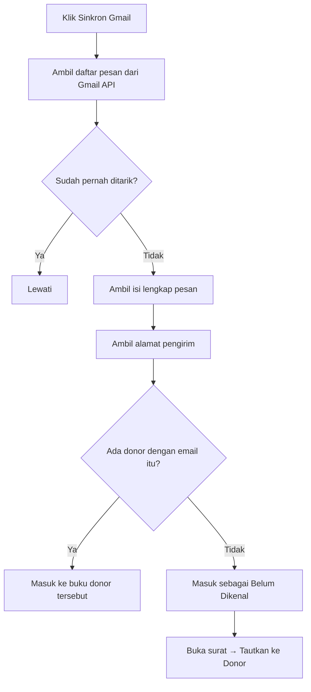

# Rencana Kerja — Aplikasi Kelola Surat & Email Donor (Kartidaya)

> Dokumen ini adalah rencana kerja sebelum pembuatan aplikasi.
> Sumber data: **`data.xlsx`** (sheet `Utama` + `Detail`).
> `data excel.jpeg` **tidak dipakai** karena banyak data ganda dan penempatan tidak konsisten.

---

## 1. Tujuan Aplikasi

Aplikasi demo berbasis **HTML + CSS + JS** (tanpa build, tanpa framework) untuk:

1. **Menyimpan data donor** (form isi seperti di Excel).
2. **Mengelola kategori** donor (5 kategori awal, bisa ditambah).
3. **Membuat & mengirim surat/email** ke banyak penerima sekaligus memakai template.
4. **Buku terima & kirim per donor** — setiap ID punya buku sendiri berisi surat
   keluar dan masuk, mirip Outlook tetapi disesuaikan kebutuhan perusahaan.
5. **Kirim & terima email sungguhan** lewat akun `@gmail.com` (Gmail API + OAuth).

Target jalan: **HP Android** dan **PC** (Chrome/Edge/Firefox).
Penyimpanan data: **localStorage** browser (demo, tanpa database).

### Dua mode operasi

| Mode | Syarat | Kemampuan |
|---|---|---|
| **Simulasi** | Tidak ada | Surat dicatat sebagai *Terkirim* di buku donor; surat masuk dicatat manual |
| **Gmail aktif** | Client ID + login Google | Kirim email sungguhan; tarik surat masuk dari inbox Gmail |

Mode simulasi membuat aplikasi **langsung bisa didemokan** tanpa menyiapkan apa pun.

---

## 2. Data yang Sudah Ada (`data.xlsx`)

### Sheet `Utama` — 18 baris data, 7 kolom

| Kolom | Isi |
|---|---|
| ID-DONOR | `L00024R`, `I00017U`, `G00009R`, … |
| KATEGORI | Member Support, Church Local, Indvidual - Local, Organization |
| PIC | Linda Lau, Kamlesh, Rany, … (bisa kosong) |
| INSTANSI | International English, GKKK Permatry, … (bisa kosong) |
| email | lindalau_T1@yahoo.co.id, … |
| HP 1 | 0896-8888-1899, … |
| HP 2 | 0819-3140-7040, … (hanya 1 baris terisi) |

### Sheet `Detail` — 5 baris, 3 kolom
`ID Donor | Email | HP` — hanya 2 baris terisi, dan isinya **duplikat** dari sheet `Utama`
(contoh: `Lindalau_T1@yahoo.co.id` vs `lindalau_T1@yahoo.co.id`, `volta@iesjakarta` vs `volta@iesjakarta.org`).

**Keputusan:** sheet `Detail` **tidak dipakai** sebagai sumber data. Cukup `Utama`.
Sheet `Detail` hanya berguna sebagai catatan bahwa pernah ada input email/HP terpisah.

### Kolom lengkap dari file Excel asli (terlihat di `_hdr*.png`)

`ID Donor | Kategori Donor | PIC | Nama Lengkap | Nama Instansi | Email | No HP | Date Start | Asal Gereja | Alamat Lengkap | Tgl Lahir | Pengiriman melalui POS/WA/…`

Kolom di atas dipakai sebagai **daftar field form**, tetapi hanya kolom yang ada di `data.xlsx`
yang diisi data awal. Sisanya kosong dan siap diisi user.

---

## 3. Kategori

Dari filter Excel (`Kategori.jpeg`) ditemukan: `Church - Local`, `Church Local`,
`Funder - Foreign`, `Individual - Local`, `Member Support`, `Organization`, `(Blanks)`.

`Church - Local` dan `Church Local` adalah **duplikat penulisan** → digabung.

**5 kategori awal (final):**

1. `Member Support`
2. `Church Local`
3. `Individual - Local`
4. `Funder - Foreign`
5. `Organization`

Kategori disimpan di localStorage sebagai **daftar terpisah** sehingga user bisa
**tambah / ubah nama / hapus** tanpa mengubah kode.

---

## 4. Aturan ID-DONOR

Format: **`[X]99999[Z]`**

| Bagian | Aturan |
|---|---|
| `[X]` | 1 huruf. Ambil **huruf pertama INSTANSI** (kapital). Jika instansi kosong → ambil **huruf pertama PIC**. Jika keduanya kosong → `X`. |
| `99999` | **Counter 5 digit** (zero-padded). Counter dihitung **per huruf X**. Nilai baru = counter tertinggi yang sudah ada untuk huruf itu **+ 1**. |
| `[Z]` | 1 huruf **suffix**. Artinya belum diketahui pasti (di data lama muncul `R` dan `U`). **User bisa isi manual**; default `R`. |

Contoh dari data lama:

| ID | PIC | Instansi | X dari | Counter |
|---|---|---|---|---|
| `L00024R` | Linda Lau | — | **L**inda | 24 |
| `I00017U` | Kamlesh | International English | **I**nternational | 17 |
| `G00009R` | Rany | GKKK Permatry | **G**KKK | 9 |
| `Y00002R` | Setiyani | Yay Misi Parousia | **Y**ay | 2 |
| `H00030R` | — | Hope Special Need | **H**ope | 30 |

Catatan: data lama tidak konsisten (`P0003U` hanya 4 digit). Aplikasi akan
**menormalkan ke 5 digit** (`P00003U`) untuk data baru.

---

## 5. Field Form Isi Data

### Wajib
- `Kategori` (dropdown dari daftar kategori)
- `PIC` **atau** `Instansi` (minimal salah satu terisi)
- `Email`

### Opsional
- `Panggilan` — **field baru**: `Ibu` / `Bapak` / `Saudara` / `Saudari`
- `Nama Lengkap`
- `Instansi` (boleh kosong)
- `HP 1`, `HP 2`
- `Date Start`, `Asal Gereja`, `Alamat Lengkap`, `Tgl Lahir`
- `Pengiriman melalui` — `Email` / `WA` / `POS` / `Lainnya`
- `Catatan`

### Otomatis
- `ID-DONOR` — dibuat otomatis, tapi bisa **di-override manual** (tombol "Ubah ID").

---

## 6. Template Surat & Placeholder

User menulis isi surat di editor, lalu menyisipkan token. Sistem mengganti token
**per penerima** saat pratinjau/kirim.

| Token | Hasil |
|---|---|
| `{/PIC}` | Panggilan + nama PIC → `Ibu Linda Lau` |
| `{/PANGGILAN}` | `Ibu` / `Bapak` / `Saudara` / `Saudari` |
| `{/NAMA}` | Nama PIC tanpa panggilan → `Linda Lau` |
| `{/INST}` | Nama instansi → `GKKK Permatry` |
| `{/NAMA_LENGKAP}` | Nama lengkap |
| `{/ID}` | ID-DONOR |
| `{/KATEGORI}` | Kategori donor |
| `{/EMAIL}` | Email penerima |
| `{/HP}` | HP 1 |
| `{/TANGGAL}` | Tanggal hari ini (format Indonesia) |

Contoh:

```
Kepada Yth.
{/PIC}
{/INST}

Dengan hormat,
...
```

Hasil untuk Linda Lau:

```
Kepada Yth.
Ibu Linda Lau

Dengan hormat,
...
```

Fitur pendukung:
- **Tombol token** untuk menyisipkan token ke posisi kursor.
- **Pratinjau per penerima** (pilih donor → lihat hasil jadi).
- **Pilih banyak penerima** (checkbox) → kirim sekaligus.
- **Simpan template** (tambah/ubah/hapus) di localStorage.
- **Kirim**:
  - Gmail aktif → dikirim sungguhan lewat Gmail API, tercatat `Terkirim`.
  - Mode simulasi → hanya dicatat `Terkirim` di buku donor.
  - Bisa juga disimpan sebagai `Draft`.
- **Cetak** surat per penerima (`window.print()`).

---

## 7. Buku Terima & Kirim per Donor

**Inti aplikasi.** Setiap ID donor punya **buku sendiri** — daftar surat keluar dan
masuk yang tercampur urut waktu, seperti percakapan di Outlook.

### Field satu surat

| Field | Isi |
|---|---|
| `arah` | `keluar` (terkirim) / `masuk` (terima) |
| `tanggal` | waktu kirim/terima (ISO) |
| `subjek` | judul surat (sudah disubstitusi token) |
| `isi` | isi surat lengkap |
| `status` | Keluar: `Draft` / `Terkirim` / `Gagal` · Masuk: `Belum dibaca` / `Dibaca` / `Dibalas` |
| `from` / `to` / `cc` | alamat email |
| `gmailId` / `threadId` | ID dari Gmail (untuk cegah duplikat saat sinkron) |
| `lampiran` | nama file (catatan) |
| `catatan` | keterangan tambahan |
| `dibaca` | boolean, untuk penanda belum dibaca |

### Arti status surat masuk

| Status | Arti | Warna chip | Kapan berubah |
|---|---|---|---|
| **Belum dibaca** | Email baru, belum pernah dibuka | kuning (`st-baru`) | Otomatis saat surat ditarik dari Gmail |
| **Dibaca** | Email sudah dibuka | biru (`st-dibaca`) | Otomatis saat surat dibuka, atau disetel manual |
| **Dibalas** | Sudah dikirimi balasan | hijau (`st-dibalas`) | Otomatis setelah balasan terkirim, atau disetel manual |

Status bisa diubah manual lewat dropdown **Status surat** di dalam modal surat
masuk. Menyetel ke *Belum dibaca* membuat surat itu dihitung lagi di badge
**Belum Dibaca**.

**Gunanya:** menyaring dan memantau pekerjaan. Dropdown **Semua status** di
Kotak Masuk bisa menyaring *Belum dibaca* (surat yang belum ditangani) atau
*Dibalas* (memastikan semua sudah dijawab). Chip berwarna membuat status terlihat
sekilas tanpa membuka surat.

### Tampilan

- **Buku donor** — klik kartu donor → semua suratnya urut waktu, bubble kiri (masuk)
  dan kanan (keluar). Tombol: *Tulis ke Donor*, *Catat Surat Masuk*, *Ubah Data*.
- **Kotak Masuk** (global) — semua surat masuk dari seluruh donor, bisa dicari &
  difilter status/donor. Surat belum dibaca ditandai garis aksen + badge di navigasi.
- **Kotak Keluar** (global) — semua surat keluar.
- **Belum Dikenal** — surat masuk dari alamat yang tidak cocok dengan donor mana pun.
  Bisa **ditautkan** ke donor; email pengirim sekaligus bisa disimpan ke data donor.
- **Kartu donor** menampilkan ringkasan `↑n ↓n` (jumlah keluar/masuk) dan aktivitas terakhir.

### Sinkron Gmail



Pencocokan memakai **alamat email** (case-insensitive). Surat yang sudah pernah
ditarik dikenali dari `gmailId` sehingga tidak dobel.

---

## 8. Struktur Halaman (UI)

Aplikasi satu halaman dengan navigasi bawah (mobile) / samping (desktop):

1. **Beranda** — total donor, belum dibaca, surat keluar, status Gmail, status
   WhatsApp, kotak masuk terbaru, donor per kategori, aktivitas terbaru, aksi cepat.
2. **Masuk** — kotak masuk global (cari, filter status, filter donor, filter
   kanal, sinkron Gmail, sinkron WhatsApp).
3. **Keluar** — kotak keluar global.
4. **Donor** — daftar + cari + filter kategori + urut; tombol `+ Tambah`.
5. **Buku Donor** — buku terima & kirim satu donor (dibuka dari kartu donor).
6. **Tulis** — pemilih kanal (Email/WhatsApp), template, token, penerima
   (multi-pilih), pratinjau, kirim/draft/cetak.
7. **Kategori** — kelola kategori.
8. **Setelan** — Gmail (Client ID, hubungkan, sinkron, putuskan), WhatsApp
   (alamat Worker, kunci aplikasi, uji sambungan, sinkron otomatis), tanda
   tangan, tema, ekspor/impor JSON, ekspor CSV, muat data contoh, reset, uji
   generator ID.

---

## 9. Desain UI

Referensi: kategori **minimal** di [awwwards.com](https://www.awwwards.com/websites/minimal/).
Situs yang dipelajari: `concretaceramiche.it`, `nader.io`, `billcreates.tech`, `fastsocial.co`.

Prinsip (sesuai permintaan: **jangan terlalu banyak main warna**):

- **1 warna aksen saja**, sisanya netral.
- Banyak ruang kosong, garis tipis, sudut kecil (radius 8–10px).
- Tipografi sebagai pembawa karakter, bukan warna.
- Angka/ID memakai **monospace** agar rapi sejajar.

### Palet

| Peran | Nilai |
|---|---|
| Latar | `#f5f5f0` (off-white) |
| Permukaan / kartu | `#ffffff` |
| Teks utama | `#161616` |
| Teks sekunder | `#6b6b6b` |
| Garis | `#e3e3dc` |
| **Aksen (tunggal)** | `#1f6f5c` (hijau tua kalem) |
| Aksen lembut | `#e8f0ed` |
| Bahaya | `#a33a2c` (hanya untuk hapus/gagal) |

Mode gelap: latar `#111312`, permukaan `#191c1b`, teks `#eeeedc`, aksen tetap `#55d1c5`.

### Tipografi

- UI: system font stack (`-apple-system, Segoe UI, Roboto, …`) — **tanpa internet**, aman di Android.
- ID / angka / token: `ui-monospace, "IBM Plex Mono", Consolas, monospace`.

### Responsif

- Mobile-first. Navigasi bawah (bottom bar) di layar < 860px, sidebar di layar besar.
- Tabel donor berubah jadi kartu di layar kecil.
- Target sentuh minimal 44px.
- Grid memakai `minmax(min(230px,100%),1fr)` + `.grid > *{min-width:0}` agar tidak
  ada overflow horizontal di layar sempit (diuji 320–1440px).

---

## 10. Teknis

| Aspek | Keputusan |
|---|---|
| File | **Multi-file**: `index.html` + `app.css` + `app.js` + `gmail.js` |
| Penyimpanan | `localStorage` (key: `kartidaya.v2.*`) |
| Data awal | 18 donor dari `data.xlsx` di-embed sebagai seed |
| Framework | Tanpa framework (vanilla JS) |
| Hosting | **GitHub Pages** (`https://suwandhih.github.io/kartidaya/`) |
| Server lokal | **`serve.bat`** → `serve.py` (Python `http.server`, port 8080) |
| Ekspor | JSON (backup/restore) + CSV (buka di Excel) |
| Cetak | `window.print()` untuk cetak surat |
| Email | **Gmail API + OAuth 2.0** (Google Identity Services, alur token) |

### Kenapa perlu origin https / localhost?

Google **menolak** origin `file://` untuk OAuth. Origin yang diterima:

- `https://` apa pun — termasuk GitHub Pages
- `http://localhost` / `http://127.0.0.1`

Karena itu aplikasi di-host di GitHub Pages (juga bisa dibuka dari HP Android
tanpa PC menyala), dan `serve.bat` disediakan untuk pemakaian lokal.

### Kenapa multi-file?

`gmail.js` dipisah karena berisi integrasi pihak ketiga (Google) yang berdiri
sendiri; `app.css` dipisah agar gaya mudah ditinjau tanpa membaca logika.

### Scope OAuth

```
https://www.googleapis.com/auth/gmail.send
https://www.googleapis.com/auth/gmail.readonly
https://www.googleapis.com/auth/userinfo.email
```

Alur **token** (bukan authorization code) dipilih karena **tidak butuh Client
Secret** — aman untuk aplikasi yang seluruhnya jalan di browser.

### Kunci localStorage
- `kartidaya.v2.donors`
- `kartidaya.v2.categories`
- `kartidaya.v2.templates`
- `kartidaya.v2.messages`
- `kartidaya.v2.settings`

---

## 11. Urutan Pengerjaan

**Fase 1 — Aplikasi inti**
- [x] Baca & verifikasi `data.xlsx`
- [x] Kumpulkan referensi desain (Awwwards minimal)
- [x] Tulis `rencanakerja.md` (dokumen ini)
- [x] Struktur + CSS (palet & tipografi)
- [x] Data layer: seed 18 donor, kategori, localStorage
- [x] Halaman Donor: daftar, cari, filter, tambah/ubah/hapus
- [x] Generator ID-DONOR `[X]99999[Z]`
- [x] Halaman Kategori (tambah/ubah/hapus)
- [x] Halaman Tulis Surat: template, token, pratinjau, kirim massal
- [x] Beranda (dashboard)
- [x] Setelan: ekspor/impor JSON, ekspor CSV, reset
- [x] Uji di layar HP (320–414px) & PC (768–1440px)

**Fase 2 — Buku terima & kirim + Gmail**
- [x] Pisah jadi `index.html` + `app.css` + `app.js` + `gmail.js`
- [x] `serve.py` + `serve.bat` (server lokal, threaded, LAN)
- [x] `gmail.js`: OAuth, kirim, daftar pesan, ambil pesan, urai MIME
- [x] Model data `messages` (satu buku per donor)
- [x] Halaman **Buku Donor** (bubble masuk/keluar)
- [x] Halaman **Kotak Masuk** & **Kotak Keluar** global
- [x] **Catat Surat Masuk** manual (mode simulasi)
- [x] **Tautkan surat tak dikenal** ke donor
- [x] **Sinkron Gmail** + pencocokan otomatis lewat email
- [x] Setelan Gmail: Client ID, hubungkan, sinkron, putuskan
- [x] `PANDUAN-GMAIL.md` (panduan Google Cloud Console langkah demi langkah)
- [x] Uji: kirim simulasi, catat masuk, tautkan, ekspor, tema, responsif

**Fase 3 — Publikasi**
- [x] `.gitignore` — `data.xlsx` & screenshot data tidak ikut ter-commit
- [x] `README.md`
- [x] Repo publik `suwandhih/kartidaya`
- [x] **GitHub Pages** aktif di `https://suwandhih.github.io/kartidaya/`
- [x] Dukung origin `https://` untuk OAuth (bukan hanya localhost)
- [x] Halaman Setelan menampilkan origin yang perlu didaftarkan

**Fase 4 — WhatsApp Cloud API**
- [x] `worker/index.js` — Cloudflare Worker (kirim, webhook, antrean KV, anti-duplikat)
- [x] `worker/wrangler.toml` — konfigurasi deploy + binding KV
- [x] `whatsapp.js` — pembungkus sisi browser (bentuk API mirip `Gmail`)
- [x] Field `kanal` pada pesan (`email` / `whatsapp`)
- [x] Pencocokan donor lewat nomor HP (`donorByPhone`, `donorWa`)
- [x] Pemilih kanal di halaman **Tulis** + pratinjau gelembung WhatsApp
- [x] Kirim WhatsApp dari aplikasi (`kirimSurat` bercabang per kanal)
- [x] Terima WhatsApp: `waSync()` + `waSinkronOtomatis()` + tombol sinkron
- [x] Filter kanal & chip kanal di Kotak Masuk dan buku donor
- [x] Kartu **WhatsApp** di Setelan (alamat Worker, kunci, uji sambungan)
- [x] **Catat Surat Masuk** dengan pilihan kanal
- [x] `PANDUAN-WHATSAPP.md`
- [x] Deploy Worker ke Cloudflare — `https://kartidaya-wa.suwandhih.workers.dev`
- [x] Setup Meta Business + nomor WhatsApp Business (nomor uji `+1 (555) 173-4967`)
- [x] Daftarkan webhook di Meta (field `messages` ter-subscribe)
- [x] Lacak status kirim (`statuses` → KV → chip **Gagal** + alasan)
- [ ] Uji kirim/terima WhatsApp sungguhan — **terblokir `130497`**: akun bisnis
      belum lulus verifikasi, jadi Meta menolak kirim ke nomor Indonesia.
      Perlu: profil bisnis lengkap (`131000`), verifikasi bisnis (`141010`),
      metode pembayaran (`141006`), lalu nomor WhatsApp Business sungguhan.
      Rincian di bagian 14.

---

## 12. Hal yang Masih Perlu Dikonfirmasi

1. **Arti huruf terakhir `[Z]`** pada ID-DONOR (`R` / `U`). Sementara: bisa diisi manual, default `R`.
2. Apakah **counter** ID dihitung per huruf (keputusan saat ini) atau global.
3. Apakah perlu **login / multi-user** (saat ini tidak, karena demo tanpa server).
4. **Alamat Gmail** yang akan dipakai — **`fotohotono03@gmail.com`** (ditetapkan
   5 Nov 2026). Alamat ini harus didaftarkan di **Test users**.
5. Apakah perlu **lampiran file** sungguhan (saat ini hanya catatan nama file).
6. Apakah perlu **balas semua / teruskan** (belum dibuat; saat ini hanya *Balas*).
7. Apakah perlu **template HTML** (berformat tebal/miring), bukan teks biasa.
8. **Data donor di `app.js`** — 18 nama/email/HP asli ikut ter-publish di repo
   publik. User menyetujui karena aplikasi hanya dipakai sementara di GitHub;
   nanti akan dipindah ke hosting sendiri. Kalau perlu, pindahkan ke `seed.js`
   yang di-gitignore.

---

## 13. Status Terakhir & Langkah Berikutnya

*Diperbarui: 5 November 2026, 14:45 WIB*

### Akar masalah `access_denied` — SUDAH DITEMUKAN & DIPERBAIKI

Penyebab sebenarnya **bukan** Test users. Client ID lama
(`205859365311-…`) milik **project Google Cloud lain** yang tidak bisa diakses
akun `suwandhih@gmail.com`:

| | |
|---|---|
| Client ID lama | `205859365311-…` → project **205859365311** |
| Akses akun ini | ❌ *"You need additional access to the project: 205859365311"* |
| Project `Kartidaya` milik user | `kartidaya-513714` → nomor **531116872278** |
| Kondisi project itu | ❌ *"Google Auth Platform not configured yet"* — belum ada OAuth client |

Jadi Test user selama ini ditambahkan di project yang **tidak memiliki OAuth
client**, sehingga tidak berpengaruh sama sekali.

### Yang sudah dikerjakan 5 Nov 2026 (lewat Cloud Console)

Semua di project **`kartidaya-513714`**:

- [x] Konfigurasi Google Auth Platform dibuat (App name `Kartidaya`,
      tipe **External**)
- [x] **OAuth Client ID baru** dibuat — `Kartidaya Web`, tipe *Web application*
- [x] Authorized JavaScript origin: `https://suwandhih.github.io`
- [x] **Gmail API diaktifkan**
- [x] **Data Access**: `gmail.send` (sensitive) + `gmail.readonly` (restricted)
      → *"Data access changes saved!"*
- [x] **Test users**: `fotohotono03@gmail.com` ditambahkan → **Save**
- [x] **Developer contact** diubah jadi **hanya `fotohotono03@gmail.com`**
      (`suwandhih@gmail.com` dihapus) → *"Branding changes saved!"*
- [x] **IAM**: `fotohotono03@gmail.com` diberi role **OAuth Config Editor**
      agar bisa membuka project ini sendiri
- [x] Client ID baru dipasang di halaman Setelan aplikasi
- [x] Diverifikasi: alur GIS Google menerima Client ID + origin baru
      (redirect ke halaman login, bukan `invalid_client` / `origin_mismatch`)

> **Kebijakan email:** `suwandhih@gmail.com` adalah email pribadi dan
> **tidak boleh dipakai** untuk aplikasi ini. Semua konfigurasi yang bisa
> diubah sudah dipindah ke `fotohotono03@gmail.com`.
>
> Satu pengecualian yang **tidak bisa** diubah: field **User support email**
> di halaman Branding hanya menerima akun yang sedang login di browser.
> Karena project ini dibuat dari akun `suwandhih@gmail.com`, field itu masih
> menampilkan email tersebut. Ini hanya alamat kontak yang tampil di layar
> izin Google — **tidak memengaruhi pengiriman email**, dan tidak dipakai
> aplikasi sama sekali. Untuk menggantinya sepenuhnya, project harus dibuat
> ulang dari akun `fotohotono03@gmail.com`.

**Client ID yang dipakai sekarang:**

```
531116872278-hep5meju0djk30qrsee5ec4np2t895qo.apps.googleusercontent.com
```

> Client secret `GOCSPX-…` **tidak dipakai** aplikasi ini (alur token GIS).
> Jangan pernah menaruhnya di kode.

### Perbaikan lanjutan — Client ID lama masih terpakai

Setelah konfigurasi Google selesai, error `access_denied` **masih muncul**.
Penyebabnya: browser masih menyimpan **Client ID lama** (`205859365311-…`) di
`localStorage`, dan `app.js` juga masih tersimpan di cache browser.

Perbaikan yang ditambahkan:

- [x] `DEFAULT_CLIENT_ID` — Client ID project Kartidaya dipakai sebagai nilai awal
- [x] **Migrasi otomatis** — Client ID berawalan `205859365311-` diganti otomatis
      saat aplikasi dimuat
- [x] Halaman Setelan menampilkan **Client ID yang benar-benar dipakai**
- [x] Tombol **Pakai Client ID bawaan** untuk reset manual
- [x] Peringatan di Setelan kalau Client ID bukan milik project Kartidaya
- [x] **Cache-busting** `app.js?v=3` & `gmail.js?v=3` di `index.html`

Diverifikasi: dengan `localStorage` sengaja diisi Client ID lama, aplikasi
otomatis menggantinya ke Client ID project Kartidaya saat dimuat.

### Yang belum selesai

| # | Tugas | Keterangan |
|---|---|---|
| 1 | Uji **kirim email sungguhan** | ✅ SELESAI — Ferry Kangsadjaja menerima surat dari `fotohotono03@gmail.com` |
| 2 | Uji **pembaruan sesi otomatis** terhadap Google sungguhan | Butuh sesi login nyata; jalur kode sudah diverifikasi dengan stub |
| 3 | Ajukan **verifikasi OAuth** ke Google | Menghapus batas 7 hari & batas Test user (opsional) |
| 4 | Uji **sinkron otomatis** terhadap Gmail sungguhan | Logika & pemicu sudah diverifikasi; tinggal dilihat di akun asli |
### Hubungkan Gmail — BERHASIL (5 Nov 2026, 15:28 WIB)

`fotohotono03@gmail.com` **sudah berhasil terhubung**. Akar masalahnya ada dua,
keduanya sudah diperbaiki:

1. Client ID lama milik project lain → diganti Client ID project `kartidaya-513714`
2. Browser masih memakai `app.js` dari cache + Client ID lama di localStorage
   → ditambah migrasi otomatis dan cache-busting

Perbaikan tambahan setelah terhubung:

- [x] Header `From` diperkuat — kalau profil Gmail belum terbaca, header
      dihilangkan dan Gmail mengisi sendiri (sebelumnya `From: me` ditolak Gmail)
- [x] `app.js?v=4` & `gmail.js?v=4`

### Terima surat — BERHASIL (5 Nov 2026, 15:51 WIB)

Email dari `suwandhih@gmail.com` **berhasil masuk** ke buku donor
**Ferry Kangsadjaja** (`F00004R`).

Kendala yang ditemukan & diperbaiki:

- Surat sudah ditarik sebagai **Belum Dikenal** karena email donor Ferry masih
  `ferryk@indo.net.id` (data awal Excel), bukan `suwandhih@gmail.com`
- **Bug:** surat yang sudah masuk sebagai Belum Dikenal **tidak pernah** pindah
  ke buku donor walau email donornya kemudian diisi
- **Perbaikan:** Sinkron Gmail otomatis mencocokkan ulang, plus tombol
  **⇄ Cocokkan ulang** di Kotak Masuk (`app.js?v=5`)

Diverifikasi: setelah email donor diisi, klik **Cocokkan ulang** → surat pindah
ke buku Ferry, counter jadi **↓1 masuk**.

### Status surat masuk bisa diubah — SELESAI (5 Nov 2026)

**Masalah yang dilaporkan:** status surat masuk tidak bisa diubah — tidak ada
tempat untuk mengubahnya setelah surat tersimpan.

**Akar masalah:** status hanya bisa disetel saat surat **dibuat** (Catat Surat
Masuk, atau otomatis oleh Sinkron Gmail). Di modal surat, status hanya tampil
sebagai chip read-only. Selain itu, membuka surat hanya mengubah flag `dibaca`
tetapi **tidak** menaikkan `status` dari *Belum dibaca* ke *Dibaca*, sehingga
surat yang sudah dibuka tetap terlihat "Belum dibaca".

**Perbaikan (`app.js?v=7`):**

- [x] Dropdown **Status surat** di modal surat masuk — bisa pilih
      *Belum dibaca* / *Dibaca* / *Dibalas*, langsung tersimpan
- [x] Membuka surat *Belum dibaca* otomatis menaikkan status ke *Dibaca*
- [x] Mengirim balasan otomatis menandai surat masuk terakhir donor itu sebagai
      *Dibalas*
- [x] Chip status diberi warna: hijau = *Belum dibaca*, abu-abu = *Dibaca* /
      *Dibalas*, merah = *Gagal*
- [x] Menyetel ke *Belum dibaca* ikut memperbarui badge **Belum Dibaca** di menu

Diverifikasi di browser: buka surat → status naik ke *Dibaca*; ganti ke
*Dibalas* → tersimpan; ganti ke *Belum dibaca* → badge naik; kirim balasan →
surat masuk jadi *Dibalas*.

### Kirim surat tercatat "Terkirim" tapi email tidak sampai — SELESAI (5 Nov 2026)

**Masalah yang dilaporkan:** surat untuk Ferry Kangsadjaja ditandai `00005` dan
dikirim, tetapi emailnya tidak pernah sampai.

**Akar masalah:** Gmail **belum terhubung** saat surat dikirim. Aplikasi
diam-diam beralih ke **mode simulasi** — surat hanya dicatat `Terkirim` di buku
donor, emailnya tidak pernah dikirim. Bukti dari data pengguna:

| Surat | `status` | `gmailId` | Artinya |
|---|---|---|---|
| Terima kasih — Ferry Kangsadjaja (09:24) | `Terkirim` | *(kosong)* | tidak dikirim |
| Terima kasih — Ferry Kangsadjaja (09:26) | `Terkirim` | *(kosong)* | tidak dikirim |

`gmailId` kosong = Gmail API tidak pernah dipanggil.

**Dua penyebab Gmail "belum terhubung":**

1. **Token tidak disimpan.** Token hanya ada di memori (`Gmail.token`), jadi
   setiap halaman dimuat ulang koneksi hilang. Pengguna menghubungkan Gmail,
   lalu refresh / pindah halaman → kembali ke mode simulasi tanpa sadar.
2. **Mode simulasi tidak pernah dikonfirmasi.** `kirimSurat()` langsung
   mencatat `Terkirim` tanpa memberi tahu bahwa email tidak dikirim.

**Perbaikan (`app.js?v=8` & `gmail.js?v=8`):**

- [x] Token Gmail disimpan di `sessionStorage` (`kartidaya.gmail.session`) dan
      dipulihkan otomatis saat halaman dimuat — refresh tidak lagi memutus
      koneksi. Dipilih `sessionStorage` (bukan `localStorage`) supaya token
      hilang saat tab ditutup.
- [x] Token kedaluwarsa / `401` / *Putuskan* otomatis menghapus sesi tersimpan
- [x] `kirimSurat()` menampilkan **konfirmasi** kalau Gmail belum terhubung —
      pengguna diberi tahu email tidak akan terkirim dan bisa membatalkan
- [x] Donor tanpa email saat Gmail aktif → status `Gagal` dengan pesan jelas
      (sebelumnya ikut dicatat `Terkirim`)

Diverifikasi di browser: token dipulihkan dari `sessionStorage`; token
kedaluwarsa tidak dipulihkan; *Putuskan* membersihkan sesi; kirim tanpa Gmail
menampilkan konfirmasi dan tidak mencatat apa pun bila dibatalkan; donor tanpa
email menghasilkan status `Gagal`.

### Sesi Gmail diperbarui otomatis — SELESAI (5 Nov 2026)

**Permintaan pengguna:** *"apakah ada cara secara otomatis sistem menghitung
waktu untuk menghubung email secara otomatis jadi user menggunakan tidak perlu
was was untuk hubungkan gmail .. bentar2 hubungkan gmail .. ada cara tidak"*

**Jawaban: bisa.** Token diperbarui sendiri di latar belakang tanpa jendela izin.

**Desain (`app.js?v=9` & `gmail.js?v=9`):**

| Bagian | Fungsi |
|---|---|
| `Gmail.msLeft()` | Sisa umur token dalam milidetik (0 kalau tidak ada token) |
| `Gmail.renew()` | Perbarui token senyap lewat `initTokenClient({ prompt: '' })` + `requestAccessToken({ prompt: '' })`; timeout pengaman 15 detik; simpan ke `sessionStorage`; ambil profil kalau `email` masih kosong |
| `Gmail.ensureConnected()` | `true` langsung kalau sisa > 5 menit; kalau tidak, coba `renew()` dulu |
| `jagaSesiGmail()` | Penjaga latar belakang: perbarui kalau sisa ≤ 10 menit |
| `sisaWaktu(ms)` | Format sisa waktu: *habis* / *kurang dari 1 menit* / *N menit* / *N jam M menit* |

**Kapan penjaga berjalan:**

- `setInterval(jagaSesiGmail, 5 * 60 * 1000)` — tiap 5 menit selama aplikasi terbuka
- `visibilitychange` — saat tab kembali aktif
- sekali saat aplikasi dimuat
- `kirimSurat()` dan `gmailSync()` memanggil `ensureConnected()` lebih dulu

**Kalau pembaruan gagal** (sesi login Google sudah berakhir): muncul pesan
*"Sesi Gmail perlu diperbarui — buka Setelan lalu klik Hubungkan Gmail"*
**sekali saja** (dijaga flag `_gmailPeringatan`), tidak berulang tiap 5 menit.

**Tampilan:** kartu Gmail di **Setelan** menampilkan *"Sesi diperbarui otomatis
di latar belakang. Sisa waktu token: …"* (`id="g-sisa"`).

**Batas yang jujur:** pembaruan senyap hanya berhasil selama pengguna masih
punya sesi login Google di browser itu. Kalau sesi Google berakhir — atau setelah
**7 hari** karena aplikasi masih berstatus *Testing* — satu kali klik
**Hubungkan Gmail** tetap diperlukan. Batas 7 hari ini hilang kalau aplikasi
diajukan verifikasi ke Google.

**Verifikasi di browser (dengan Google Identity Services di-stub):**

| Uji | Hasil |
|---|---|
| `renew()` dengan `prompt: ''` | `ok: true`, token & email terisi, tersimpan di `sessionStorage` ✅ |
| `renew()` memakai scope benar | `gmail.send` + `gmail.readonly` ✅ |
| `ensureConnected()` sisa 1 jam | tidak memanggil `renew()` ✅ |
| `ensureConnected()` sisa 1 menit | memanggil `renew()` ✅ |
| `jagaSesiGmail()` sisa 30 menit | tidak memperbarui ✅ |
| `jagaSesiGmail()` sisa 5 menit | memperbarui ✅ |
| `jagaSesiGmail()` tanpa token | tidak memperbarui (belum pernah login) ✅ |
| `jagaSesiGmail()` gagal | pesan muncul sekali, percobaan kedua senyap ✅ |
| `sisaWaktu()` | `1 jam 0 menit` / `habis` / `kurang dari 1 menit` ✅ |
| Kartu Setelan | menampilkan *Sisa waktu token: 41 menit* ✅ |

> Yang **belum** bisa diuji otomatis: `renew()` terhadap Google sungguhan —
> butuh sesi login nyata. Kalau Google menolak, jalur gagal di atas yang aktif.

### Sinkron otomatis — SELESAI (5 Nov 2026)

**Permintaan pengguna:** *"termasuk sinkron sekarang .. user jg tidak perlu bolak
balik setelan, untuk sinkron"*

**Desain (`app.js?v=10`):**

| Bagian | Fungsi |
|---|---|
| `gmailSync({ silent:true })` | Sinkron tanpa pesan *"Menarik surat masuk…"* dan tanpa pesan *"Tidak ada surat baru"* |
| `sinkronOtomatis(paksa)` | Penjaga: lewati kalau `autoSync` mati, Gmail belum diatur, belum pernah login, atau jarak belum lewat |
| `state.settings.autoSync` | Bawaan `true` |
| `state.settings.syncMinutes` | Bawaan `10` menit (1–240) |
| `state.settings.lastSync` | Diisi setiap sinkron berhasil — dipakai sebagai gerbang jarak |
| `_syncJalan` | Penanda anti-tumpang-tindih, dengan jaring pengaman `Promise.race` 60 detik |

**Kapan berjalan:**

- `setTimeout(sinkronOtomatis, 3000)` saat aplikasi dimuat (jeda supaya token
  sempat dipulihkan lebih dulu)
- `setInterval(sinkronOtomatis, 60 * 1000)` — dicek tiap menit, tapi hanya
  benar-benar menarik kalau `syncMinutes` sudah lewat
- `visibilitychange` — saat tab kembali aktif

**UI:**

- **Setelan → Gmail**: tombol **Sinkron otomatis** (Aktif/Mati), input
  **Jarak antar sinkron otomatis**, dan **Terakhir sinkron**
- **Beranda**: baris *"Sinkron otomatis · baru saja"* + tombol **⟳ Sinkron sekarang**

**Verifikasi di browser:**

| Uji | Hasil |
|---|---|
| `autoSync` mati | tidak memanggil sinkron ✅ |
| Belum pernah sinkron | langsung menarik ✅ |
| Sinkron 1 menit lalu, jarak 10 menit | dilewati ✅ |
| Sinkron 11 menit lalu | ditarik ✅ |
| `paksa = true` | melewati gerbang jarak ✅ |
| Gmail belum diatur | dilewati ✅ |
| Belum pernah login | dilewati ✅ |
| Dua panggilan bersamaan | hanya satu yang jalan ✅ |
| Sinkron senyap, ada surat baru | pesan *"1 surat masuk baru"* ✅ |
| Sinkron senyap, tidak ada surat baru | **tanpa pesan** ✅ |
| Sinkron manual | pesan *"Menarik surat masuk…"* lalu *"Tidak ada surat baru"* ✅ |
| Muat ulang halaman | surat ditarik sendiri, `lastSync` terisi, badge Masuk jadi 1 ✅ |
| Tab kembali aktif | ditarik kalau jarak sudah lewat ✅ |
| Tab kembali aktif, baru saja sinkron | dilewati ✅ |
| Tombol Aktif/Mati | tersimpan di `localStorage`, input jarak hilang saat mati ✅ |
| Input jarak `9999` | dijepit ke `240` ✅ |

### Status surat masuk — diperjelas & 2 bug diperbaiki (5 Nov 2026)

**Pertanyaan pengguna:** *"status di ubah belum baca, dibaca dan dibalas tidak ada
beda .. kolom catat surat masuk tetap tidak ada informasi lain .. jadi fungsi ini
apa?"*

**Jawaban:** fungsinya menyaring & memantau pekerjaan — *Belum dibaca* = surat
yang belum ditangani, *Dibalas* = sudah dijawab. Tetapi memang ada **dua bug**
yang membuat status tampak tidak berguna:

| # | Bug | Akibat yang dilihat pengguna |
|---|---|---|
| 1 | `renderNav()` dipanggil, bukan `render()` | Chip di daftar Kotak Masuk **tidak ikut berubah** setelah status diubah — hanya chip di dalam modal yang berubah. Setelah modal ditutup, chip lama muncul lagi, seolah perubahan tidak tersimpan |
| 2 | `dibaca:true` dipaku di `catat-masuk-simpan` | Surat yang dicatat manual dengan status *Belum dibaca* **tidak pernah** dihitung di badge menu Masuk |

Ditambah dua masalah tampilan:

| # | Masalah | Akibat |
|---|---|---|
| 3 | `Dibaca` dan `Dibalas` sama-sama `chip plain` | Ketiga status **tidak bisa dibedakan** secara visual |
| 4 | Dropdown hanya berisi nama status | Tidak ada penjelasan artinya di UI |

**Perbaikan (`app.js?v=11`, `app.css?v=11`):**

- [x] `render()` dipanggil setelah status diubah → daftar Kotak Masuk dan buku
      donor langsung ikut berubah
- [x] `dibaca` mengikuti status saat mencatat surat masuk manual
- [x] Warna chip dibedakan tegas: `Belum dibaca` → **kuning** (`st-baru`),
      `Dibaca` → **biru** (`st-dibaca`), `Dibalas` → **hijau** (`st-dibalas`).
      Ditambah variabel `--st-baru`/`--st-dibaca`/`--st-dibalas` untuk tema
      terang & gelap. Versi pertama (`info`/`ok`) terlalu mirip sehingga
      pengguna masih menganggap "tampil sama saja" — diganti hue yang jauh
      berbeda plus garis tepi sewarna
- [x] Kartu surat belum dibaca diberi latar kuning tipis + garis kiri kuning
      (`.mail.unread`, `.bubble.in.unread`) supaya terlihat sekilas
- [x] Dropdown status menampilkan artinya: *"Dibalas — sudah dikirimi balasan"*
- [x] Keterangan singkat di bawah dropdown, baik di modal surat maupun di form
      **Catat Surat Masuk**
- [x] Chip status di **buku donor** memakai `statusChipClass()` (sebelumnya teks
      polos tanpa warna)
- [x] `app.css` ikut diberi `?v=` supaya perubahan warna tidak tertahan cache

**Verifikasi di browser:**

| Uji | Hasil |
|---|---|
| Ubah status di modal → chip di daftar di belakang modal | langsung berubah ✅ |
| Tutup modal → chip di daftar | tetap sesuai ✅ |
| `Dibalas` → chip `chip st-dibalas`; `Dibaca` → `chip st-dibaca`; `Belum dibaca` → `chip st-baru` | ✅ |
| Warna terang: kuning `#fdf3d7`/`#a16207`, biru `#e3edf8`/`#2f5d8a`, hijau `#e2f2e6`/`#2f6b3f` | ✅ |
| Warna gelap: kuning `#3a2f14`/`#f0c14b`, biru `#1b2530`/`#8fb6dd`, hijau `#1a2620`/`#8fc79c` | ✅ |
| Kartu belum dibaca → latar kuning + garis kiri kuning | ✅ |
| Setel ke `Belum dibaca` → `dibaca:false`, badge Masuk naik | ✅ |
| Catat manual status `Belum dibaca` → `dibaca:false`, badge naik | ✅ |
| Catat manual status `Dibaca` → `dibaca:true`, badge tidak naik | ✅ |
| Filter **Semua status** = `Belum dibaca` / `Dibalas` | menyaring dengan benar ✅ |
| Chip di buku donor | berwarna sesuai status ✅ |

### Cara menguji kirim

**Kirim (Tes 3):**

1. Menu **Donor** → **+ Tambah** → buat donor uji dengan email
   `fotohotono03@gmail.com` (kirim ke diri sendiri paling aman)
2. Menu **Tulis** → centang donor uji itu → **➤ Kirim**
3. Pesan sukses harus menyebut *"terkirim lewat Gmail"* (bukan *mode simulasi*)
4. Cek <https://mail.google.com> → **Sent** dan **Inbox**
5. Kalau status jadi **Gagal**, buka suratnya — pesan error Gmail ada di situ

**Terima (Tes 4) — sudah lolos:**

1. Kirim email **ke** `fotohotono03@gmail.com` dari akun lain
2. Menu **Masuk** → **⟳ Sinkron Gmail**
3. Surat muncul; cocok email donor → masuk buku donor, tidak cocok →
   **Belum Dikenal**
4. Klik Sinkron sekali lagi → jumlah **tidak bertambah** (anti-duplikat)

### Cara melanjutkan

1. Buka <https://suwandhih.github.io/kartidaya/> → **Setelan**
2. Pastikan baris *"Client ID yang benar-benar dipakai saat ini"* menampilkan
   `531116872278-…`. Kalau masih `205859365311-…`, klik
   **Pakai Client ID bawaan** (atau tekan `Ctrl+Shift+R` untuk buang cache)
3. Klik **Hubungkan Gmail**, lalu login dengan **`fotohotono03@gmail.com`**
4. Bila muncul *"Google hasn't verified this app"* → **Advanced** →
   **Go to Kartidaya (unsafe)** — normal untuk aplikasi Testing sendiri
5. Setelah status **Terhubung**: uji kirim email, lalu **⟳ Sinkron sekarang**
6. Cadangan lokal kalau perlu: `serve.bat` → <http://localhost:8080>

> Catatan: langkah login **tidak bisa** diotomasi — Google memblokir popup
> otomatis dan butuh kredensial akun. Sisanya sudah beres.

### Catatan penting

- **Client Secret tidak dipakai** aplikasi ini. Alur token Google Identity
  Services tidak memerlukan secret. Kalau secret pernah terlihat di screenshot,
  boleh di-reset — tidak akan memengaruhi aplikasi.
- **Token kedaluwarsa**: access token 1 jam, refresh token 7 hari (karena status
  masih *Testing*). Sejak `v9` token **diperbarui otomatis** di latar belakang,
  jadi klik *Hubungkan Gmail* hanya perlu kalau sesi login Google di browser
  sudah berakhir.
- **Data donor ada di `app.js`** (`SEED_DONORS`) dan ikut ter-publish. Lihat
  bagian 12 no. 8.

---

## 14. Integrasi WhatsApp — SELESAI (5 Nov 2026)

**Permintaan pengguna:** *"ok setelah ini mau masuk API whatsapp .. jadi bisa
interaksi lewat hp juga"* — dengan pilihan **konsep sepenuhnya sama dengan
email**, penyedia **Meta WhatsApp Cloud API**, backend **Cloudflare Worker**.

### Kenapa perlu backend

Aplikasi ini halaman statis di GitHub Pages. WhatsApp API **tidak bisa** dipakai
langsung dari browser karena dua hal:

| Masalah | Sebab |
|---|---|
| Token Meta | Kunci rahasia; kalau ada di `app.js`, siapa pun bisa membacanya lewat F12 |
| Webhook | Meta mengirim pesan masuk lewat **POST** ke URL publik; GitHub Pages tidak bisa menerima kiriman |

Karena itu ditambahkan **Cloudflare Worker** sebagai perantara. Browser hanya
menyimpan **alamat Worker** dan **kunci aplikasi** (`APP_KEY`) — keduanya tidak
berbahaya kalau bocor.

```
HP pengirim → Meta Cloud API → Worker (webhook) → KV antrean
                                                     │
Browser Kartidaya ←── GET /wa/inbox ─────────────────┘
Browser Kartidaya ──── POST /wa/send ────► Worker ────► Meta → HP tujuan
```

### Berkas baru

| Berkas | Isi |
|---|---|
| `worker/index.js` | Cloudflare Worker — endpoint `/wa/status`, `/wa/send`, `/wa/webhook` (GET verifikasi + POST pesan masuk), `/wa/inbox`, `/wa/ack` |
| `worker/wrangler.toml` | Konfigurasi deploy + binding KV `WA_INBOX` |
| `whatsapp.js` | Pembungkus sisi browser (objek `WhatsApp`), bentuk API sengaja mirip `Gmail` |
| `PANDUAN-WHATSAPP.md` | Panduan lengkap: setup Meta, deploy Worker, 9 uji, tabel masalah |

### Keamanan Worker

- Semua endpoint kecuali `/wa/webhook` wajib menyertakan header `X-App-Key`
- Perbandingan kunci memakai `sameKey()` — **constant-time**, supaya panjang/isi
  kunci tidak bocor lewat waktu eksekusi
- Empat rahasia disimpan sebagai **Worker secret**, bukan di kode:
  `WA_TOKEN`, `WA_PHONE_ID`, `WA_VERIFY_TOKEN`, `APP_KEY`
- CORS dibatasi ke origin pemanggil (`Vary: Origin`)
- Antrean pesan masuk dibatasi **500 pesan terakhir** (`MAX_QUEUE`)
- Anti-duplikat berdasarkan `waId` — webhook Meta yang dikirim ulang tidak
  menghasilkan pesan dobel

### Perubahan di `app.js` (`v13`)

| Bagian | Perubahan |
|---|---|
| Konstanta | `KANAL`, `LABEL_KANAL`, `ICO_KANAL`, `kanalChip()` |
| `loadState()` | `waEndpoint`, `waAutoSync` (bawaan `true`), `waSyncMinutes` (bawaan `10`), `waLastSync` |
| `addMessage()` | Field baru `kanal` (`'email'`/`'whatsapp'`), `waId`, `waNama` |
| `donorByPhone()` | Cocokkan pengirim WhatsApp ke donor lewat **HP 1 atau HP 2**, nomor dinormalkan dulu |
| `donorWa()` | Nomor WhatsApp donor: HP 1, kalau kosong HP 2 |
| `viewKotak()` | Filter **Semua kanal / Email / WhatsApp**, chip kanal di tiap kartu, tombol **⟳ Sinkron WhatsApp** |
| `viewBuku()` | Chip kanal di setiap bubble |
| `viewSurat()` | Pemilih kanal **✉ Email / ✆ WhatsApp**; daftar penerima menampilkan nomor HP atau email sesuai kanal; peringatan jumlah penerima tanpa alamat |
| `previewHTML()` | Pratinjau bergaya gelembung WhatsApp kalau kanal WhatsApp |
| `kirimSurat()` | Bercabang per kanal; `WhatsApp.send()` untuk WhatsApp; mencatat `kanal` + `waId`; donor tanpa nomor → **Gagal** |
| `waConnect()` | Simpan alamat + kunci, uji lewat `/wa/status`, tampilkan nomor WhatsApp Business |
| `waSync()` | Tarik `/wa/inbox`, cocokkan ke donor, simpan, lalu `ack()` |
| `cocokkanWa()` | Cocokkan ulang pesan WhatsApp yang belum punya donor |
| `cocokkanUlang()` | Sekarang menangani **kedua kanal** (email & WhatsApp) |
| `waSinkronOtomatis()` | Penjaga sinkron WhatsApp — sama polanya dengan `sinkronOtomatis()` |
| `openMessage()` | Label **Dari (nomor)** / **Kepada (nomor)** + pratinjau gelembung untuk WhatsApp |
| `openTautkan()` | Menyimpan nomor HP (bukan email) kalau pesannya WhatsApp |
| `openCatatMasuk()` | Pilihan **Kanal**; kolom **Dari** terisi otomatis sesuai kanal |
| `viewPengaturan()` | Kartu **WhatsApp**: alamat Worker, kunci aplikasi, uji sambungan, sinkron otomatis, jarak, terakhir sinkron |
| `viewBeranda()` | Statistik **Status WhatsApp** + tombol sinkron kedua kanal |
| `case 'balas'` | Kanal balasan mengikuti kanal pesan terakhir donor |

### Perubahan di `app.css` (`v13`)

- `--wa` / `--wa-soft` untuk tema terang & gelap
- `.chip.kanal-email`, `.chip.kanal-whatsapp`
- `.wa-preview`, `.wa-bubble` — pratinjau bergaya WhatsApp

### Verifikasi di browser (Worker di-stub)

| Uji | Hasil |
|---|---|
| Kartu WhatsApp muncul di Setelan | ✅ |
| **Simpan & uji sambungan** dengan Worker hidup | chip jadi **Tersambung**, nomor `628123456789` tampil ✅ |
| **⟳ Sinkron WhatsApp** | 2 pesan masuk; 1 cocok ke Ferry (`F00004R`), 1 belum dikenal ✅ |
| Badge menu Masuk | naik ke 2 ✅ |
| Filter kanal **✆ WhatsApp** | menyaring dengan benar ✅ |
| Chip kanal di Kotak Masuk & buku donor | `✆ WhatsApp` ✅ |
| Pemilih kanal di **Tulis** | tombol Email/WhatsApp, pratinjau berubah jadi gelembung ✅ |
| Daftar penerima saat kanal WhatsApp | menampilkan nomor HP, bukan email ✅ |
| **Kirim** lewat WhatsApp | `status: Terkirim`, `kanal: whatsapp`, `waId` terisi, `to: 628118862345` ✅ |
| Surat masuk Ferry otomatis jadi **Dibalas** setelah kirim | ✅ |
| Buku donor Ferry | 3 bubble: ↓Masuk WhatsApp Dibalas, ↑Keluar WhatsApp Terkirim ✅ |
| Modal pesan WhatsApp | label **Dari (nomor)** / **Kepada (nomor)**, nomor diformat `0811-8862-345` ✅ |
| **Catat Surat Masuk** kanal WhatsApp | `from` terisi nomor HP donor, `to` nomor bisnis, `dibaca` ikut status ✅ |
| **⇄ Cocokkan ulang** setelah nomor HP donor diisi | pesan pindah ke buku donor yang benar ✅ |
| Anti-duplikat | pesan dengan `waId` sama tidak ditarik dua kali ✅ |

### Status deploy (sudah dikerjakan)

| # | Tugas | Status | Nilai |
|---|---|---|---|
| 1 | Deploy Worker ke Cloudflare | ✅ | `https://kartidaya-wa.suwandhih.workers.dev` |
| 2 | Buat KV namespace `WA_INBOX` | ✅ | id `f92cebc2b7724490a76c18be3f3559a1` |
| 3 | Set 4 secret Worker | ✅ | `WA_TOKEN`, `WA_PHONE_ID`, `WA_VERIFY_TOKEN`, `APP_KEY` |
| 4 | Setup Meta Business + nomor WhatsApp Business | ✅ | App `Kartidaya` (ID `1919651829397502`), nomor uji `+1 (555) 173-4967` |
| 5 | Daftarkan webhook di Meta | ✅ | Callback `/wa/webhook`, field `messages` ter-subscribe |
| 6 | Daftarkan nomor uji sebagai *test recipient* | ✅ | `+62 859-2193-9585` |
| 7 | Uji kirim WhatsApp sungguhan | ❌ | API menerima (`wamid` terbit) tapi **gagal asinkron**: `130497` — akun bisnis diblokir untuk kirim ke nomor Indonesia |
| 8 | Uji terima WhatsApp (webhook → KV → Kotak Masuk) | ⏳ | menunggu balasan dari HP |
| 9 | Token permanen (System User) | ⏳ | token sekarang hanya berlaku 24 jam |
| 10 | Verifikasi bisnis Meta (untuk produksi) | ⏳ | **wajib** — lihat temuan di bawah |
| 11 | Lengkapi profil bisnis (Legal Name, Country, Website) | ⏳ | error `131000` — wajib sebelum verifikasi bisa diproses |
| 12 | Perbaiki metode pembayaran WABA | ⏳ | error `141006` — memblokir percakapan yang dimulai bisnis |
| 13 | Lacak status kirim di UI (chip **Gagal** + alasan) | ✅ | commit `12d7979` — jalur kode terverifikasi lewat webhook sintetis |

Langkah-langkahnya ada di **`PANDUAN-WHATSAPP.md`** bagian 3–6.

### Temuan penting: kenapa WhatsApp tidak pernah sampai

`GET /1391919354008532?fields=health_status` mengembalikan
`can_send_message: "BLOCKED"` di **tiga** tingkat sekaligus:

| Tingkat | ID | Kode | Arti |
|---|---|---|---|
| BUSINESS | `258248731445492` | `141010` | Bisnis belum lulus **verifikasi bisnis** |
| BUSINESS | `258248731445492` | `131000` | Profil bisnis belum lengkap: **Legal Name, Country, Website** |
| WABA | `1602818214333695` | `141006` | **Metode pembayaran bermasalah** — memblokir percakapan yang dimulai bisnis |
| PHONE_NUMBER | `1391919354008532` | — | `AVAILABLE` (nomor sendiri sehat) |

`business_verification_status` = `not_verified`, `account_review_status` = `APPROVED`.

Akibatnya setiap kirim ke nomor Indonesia ditolak Meta dengan:

```json
{ "code": 130497,
  "title": "Business account is restricted from messaging users in this country." }
```

Ini **kebijakan Meta**, bukan bug di kode Kartidaya. Bahkan template
`hello_world` yang sudah disetujui pun gagal dengan kode yang sama. Error
`131047` (jendela 24 jam) pada pesan bebas hanyalah gejala kedua — tidak
relevan selama `130497` masih aktif.

**Kesimpulan:** integrasi WhatsApp **tidak bisa diuji sampai tuntas** dengan
nomor uji gratis `+1 (555) 173-4967`. Yang diperlukan:

1. Lengkapi profil bisnis (Legal Name, Country, Website) → hilangkan `131000`.
2. Ajukan **verifikasi bisnis** di Meta Business Suite → hilangkan `141010`.
3. Tambahkan **metode pembayaran** yang sah di WABA → hilangkan `141006`.
4. Tambahkan **nomor WhatsApp Business sungguhan** (nomor Indonesia) → Fase 2
   *Production setup*.

Alternatif untuk sekadar membuktikan pipa data bekerja: daftarkan satu nomor
uji dari negara yang **tidak** dibatasi (mis. nomor Amerika), lalu kirim ke
nomor itu.

### Catatan penting WhatsApp

- **Subjek tidak ikut terkirim** di WhatsApp — hanya isi pesan. Subjek tetap
  disimpan sebagai judul catatan di buku donor.
- **Jendela 24 jam**: WhatsApp hanya mengizinkan pesan bebas dalam 24 jam
  setelah pelanggan terakhir menulis. Di luar itu harus pakai *message template*
  yang disetujui Meta.
- **Nomor uji gratis** Meta hanya bisa mengirim ke nomor yang didaftarkan
  sebagai *test recipient*, **dan** akun bisnis harus sudah lulus verifikasi
  bisnis. Selama belum, kirim ke nomor Indonesia ditolak dengan `130497`.
- **Status kirim bisa dilacak**: webhook `statuses` disimpan di KV, lalu
  dibaca aplikasi lewat `POST /wa/status-pesan`. Pesan yang gagal tampil
  sebagai **Gagal** dengan alasan di modal pesan.
- **Kunci aplikasi disimpan di `localStorage`** — tidak perlu diisi ulang
  setiap membuka aplikasi. Kunci hanya berguna untuk Worker ini, dan tidak
  ikut ter-ekspor ke berkas cadangan JSON. Tombol **Putuskan** menghapusnya.
- **Pencocokan donor** memakai nomor HP, jadi `0811-8862-345`, `08118862345`,
  dan `628118862345` dianggap sama.

---

## 15. Rencana — tanda "email sudah dibaca" (DITUNDA, lihat bagian 17)

**Permintaan pengguna (5 Nov 2026, 22:24):** *"apakah bisa email yg dikirim
ketika client / member klik email memberi info balik ke kartidaya email tsb di
klik / dibaca (dianggap dibaca) kalau di whatsapp 2 centang artinya message
sudah dibaca mirip seperti itu"*

### Jawaban singkat

**Bisa, tapi tidak bisa seakurat 2 centang WhatsApp.** Email tidak punya
mekanisme bawaan "sudah dibaca". Yang bisa dipakai adalah **tracking pixel**:
gambar 1×1 tak terlihat yang dimuat dari server kita saat penerima membuka
email. Saat gambar itu diminta, server mencatat "dibaca".

### Yang perlu diubah

| # | Bagian | Perubahan |
|---|---|---|
| 1 | `gmail.js` `buildRawMessage()` | Sekarang `Content-Type: text/plain` (baris 81). Ubah ke **`multipart/alternative`** (teks + HTML) supaya pixel bisa disisipkan |
| 2 | `worker/index.js` | Endpoint baru `GET /tr/buka?id=<pesanId>` → catat waktu + user-agent ke KV, balas **GIF 1×1** |
| 3 | `worker/index.js` | Endpoint baru `POST /tr/status` → aplikasi menanyakan pesan mana yang sudah dibuka (mirip `/wa/status-pesan`) |
| 4 | `app.js` `kirimSurat()` | Sisipkan `/tr/buka?id=<id>">` di versi HTML; simpan `trId` di pesan |
| 5 | `app.js` | Fungsi `emailCekDibaca()` dipanggil dari `sinkronOtomatis()`; status pesan keluar naik **Terkirim → Dibaca** |
| 6 | `app.js` / `app.css` | Chip **✓✓ Dibaca** pada pesan keluar email, sejajar dengan chip WhatsApp |
| 7 | `PANDUAN-GMAIL.md` | Bagian baru: cara kerja, batasan, cara uji |

### Batasan yang harus diterima (penting)

| Kejadian | Akibat |
|---|---|
| Penerima memakai Gmail/Outlook | Gambar di-*proxy* lewat server mereka — tetap tercatat, tapi IP & waktu tidak akurat |
| Klien email memblokir gambar otomatis (bawaan banyak klien) | Email **sudah dibaca** tapi **tidak tercatat** (salah negatif) |
| Apple Mail *Privacy Protection* | Gambar dimuat otomatis walau email belum dibuka (salah positif) |
| Email dibuka di panel pratinjau | Tetap dihitung "dibaca" |

**Kesimpulan:** status ini hanya bisa diartikan **"kemungkinan besar sudah
dibaca"**, bukan bukti pasti. Jangan dipakai sebagai dasar hukum/kesepakatan.

### Alternatif yang lebih pasti

Tambahkan **tombol konfirmasi** di dalam email, mis.
*"✅ Konfirmasi sudah menerima"* → tautan ke `GET /tr/konfirmasi?id=<pesanId>`.
Kalau penerima mengklik, itu **bukti nyata** dibaca + ditindaklanjuti. Paling
baik dipakai **bersama** pixel: pixel untuk perkiraan, tombol untuk kepastian.

### Catatan

- Gmail API **tidak** menyediakan info "dibaca" untuk pesan yang kita kirim —
  jadi pixel memang satu-satunya jalan tanpa pihak ketiga.
- Fitur ini **tidak bergantung** pada masalah `130497` WhatsApp; bisa
  dikerjakan lebih dulu sambil menunggu verifikasi bisnis Meta.

### Fase 5 — tanda email dibaca

**Status: DITUNDA (11 Nov 2026).** Prioritas hari ini pindah ke revisi data
(bagian 17). Rencana teknis di atas tetap berlaku dan bisa dikerjakan kapan saja
— tidak bergantung pada WhatsApp maupun nomor/email resmi.

- [ ] `gmail.js`: dukung `multipart/alternative` (teks + HTML)
- [ ] `worker/index.js`: `GET /tr/buka` (pixel) + `POST /tr/status`
- [ ] `app.js`: sisipkan pixel saat kirim, `emailCekDibaca()`, chip **✓✓ Dibaca**
- [ ] Tombol **Konfirmasi sudah menerima** di dalam email
- [ ] `PANDUAN-GMAIL.md`: dokumentasi + tabel batasan
- [ ] Uji: kirim ke Gmail sendiri → buka → status berubah jadi **Dibaca**

**Perkiraan waktu kerja:** ±1 jam (kode 30–45 menit, deploy Worker 2 menit,
uji 5 menit). Tidak ada biaya tambahan; memakai Worker yang sudah ada.

---

## 16. Penutup 5 Nov 2026 & rencana besok

*Ditulis: 5 November 2026, 22:33 WIB — akhir sesi kerja hari ini.*

### Yang sudah selesai hari ini

| # | Pekerjaan | Bukti |
|---|---|---|
| 1 | Integrasi WhatsApp Cloud API (Meta) lewat Cloudflare Worker | commit `98ce05c` |
| 2 | Deploy Worker + daftar webhook Meta + perbaiki nomor uji | commit `ad019a5` |
| 3 | Alamat Worker & kunci disimpan di `localStorage` | commit `5a48861` |
| 4 | Tombol **Putuskan** membersihkan alamat & kunci | commit `81c9815` |
| 5 | Lacak status pengiriman pesan keluar (chip **Gagal** + alasan) | commit `12d7979` |
| 6 | Catat temuan `130497` + status akun Meta | commit `58b393c` |
| 7 | Rencana fitur tanda "email sudah dibaca" | commit `3a2e9a2` |

### Yang masih terblokir — WhatsApp

**Bukan masalah kode.** `health_status` menunjukkan `can_send_message: BLOCKED`
di tiga tingkat:

| Tingkat | Kode | Arti | Tindakan |
|---|---|---|---|
| BUSINESS | `141010` | Bisnis belum lulus verifikasi | Meta Business Suite → **Business Verification** |
| BUSINESS | `131000` | Profil bisnis belum lengkap | Settings → **Business Info**: Legal Name, Country, Website |
| WABA | `141006` | Metode pembayaran bermasalah | WhatsApp Manager → **Payment settings** |
| PHONE_NUMBER | — | `AVAILABLE` (nomor sendiri sehat) | — |

Setelah ketiganya beres → tambahkan **nomor WhatsApp Business sungguhan**
(nomor Indonesia) lewat *Production setup*. Nomor uji gratis
`+1 (555) 173-4967` tidak akan pernah bisa kirim ke Indonesia.

### Rencana besok (urutan yang disarankan)

1. **Fase 5 — tanda email dibaca** (bagian 15). Tidak bergantung pada Meta,
   jadi bisa dikerjakan sambil menunggu verifikasi.
2. **Uji terima WhatsApp** — kirim WhatsApp dari HP ke nomor bisnis, cek
   muncul di Kotak Masuk. Ini bisa diuji **sekarang** karena webhook sudah
   ter-subscribe; yang terblokir hanya arah **kirim**.
3. **Token permanen** — buat System User token di Meta (token sekarang hanya
   berlaku 24 jam), lalu `npx wrangler secret put WA_TOKEN`.
4. **Verifikasi bisnis Meta** — prosesnya lama (bisa berhari-hari), jadi
   sebaiknya diajukan lebih dulu supaya berjalan paralel.

### Nilai & letak kredensial (jangan diubah tanpa alasan)

| Item | Nilai / letak |
|---|---|
| Worker | `https://kartidaya-wa.suwandhih.workers.dev` |
| KV `WA_INBOX` | `f92cebc2b7724490a76c18be3f3559a1` |
| `WA_PHONE_ID` | `1391919354008532` |
| `WA_VERIFY_TOKEN` | `kartidaya-2026` |
| `APP_KEY` | kartu **WhatsApp** di halaman **Setelan** aplikasi |
| App Meta | `Kartidaya` — ID `1919651829397502` |
| Nomor uji | `+1 (555) 173-4967` |
| Test recipient | `+62 859-2193-9585` |
| Gmail | `fotohotono03@gmail.com` |
| Repo | `suwandhih/kartidaya` → `https://suwandhih.github.io/kartidaya/` |

### Cara melanjutkan besok

1. Buka sesi baru, sebut: **"lanjut fitur email dibaca"** → saya kerjakan
   daftar di bagian 15.
2. Kalau ingin uji terima WhatsApp dulu, sebut: **"uji terima WhatsApp"**.
3. Semua konteks ada di dokumen ini; tidak perlu menjelaskan ulang dari awal.

### Berkas yang perlu dibuka besok

| Berkas | Untuk apa |
|---|---|
| `gmail.js` | ubah `buildRawMessage()` ke `multipart/alternative` |
| `worker/index.js` | tambah endpoint `/tr/buka` & `/tr/status` |
| `app.js` | sisipkan pixel, `emailCekDibaca()`, chip **✓✓ Dibaca** |
| `app.css` | gaya chip **✓✓ Dibaca** |
| `PANDUAN-GMAIL.md` | dokumentasi fitur baru |
| `index.html` | naikkan versi cache-busting |

---

## 17. Revisi & penambahan — 11 November 2026

*Dicatat: 11 November 2026, 15:55 WIB. Ini daftar kerja aktif hari ini.*

### 17.0 Keputusan yang sudah ditetapkan

| Item | Keputusan |
|---|---|
| **WhatsApp** | ⏸ **DITUNDA** — menunggu nomor resmi kantor. Kode yang ada disimpan, tidak dihapus, tidak dikembangkan lebih jauh dulu. |
| **Email** | ▶ **Tetap `fotohotono03@gmail.com`** untuk keperluan develop |
| **Email resmi kantor** | ⏳ Menyusul. Saat tersedia: ganti Client ID + login ulang di Setelan. **Tidak perlu ubah kode.** |
| **Fase 5 (email dibaca)** | ⏸ Ditunda, dikerjakan setelah revisi data selesai |

### 17.1 Kelola Template — tambah & edit — ✅ SELESAI (11 Nov 2026)

**Masalah sekarang:** tombol **Kelola template** hanya bisa *Pakai* dan *Hapus*.
Tidak ada cara menambah template kosong atau mengubah template yang sudah ada.
Satu-satunya jalan adalah **Simpan sebagai template** dari halaman Tulis, dan
itupun tidak bisa diedit setelahnya.

**Yang diminta:** tombol **[+ Tambah]** di dalam *Kelola template*, plus **Edit**.

| # | Perubahan | Berkas |
|---|---|---|
| 1 | Tombol **+ Tambah** di modal Kelola Template → form nama + subjek + isi | `app.js` |
| 2 | Tombol **Ubah** di setiap baris template → form yang sama, terisi data lama | `app.js` |
| 3 | Simpan ke `state.templates` (`kartidaya.v2.templates`) | `app.js` |
| 4 | Tombol token tetap tersedia di form template | `app.js` |

**Bentuk data template** (sudah ada, tidak berubah):

```js
{ id:'tpl-…', nama:'…', subjek:'…', isi:'…' }
```

**Hasil (`app.js?v=16`):**

- [x] Tombol **+ Tambah** di kaki modal Kelola Template
- [x] Tombol **Ubah** di setiap baris template
- [x] Form nama + subjek + isi, dengan baris token yang menyisipkan di posisi kursor
- [x] Validasi: nama wajib, isi wajib
- [x] **Simpan sebagai template** di halaman Tulis sekarang membuka form yang
      sudah terisi (bisa dirapikan dulu), bukan `prompt` nama saja
- [x] Tombol **Batal** kembali ke daftar template

**Verifikasi di browser:**

| Uji | Hasil |
|---|---|
| Buka Kelola template | 3 template tampil, tiap baris ada Pakai / Ubah / Hapus ✅ |
| Klik **+ Tambah** | form "Tambah Template" terbuka, field kosong ✅ |
| Isi nama + subjek + isi → Simpan | template ke-4 masuk daftar & `localStorage` ✅ |
| Klik **Ubah** | form terisi data lama (`Template Uji`, `Halo {/PIC}`) ✅ |
| Ubah nama → Simpan | nama berubah, jumlah tetap 4 (tidak dobel) ✅ |
| Klik token `{/PIC}` di form | tersisip di posisi kursor → `Halo {/PIC}`, kursor di akhir ✅ |
| Simpan tanpa nama | ditolak dengan pesan ✅ |
| **Batal** | kembali ke daftar template ✅ |
| **Simpan sebagai template** di halaman Tulis | form terbuka dengan nama `Template 4`, subjek & isi dari halaman Tulis ✅ |
| Hapus template uji | kembali 3 template, `localStorage` ikut 3 ✅ |
| Data donor | tetap 18, tidak tersentuh ✅ |

### 17.2 Lampiran kwitansi di email — per penerima berbeda

**Yang diminta:** setiap email bisa membawa **kwitansi** yang isinya berbeda per
penerima. Di dalam email tampil **isi surat + kwitansi**, dan kwitansi memuat
**nama** serta **jumlah** yang otomatis mengikuti donor yang dituju.

**Rancangan:**

| Bagian | Isi |
|---|---|
| Data kwitansi | Disimpan per donor: `kwitansi: { nomor, tanggal, jumlah, keterangan }` |
| Tampilan di email | Bagian HTML di bawah isi surat — tabel bergaya kwitansi (kop, nomor, nama donor, jumlah, terbilang, tanda tangan) |
| Sinkronisasi | `{/NAMA}`, `{/ID}`, `{/KATEGORI}` sudah ada; tambah `{/KWITANSI_NOMOR}`, `{/KWITANSI_TANGGAL}`, `{/KWITANSI_JUMLAH}`, `{/KWITANSI_TERBILANG}` |
| Pratinjau | Halaman **Tulis** menampilkan pratinjau kwitansi di bawah isi surat |
| Teknis | Butuh `multipart/alternative` (HTML) — **satu paket dengan Fase 5** |

**Catatan:** karena butuh HTML, pekerjaan ini **menggabung** dengan Fase 5
(email dibaca). Keduanya sama-sama mengubah `buildRawMessage()` di `gmail.js`.
Lebih hemat dikerjakan sekali jalan.

### 17.3 Majalah di email — ±10 halaman

**Yang diminta:** majalah juga tampil di dalam email, mirip kwitansi, sekitar
10 halaman.

**Rancangan:**

| Aspek | Keputusan yang disarankan |
|---|---|
| Bentuk | **Gambar per halaman** (JPG/PNG) yang diunggah user, bukan PDF |
| Alasan | PDF di email sering diblokir/diunduh, tidak tampil langsung. Gambar tampil langsung di badan email |
| Penyimpanan | Gambar di-*host* di Cloudflare Worker (KV/R2) → email hanya memuat `` |
| Batas | Maks 10 halaman, tiap gambar dikompres ≤ 200 KB agar tidak masuk folder spam |
| Ukuran email | Total < 2 MB (batas aman Gmail) |
| Alternatif | Kalau gambar terlalu besar: kirim **tautan** ke halaman majalah, bukan gambar penuh |

**Perlu keputusan Anda:** gambar majalah **diunggah setiap kali kirim**, atau
**disimpan sekali** lalu dipakai berulang untuk semua penerima?

### 17.4 Ekspor semua data ke Excel (`.xlsx`) — ✅ SELESAI (11 Nov 2026)

**Sekarang:** hanya ada **Ekspor CSV Donor** ([app.js:1772](C:/data/Kartidaya/app.js:1772)).
Belum ada `.xlsx`, dan belum mencakup surat/kategori/template.

**Yang diminta:** semua data bisa diekspor ke **file Excel (.xlsx)**.

| # | Lembar (sheet) di file Excel | Isi |
|---|---|---|
| 1 | `Donor` | semua field donor |
| 2 | `Surat` | semua surat keluar & masuk (kanal, arah, status, tanggal, subjek, isi) |
| 3 | `Kategori` | daftar kategori |
| 4 | `Template` | daftar template surat |
| 5 | `Keuangan` | data finance (bagian 17.5) |
| 6 | `Program` | master program dukungan (bagian 17.5) |

**Teknis:** perlu pustaka pembuat `.xlsx` di browser. Dua pilihan:

| Pilihan | Ukuran | Catatan |
|---|---|---|
| **SheetJS (`xlsx.full.min.js`)** | ±900 KB | Paling umum, bisa baca & tulis. Perlu di-*host* lokal (tidak boleh CDN, aplikasi harus jalan offline) |
| **Tulis XLSX sendiri** | 0 KB | `.xlsx` sebenarnya zip berisi XML. Bisa dibuat tanpa pustaka, tapi kodenya ±200 baris dan rawan salah |

**Saran:** pakai SheetJS yang disimpan di repo (`vendor/xlsx.full.min.js`).
Sekali unduh, aplikasi tetap jalan offline.

**Keputusan pengguna (11 Nov 2026):** *"pembuat excel atau aplikasi export to
excel tetap ada di aplikasi saja.. supaya tidak terlalu banyak aplikasi"* —
pustaka **disimpan di dalam repo**, bukan aplikasi terpisah, bukan CDN.

**Hasil (`app.js?v=18`):**

- [x] `vendor/xlsx.full.min.js` (SheetJS 0.20.3, 952 KB) disimpan di repo
- [x] Tombol **↓ Ekspor Excel (.xlsx)** di Setelan → Data (paling atas, ditandai *primary*)
- [x] 6 lembar: **Donor, Surat, Kategori, Template, Keuangan, Program**
- [x] Lebar kolom otomatis mengikuti isi terpanjang (maks 48)
- [x] Nama berkas: `kartidaya-YYYY-MM-DD.xlsx`
- [x] Keterangan di UI: pustaka sudah di dalam aplikasi, tidak perlu internet tambahan

**Catatan bentuk data di lembar Keuangan:** satu baris **per program**, bukan
per transaksi. Tujuannya supaya di Excel bisa langsung di-*pivot* atau
di-`SUMIF` per program. Kolom: `TANGGAL | ID-DONOR | NAMA | KATEGORI | PROGRAM |
JUMLAH | MATA UANG | CATATAN`.

**Verifikasi di browser:**

| Uji | Hasil |
|---|---|
| Pustaka termuat | `XLSX.version` = `0.20.3` ✅ |
| Tombol muncul di Setelan | ✅ |
| Nama berkas | `kartidaya-2026-11-11.xlsx` ✅ |
| Daftar lembar | Donor, Surat, Kategori, Template, Keuangan, Program ✅ |
| Lembar Donor | 18 baris, 15 kolom ✅ |
| Lembar Surat | 1 baris, 16 kolom, tanggal terformat ✅ |
| Lembar Kategori | 5 baris + jumlah donor ✅ |
| Lembar Template | 3 baris ✅ |
| Lembar Keuangan | 2 baris (1 transaksi 2 program → 2 baris) ✅ |
| Lembar Program | 5 baris + total diterima `Rp 750.000` ✅ |
| Lebar kolom otomatis | `[10, 20, 29, 34]` ✅ |
| **Tulis → baca ulang** | 38.752 byte, 6 lembar terbaca kembali dengan jumlah baris sama ✅ |

### 17.5 Form baru — Keuangan (Finance) — ✅ SELESAI (11 Nov 2026)

**Yang diminta:** form input untuk bagian finance.

| Field | Sumber | Keterangan |
|---|---|---|
| **Nama** | 🔒 otomatis dari donor | read-only, ikut donor yang dipilih |
| **Kategori** | 🔒 otomatis dari donor | read-only, ikut donor yang dipilih |
| **Jumlah donor** | ✎ finance | nominal uang |
| **Tanggal donor** | ✎ finance | tanggal transaksi |
| **Dukung untuk program** | ✎ finance | **pilih banyak** (multi-select) dari master program |

**Catatan penting:** satu donor **bisa mendukung beberapa program** dalam satu
transaksi. Jadi bentuk datanya:

```js
{
  id:'fin-…',
  donorId:'F00004R',
  jumlah: 1500000,
  tanggal:'2026-11-11',
  program: ['PROG-01','PROG-03'],   // array, bukan satu nilai
  catatan:''
}
```

**Master program** (baru, bisa dikelola user):

```js
{ id:'PROG-01', nama:'Beasiswa Anak Pelayan', aktif:true }
```

**Halaman baru:** menu **Keuangan** — daftar transaksi, filter donor/program/
tanggal, total per program, tombol **+ Tambah**.

**Pertanyaan yang perlu dijawab:**

1. Apakah **satu transaksi** bisa mencakup beberapa program sekaligus, atau
   satu transaksi = satu program (jadi input terpisah per program)?
2. Apakah **jumlah** dibagi rata ke program yang dipilih, atau ada nominal
   per program?
3. Apakah perlu **mata uang** selain Rupiah (mis. USD untuk *Funder - Foreign*)?

**Jawaban pengguna (11 Nov 2026):**

| # | Pertanyaan | Jawaban |
|---|---|---|
| 1 | Satu transaksi & beberapa program | **Nominal per program** — tiap program punya jumlah sendiri |
| 2 | Mata uang | **Multi mata uang** — IDR, USD, SGD, EUR, AUD, MYR |
| 3 | Master program | **Buatkan contoh** — user isi/ubah sendiri nanti |

**Hasil (`app.js?v=17`):**

- [x] Halaman **Keuangan** + menu navigasi (sidebar & tab bawah)
- [x] Form transaksi: pilih donor → **Nama** & **Kategori** terisi otomatis (read-only)
- [x] **Nominal per program** — baris program bisa ditambah/dihapus, total dihitung langsung
- [x] **Multi mata uang** — 6 pilihan; total dipisah per mata uang (tidak dijumlahkan lintas kurs)
- [x] **Master program** — 5 contoh, bisa tambah/ubah/hapus, ada status aktif/nonaktif
- [x] Filter: cari, program, mata uang, rentang tanggal, tombol bersihkan
- [x] Ringkasan: total per mata uang + total per program
- [x] Validasi: donor wajib, minimal 1 program, program tidak boleh dobel, jumlah wajib
- [x] Program yang sudah dipakai transaksi **tidak bisa dihapus** (disarankan nonaktifkan)
- [x] Ekspor/impor JSON ikut menyertakan `programs` & `finance`

**Bentuk data final:**

```js
// transaksi
{ id:'fin-…', donorId:'F00004R', tanggal:'2026-11-11', mataUang:'IDR',
  program:[ { id:'PRG-01', jumlah:750000 }, { id:'PRG-02', jumlah:1000000 } ],
  catatan:'', createdAt:'…' }

// program
{ id:'PRG-01', nama:'Beasiswa Anak Pelayan', aktif:true }
```

**Kunci localStorage baru:** `kartidaya.v2.programs`, `kartidaya.v2.finance`

**Verifikasi di browser:**

| Uji | Hasil |
|---|---|
| Menu **Keuangan** muncul di sidebar & tab bawah | ✅ |
| Form: pilih donor → Nama `Ferry Kangsadjaja`, Kategori `Member Support` | ✅ |
| Nama & Kategori read-only | ✅ |
| Tambah baris program → 2 baris, total `Rp 1.500.000` | ✅ |
| Simpan → tersimpan di `localStorage`, tabel tampil 2 program | ✅ |
| Ringkasan total IDR | `Rp 1.500.000` ✅ |
| Total per program | Beasiswa `Rp 500.000`, Pembangunan `Rp 1.000.000` ✅ |
| Transaksi USD | `$250.00`, ringkasan terpisah `TOTAL USD` ✅ |
| Filter program `PRG-01` | 1 baris ✅ |
| Filter mata uang `USD` | 1 baris ✅ |
| Cari `gky` | 1 baris ✅ |
| Cari `zzz` | 0 baris ✅ |
| Bersihkan filter | kembali 2 baris ✅ |
| Ubah transaksi → form terisi 2 baris, total `Rp 1.500.000` | ✅ |
| Ubah jumlah → total `Rp 1.750.000`, tersimpan | ✅ |
| Simpan tanpa donor | ditolak ✅ |
| Simpan tanpa program | ditolak ✅ |
| Program sama dua kali | ditolak ✅ |
| Jumlah program kosong | ditolak ✅ |
| Tambah program `PRG-06` | ✅ |
| Nama program kembar | ditolak ✅ |
| Ubah program jadi nonaktif | ✅ |
| Hapus program yang belum dipakai | ✅ |
| Hapus program yang sudah dipakai | ditolak dengan saran nonaktifkan ✅ |
| Tab bawah di 320px | 6 tab, tidak ada overflow horizontal ✅ |
| Semua halaman lain | tetap normal ✅ |

### 17.6 Urutan pengerjaan yang disarankan

| Urutan | Pekerjaan | Perkiraan | Alasan urutan |
|---|---|---|---|
| 1 | **17.1 Kelola Template** (tambah + edit) | ±30 menit | ✅ **selesai** |
| 2 | **17.5 Master Program + Form Keuangan** | ±2 jam | ✅ **selesai** |
| 3 | **17.4 Ekspor XLSX** (6 lembar) | ±1,5 jam | ✅ **selesai** |
| 4 | **17.2 + 17.3 + Fase 5** (HTML email: kwitansi, majalah, tanda dibaca) | ±3 jam | Sama-sama mengubah `buildRawMessage()` — dikerjakan sekali jalan |

**Total perkiraan: ±7 jam kerja** (bisa dipecah beberapa sesi).

### 17.7 Berkas yang akan tersentuh

| Berkas | Untuk apa |
|---|---|
| `app.js` | template CRUD, halaman Keuangan, master Program, ekspor XLSX, pratinjau kwitansi |
| `app.css` | gaya tabel kwitansi, halaman Keuangan, pratinjau majalah |
| `gmail.js` | `multipart/alternative` + lampiran HTML (kwitansi & majalah) |
| `worker/index.js` | host gambar majalah + pixel tanda dibaca |
| `index.html` | menu **Keuangan**, `vendor/xlsx.full.min.js`, naikkan `?v=` |
| `vendor/xlsx.full.min.js` | pustaka pembuat Excel (baru) |
| `PANDUAN-GMAIL.md` | dokumentasi lampiran HTML |

### 17.8 Checklist

**17.1 Template**
- [x] Tombol **+ Tambah** di Kelola Template
- [x] Tombol **Ubah** per template
- [x] Form nama + subjek + isi + token
- [x] Uji: tambah, ubah, hapus, pakai

**17.5 Keuangan**
- [x] Master program (tambah/ubah/hapus)
- [x] Halaman **Keuangan** + menu navigasi
- [x] Form transaksi: donor → nama & kategori otomatis
- [x] Multi-pilih program
- [x] Daftar + filter + total
- [x] Uji: input, ubah, hapus, filter

**17.4 Ekspor**
- [x] `vendor/xlsx.full.min.js` masuk repo
- [x] Ekspor 6 lembar
- [x] Uji: buka hasil di Excel/LibreOffice

**17.2 / 17.3 / Fase 5**
- [ ] `buildRawMessage()` → `multipart/alternative`
- [ ] Data kwitansi per donor + token
- [ ] Pratinjau kwitansi di halaman Tulis
- [ ] Unggah & host gambar majalah
- [ ] Pixel tanda dibaca + chip **✓✓ Dibaca**
- [ ] Uji kirim ke Gmail sendiri
