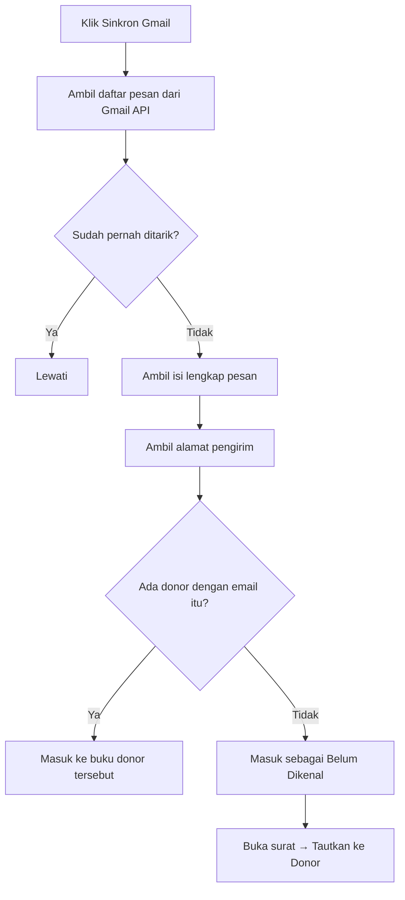

# Rencana Kerja — Aplikasi Kelola Surat & Email Donor (Kartidaya)

> Dokumen ini adalah rencana kerja sebelum pembuatan aplikasi.
> Sumber data: **`data.xlsx`** (sheet `Utama` + `Detail`).
> `data excel.jpeg` **tidak dipakai** karena banyak data ganda dan penempatan tidak konsisten.

---

## 1. Tujuan Aplikasi

Aplikasi demo berbasis **HTML + CSS + JS** (tanpa build, tanpa framework) untuk:

1. **Menyimpan data donor** (form isi seperti di Excel).
2. **Mengelola kategori** donor (5 kategori awal, bisa ditambah).
3. **Membuat & mengirim surat/email** ke banyak penerima sekaligus memakai template.
4. **Buku terima & kirim per donor** — setiap ID punya buku sendiri berisi surat
   keluar dan masuk, mirip Outlook tetapi disesuaikan kebutuhan perusahaan.
5. **Kirim & terima email sungguhan** lewat akun `@gmail.com` (Gmail API + OAuth).

Target jalan: **HP Android** dan **PC** (Chrome/Edge/Firefox).
Penyimpanan data: **localStorage** browser (demo, tanpa database).

### Dua mode operasi

| Mode | Syarat | Kemampuan |
|---|---|---|
| **Simulasi** | Tidak ada | Surat dicatat sebagai *Terkirim* di buku donor; surat masuk dicatat manual |
| **Gmail aktif** | Client ID + login Google | Kirim email sungguhan; tarik surat masuk dari inbox Gmail |

Mode simulasi membuat aplikasi **langsung bisa didemokan** tanpa menyiapkan apa pun.

---

## 2. Data yang Sudah Ada (`data.xlsx`)

### Sheet `Utama` — 18 baris data, 7 kolom

| Kolom | Isi |
|---|---|
| ID-DONOR | `L00024R`, `I00017U`, `G00009R`, … |
| KATEGORI | Member Support, Church Local, Indvidual - Local, Organization |
| PIC | Linda Lau, Kamlesh, Rany, … (bisa kosong) |
| INSTANSI | International English, GKKK Permatry, … (bisa kosong) |
| email | lindalau_T1@yahoo.co.id, … |
| HP 1 | 0896-8888-1899, … |
| HP 2 | 0819-3140-7040, … (hanya 1 baris terisi) |

### Sheet `Detail` — 5 baris, 3 kolom
`ID Donor | Email | HP` — hanya 2 baris terisi, dan isinya **duplikat** dari sheet `Utama`
(contoh: `Lindalau_T1@yahoo.co.id` vs `lindalau_T1@yahoo.co.id`, `volta@iesjakarta` vs `volta@iesjakarta.org`).

**Keputusan:** sheet `Detail` **tidak dipakai** sebagai sumber data. Cukup `Utama`.
Sheet `Detail` hanya berguna sebagai catatan bahwa pernah ada input email/HP terpisah.

### Kolom lengkap dari file Excel asli (terlihat di `_hdr*.png`)

`ID Donor | Kategori Donor | PIC | Nama Lengkap | Nama Instansi | Email | No HP | Date Start | Asal Gereja | Alamat Lengkap | Tgl Lahir | Pengiriman melalui POS/WA/…`

Kolom di atas dipakai sebagai **daftar field form**, tetapi hanya kolom yang ada di `data.xlsx`
yang diisi data awal. Sisanya kosong dan siap diisi user.

---

## 3. Kategori

Dari filter Excel (`Kategori.jpeg`) ditemukan: `Church - Local`, `Church Local`,
`Funder - Foreign`, `Individual - Local`, `Member Support`, `Organization`, `(Blanks)`.

`Church - Local` dan `Church Local` adalah **duplikat penulisan** → digabung.

**5 kategori awal (final):**

1. `Member Support`
2. `Church Local`
3. `Individual - Local`
4. `Funder - Foreign`
5. `Organization`

Kategori disimpan di localStorage sebagai **daftar terpisah** sehingga user bisa
**tambah / ubah nama / hapus** tanpa mengubah kode.

---

## 4. Aturan ID-DONOR

Format: **`[X]99999[Z]`**

| Bagian | Aturan |
|---|---|
| `[X]` | 1 huruf. Ambil **huruf pertama INSTANSI** (kapital). Jika instansi kosong → ambil **huruf pertama PIC**. Jika keduanya kosong → `X`. |
| `99999` | **Counter 5 digit** (zero-padded). Counter dihitung **per huruf X**. Nilai baru = counter tertinggi yang sudah ada untuk huruf itu **+ 1**. |
| `[Z]` | 1 huruf **suffix**. Artinya belum diketahui pasti (di data lama muncul `R` dan `U`). **User bisa isi manual**; default `R`. |

Contoh dari data lama:

| ID | PIC | Instansi | X dari | Counter |
|---|---|---|---|---|
| `L00024R` | Linda Lau | — | **L**inda | 24 |
| `I00017U` | Kamlesh | International English | **I**nternational | 17 |
| `G00009R` | Rany | GKKK Permatry | **G**KKK | 9 |
| `Y00002R` | Setiyani | Yay Misi Parousia | **Y**ay | 2 |
| `H00030R` | — | Hope Special Need | **H**ope | 30 |

Catatan: data lama tidak konsisten (`P0003U` hanya 4 digit). Aplikasi akan
**menormalkan ke 5 digit** (`P00003U`) untuk data baru.

---

## 5. Field Form Isi Data

### Wajib
- `Kategori` (dropdown dari daftar kategori)
- `PIC` **atau** `Instansi` (minimal salah satu terisi)
- `Email`

### Opsional
- `Panggilan` — **field baru**: `Ibu` / `Bapak` / `Saudara` / `Saudari`
- `Nama Lengkap`
- `Instansi` (boleh kosong)
- `HP 1`, `HP 2`
- `Date Start`, `Asal Gereja`, `Alamat Lengkap`, `Tgl Lahir`
- `Pengiriman melalui` — `Email` / `WA` / `POS` / `Lainnya`
- `Catatan`

### Otomatis
- `ID-DONOR` — dibuat otomatis, tapi bisa **di-override manual** (tombol "Ubah ID").

---

## 6. Template Surat & Placeholder

User menulis isi surat di editor, lalu menyisipkan token. Sistem mengganti token
**per penerima** saat pratinjau/kirim.

| Token | Hasil |
|---|---|
| `{/PIC}` | Panggilan + nama PIC → `Ibu Linda Lau` |
| `{/PANGGILAN}` | `Ibu` / `Bapak` / `Saudara` / `Saudari` |
| `{/NAMA}` | Nama PIC tanpa panggilan → `Linda Lau` |
| `{/INST}` | Nama instansi → `GKKK Permatry` |
| `{/NAMA_LENGKAP}` | Nama lengkap |
| `{/ID}` | ID-DONOR |
| `{/KATEGORI}` | Kategori donor |
| `{/EMAIL}` | Email penerima |
| `{/HP}` | HP 1 |
| `{/TANGGAL}` | Tanggal hari ini (format Indonesia) |

Contoh:

```
Kepada Yth.
{/PIC}
{/INST}

Dengan hormat,
...
```

Hasil untuk Linda Lau:

```
Kepada Yth.
Ibu Linda Lau

Dengan hormat,
...
```

Fitur pendukung:
- **Tombol token** untuk menyisipkan token ke posisi kursor.
- **Pratinjau per penerima** (pilih donor → lihat hasil jadi).
- **Pilih banyak penerima** (checkbox) → kirim sekaligus.
- **Simpan template** (tambah/ubah/hapus) di localStorage.
- **Kirim**:
  - Gmail aktif → dikirim sungguhan lewat Gmail API, tercatat `Terkirim`.
  - Mode simulasi → hanya dicatat `Terkirim` di buku donor.
  - Bisa juga disimpan sebagai `Draft`.
- **Cetak** surat per penerima (`window.print()`).

---

## 7. Buku Terima & Kirim per Donor

**Inti aplikasi.** Setiap ID donor punya **buku sendiri** — daftar surat keluar dan
masuk yang tercampur urut waktu, seperti percakapan di Outlook.

### Field satu surat

| Field | Isi |
|---|---|
| `arah` | `keluar` (terkirim) / `masuk` (terima) |
| `tanggal` | waktu kirim/terima (ISO) |
| `subjek` | judul surat (sudah disubstitusi token) |
| `isi` | isi surat lengkap |
| `status` | Keluar: `Draft` / `Terkirim` / `Gagal` · Masuk: `Belum dibaca` / `Dibaca` / `Dibalas` |
| `from` / `to` / `cc` | alamat email |
| `gmailId` / `threadId` | ID dari Gmail (untuk cegah duplikat saat sinkron) |
| `lampiran` | nama file (catatan) |
| `catatan` | keterangan tambahan |
| `dibaca` | boolean, untuk penanda belum dibaca |

### Tampilan

- **Buku donor** — klik kartu donor → semua suratnya urut waktu, bubble kiri (masuk)
  dan kanan (keluar). Tombol: *Tulis ke Donor*, *Catat Surat Masuk*, *Ubah Data*.
- **Kotak Masuk** (global) — semua surat masuk dari seluruh donor, bisa dicari &
  difilter status/donor. Surat belum dibaca ditandai garis aksen + badge di navigasi.
- **Kotak Keluar** (global) — semua surat keluar.
- **Belum Dikenal** — surat masuk dari alamat yang tidak cocok dengan donor mana pun.
  Bisa **ditautkan** ke donor; email pengirim sekaligus bisa disimpan ke data donor.
- **Kartu donor** menampilkan ringkasan `↑n ↓n` (jumlah keluar/masuk) dan aktivitas terakhir.

### Sinkron Gmail



Pencocokan memakai **alamat email** (case-insensitive). Surat yang sudah pernah
ditarik dikenali dari `gmailId` sehingga tidak dobel.

---

## 8. Struktur Halaman (UI)

Aplikasi satu halaman dengan navigasi bawah (mobile) / samping (desktop):

1. **Beranda** — total donor, belum dibaca, surat keluar, status Gmail, kotak masuk
   terbaru, donor per kategori, aktivitas terbaru, aksi cepat.
2. **Masuk** — kotak masuk global (cari, filter status, filter donor, sinkron).
3. **Keluar** — kotak keluar global.
4. **Donor** — daftar + cari + filter kategori + urut; tombol `+ Tambah`.
5. **Buku Donor** — buku terima & kirim satu donor (dibuka dari kartu donor).
6. **Tulis** — template, token, penerima (multi-pilih), pratinjau, kirim/draft/cetak.
7. **Kategori** — kelola kategori.
8. **Setelan** — Gmail (Client ID, hubungkan, sinkron, putuskan), tanda tangan,
   tema, ekspor/impor JSON, ekspor CSV, muat data contoh, reset, uji generator ID.

---

## 9. Desain UI

Referensi: kategori **minimal** di [awwwards.com](https://www.awwwards.com/websites/minimal/).
Situs yang dipelajari: `concretaceramiche.it`, `nader.io`, `billcreates.tech`, `fastsocial.co`.

Prinsip (sesuai permintaan: **jangan terlalu banyak main warna**):

- **1 warna aksen saja**, sisanya netral.
- Banyak ruang kosong, garis tipis, sudut kecil (radius 8–10px).
- Tipografi sebagai pembawa karakter, bukan warna.
- Angka/ID memakai **monospace** agar rapi sejajar.

### Palet

| Peran | Nilai |
|---|---|
| Latar | `#f5f5f0` (off-white) |
| Permukaan / kartu | `#ffffff` |
| Teks utama | `#161616` |
| Teks sekunder | `#6b6b6b` |
| Garis | `#e3e3dc` |
| **Aksen (tunggal)** | `#1f6f5c` (hijau tua kalem) |
| Aksen lembut | `#e8f0ed` |
| Bahaya | `#a33a2c` (hanya untuk hapus/gagal) |

Mode gelap: latar `#111312`, permukaan `#191c1b`, teks `#eeeedc`, aksen tetap `#55d1c5`.

### Tipografi

- UI: system font stack (`-apple-system, Segoe UI, Roboto, …`) — **tanpa internet**, aman di Android.
- ID / angka / token: `ui-monospace, "IBM Plex Mono", Consolas, monospace`.

### Responsif

- Mobile-first. Navigasi bawah (bottom bar) di layar < 860px, sidebar di layar besar.
- Tabel donor berubah jadi kartu di layar kecil.
- Target sentuh minimal 44px.
- Grid memakai `minmax(min(230px,100%),1fr)` + `.grid > *{min-width:0}` agar tidak
  ada overflow horizontal di layar sempit (diuji 320–1440px).

---

## 10. Teknis

| Aspek | Keputusan |
|---|---|
| File | **Multi-file**: `index.html` + `app.css` + `app.js` + `gmail.js` |
| Penyimpanan | `localStorage` (key: `kartidaya.v2.*`) |
| Data awal | 18 donor dari `data.xlsx` di-embed sebagai seed |
| Framework | Tanpa framework (vanilla JS) |
| Hosting | **GitHub Pages** (`https://suwandhih.github.io/kartidaya/`) |
| Server lokal | **`serve.bat`** → `serve.py` (Python `http.server`, port 8080) |
| Ekspor | JSON (backup/restore) + CSV (buka di Excel) |
| Cetak | `window.print()` untuk cetak surat |
| Email | **Gmail API + OAuth 2.0** (Google Identity Services, alur token) |

### Kenapa perlu origin https / localhost?

Google **menolak** origin `file://` untuk OAuth. Origin yang diterima:

- `https://` apa pun — termasuk GitHub Pages
- `http://localhost` / `http://127.0.0.1`

Karena itu aplikasi di-host di GitHub Pages (juga bisa dibuka dari HP Android
tanpa PC menyala), dan `serve.bat` disediakan untuk pemakaian lokal.

### Kenapa multi-file?

`gmail.js` dipisah karena berisi integrasi pihak ketiga (Google) yang berdiri
sendiri; `app.css` dipisah agar gaya mudah ditinjau tanpa membaca logika.

### Scope OAuth

```
https://www.googleapis.com/auth/gmail.send
https://www.googleapis.com/auth/gmail.readonly
https://www.googleapis.com/auth/userinfo.email
```

Alur **token** (bukan authorization code) dipilih karena **tidak butuh Client
Secret** — aman untuk aplikasi yang seluruhnya jalan di browser.

### Kunci localStorage
- `kartidaya.v2.donors`
- `kartidaya.v2.categories`
- `kartidaya.v2.templates`
- `kartidaya.v2.messages`
- `kartidaya.v2.settings`

---

## 11. Urutan Pengerjaan

**Fase 1 — Aplikasi inti**
- [x] Baca & verifikasi `data.xlsx`
- [x] Kumpulkan referensi desain (Awwwards minimal)
- [x] Tulis `rencanakerja.md` (dokumen ini)
- [x] Struktur + CSS (palet & tipografi)
- [x] Data layer: seed 18 donor, kategori, localStorage
- [x] Halaman Donor: daftar, cari, filter, tambah/ubah/hapus
- [x] Generator ID-DONOR `[X]99999[Z]`
- [x] Halaman Kategori (tambah/ubah/hapus)
- [x] Halaman Tulis Surat: template, token, pratinjau, kirim massal
- [x] Beranda (dashboard)
- [x] Setelan: ekspor/impor JSON, ekspor CSV, reset
- [x] Uji di layar HP (320–414px) & PC (768–1440px)

**Fase 2 — Buku terima & kirim + Gmail**
- [x] Pisah jadi `index.html` + `app.css` + `app.js` + `gmail.js`
- [x] `serve.py` + `serve.bat` (server lokal, threaded, LAN)
- [x] `gmail.js`: OAuth, kirim, daftar pesan, ambil pesan, urai MIME
- [x] Model data `messages` (satu buku per donor)
- [x] Halaman **Buku Donor** (bubble masuk/keluar)
- [x] Halaman **Kotak Masuk** & **Kotak Keluar** global
- [x] **Catat Surat Masuk** manual (mode simulasi)
- [x] **Tautkan surat tak dikenal** ke donor
- [x] **Sinkron Gmail** + pencocokan otomatis lewat email
- [x] Setelan Gmail: Client ID, hubungkan, sinkron, putuskan
- [x] `PANDUAN-GMAIL.md` (panduan Google Cloud Console langkah demi langkah)
- [x] Uji: kirim simulasi, catat masuk, tautkan, ekspor, tema, responsif

**Fase 3 — Publikasi**
- [x] `.gitignore` — `data.xlsx` & screenshot data tidak ikut ter-commit
- [x] `README.md`
- [x] Repo publik `suwandhih/kartidaya`
- [x] **GitHub Pages** aktif di `https://suwandhih.github.io/kartidaya/`
- [x] Dukung origin `https://` untuk OAuth (bukan hanya localhost)
- [x] Halaman Setelan menampilkan origin yang perlu didaftarkan

---

## 12. Hal yang Masih Perlu Dikonfirmasi

1. **Arti huruf terakhir `[Z]`** pada ID-DONOR (`R` / `U`). Sementara: bisa diisi manual, default `R`.
2. Apakah **counter** ID dihitung per huruf (keputusan saat ini) atau global.
3. Apakah perlu **login / multi-user** (saat ini tidak, karena demo tanpa server).
4. **Alamat Gmail** yang akan dipakai — **`fotohotono03@gmail.com`** (ditetapkan
   5 Nov 2026). Alamat ini harus didaftarkan di **Test users**.
5. Apakah perlu **lampiran file** sungguhan (saat ini hanya catatan nama file).
6. Apakah perlu **balas semua / teruskan** (belum dibuat; saat ini hanya *Balas*).
7. Apakah perlu **template HTML** (berformat tebal/miring), bukan teks biasa.
8. **Data donor di `app.js`** — 18 nama/email/HP asli ikut ter-publish di repo
   publik. User menyetujui karena aplikasi hanya dipakai sementara di GitHub;
   nanti akan dipindah ke hosting sendiri. Kalau perlu, pindahkan ke `seed.js`
   yang di-gitignore.

---

## 13. Status Terakhir & Langkah Berikutnya

*Diperbarui: 5 November 2026, 14:20 WIB*

### Yang sudah selesai

- Aplikasi lengkap & berjalan (Fase 1, 2, 3)
- Repo publik: <https://github.com/suwandhih/kartidaya>
- Aplikasi live: <https://suwandhih.github.io/kartidaya/>
- Google Cloud project `Kartidaya` + Gmail API aktif
- OAuth Client ID dibuat, origin terdaftar:
  - `https://suwandhih.github.io`
  - `http://localhost:8080`
- **Data Access sudah benar** — `gmail.send` (sensitive) + `gmail.readonly`
  (restricted), tidak ada scope berbahaya
- **GitHub Pages sudah pulih & ter-deploy** — `describeOAuthError()`,
  toast 12 detik, dan `.nojekyll` sudah live (diverifikasi 5 Nov 2026)
- **Client ID sudah tersimpan** di halaman Setelan (localStorage)
- **Client ID valid** — diuji langsung: Google menerima client ID + origin
  `https://suwandhih.github.io` dan menampilkan halaman login normal
  (bukan `invalid_client` / `origin_mismatch`)
- **Mode simulasi teruji** — kirim surat tercatat `Terkirim` di buku donor

### Yang belum selesai

| # | Tugas | Keterangan |
|---|---|---|
| 1 | **Audience → Test users → Add users** | Masukkan `fotohotono03@gmail.com` lalu **Save**. Ini penyebab error `access_denied` |
| 2 | Uji **Hubungkan Gmail** | Belum pernah berhasil — masih gagal di tahap login |
| 3 | Uji **kirim email sungguhan** | Belum pernah |
| 4 | Uji **Sinkron Gmail** (tarik surat masuk) | Belum pernah |

### Kendala saat ini

**Hambatan tunggal: `fotohotono03@gmail.com` belum terdaftar sebagai Test user.**

Bukti dari pengujian 5 Nov 2026:

1. Client ID **valid** — Google menampilkan halaman login normal untuk
   `suwandhih.github.io` (kalau client ID salah, muncul `invalid_client`).
2. Origin **sudah benar** — tidak ada `origin_mismatch`.
3. Yang tersisa hanya daftar Test user. Selama status OAuth masih **Testing**,
   Google menolak semua akun yang tidak ada di daftar itu dengan
   `Error 403: access_denied`.

**Cara memperbaiki (di Google Cloud Console):**

1. Buka <https://console.cloud.google.com/auth/audience> (project `Kartidaya`)
2. Bagian **Test users** → **Add users**
3. Masukkan `fotohotono03@gmail.com` → **Save**
4. Tunggu ±1 menit, lalu di aplikasi: **Setelan → Hubungkan Gmail**

> Catatan: daftar Test user **tidak bisa** diperiksa/diubah lewat API atau CLI —
> hanya lewat Console. Jadi langkah ini harus dikerjakan manual.

### Cara melanjutkan

1. **Bereskan Test users** (langkah di atas) — ini satu-satunya penghambat
2. Buka <https://suwandhih.github.io/kartidaya/> → **Setelan**
3. Client ID sudah terisi; klik **Hubungkan Gmail** → login dengan
   `fotohotono03@gmail.com` → izinkan akses
4. Setelah terhubung: uji **kirim email sungguhan** ke alamat sendiri
5. Lalu uji **⟳ Sinkron sekarang** untuk menarik surat masuk
6. Cadangan lokal kalau perlu: `serve.bat` → <http://localhost:8080>

### Catatan penting

- **Client Secret tidak dipakai** aplikasi ini. Alur token Google Identity
  Services tidak memerlukan secret. Kalau secret pernah terlihat di screenshot,
  boleh di-reset — tidak akan memengaruhi aplikasi.
- **Token kedaluwarsa**: access token 1 jam, refresh token 7 hari (karena status
  masih *Testing*). Kalau muncul *"Sesi Gmail kedaluwarsa"*, klik
  **Hubungkan Gmail** lagi.
- **Data donor ada di `app.js`** (`SEED_DONORS`) dan ikut ter-publish. Lihat
  bagian 12 no. 8.
